# Architecture

Status: public pre-alpha. This document describes the system that is in the repository today and the target design in [ROADMAP.md](ROADMAP.md). It makes no claim of customers, SOC 2, or any certification.

Audience: someone reading the repository to see how Credentials is put together.

Credentials is an open-source, client-agnostic, AI-native secrets provider. Agents and other runtimes receive scoped, short-lived access. A gateway or injector places the secret into a runtime or an upstream call. The value stays out of prompts, transcripts, and model context. The public HTTP API is the only integration surface. The service is a direct competitor to Infisical, Doppler, and 1Password: a team imports secrets once, and Credentials stores them. The licence today is Apache-2.0. A later licence or naming decision is [planned (M7)](ROADMAP.md).

Zero-knowledge against the operator is a core requirement for both a self-hosted production deployment and a Tactico-hosted one. The operator includes whoever administers the control plane, Tactico included when Tactico hosts it. **That property is not what the current code does.** The gateway decrypts in process. The sections below say **implemented** or **planned (Mx)** for each piece. The normative detail for the envelope, associated data, tokens, and the audit encoding is [ENCRYPTION.md](ENCRYPTION.md). Where this document and that spec disagree, the disagreement is named. Milestone order and exit criteria are in [ROADMAP.md](ROADMAP.md).

## 1. System overview

An agent or runtime calls the public API. The control plane authorizes the call and writes the audit log. Something that holds unwrap keys then injects the secret. Storage holds ciphertext. A KMS or HSM holds non-exportable keys. Today those roles are collapsed into one loopback process.

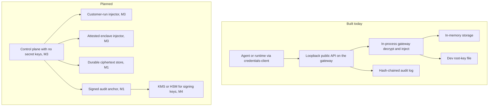

| Piece | Today | Target |
| --- | --- | --- |
| Agent or runtime | **Implemented.** `credentials-client` speaks plain HTTP to a loopback gateway and attaches DPoP proofs on inject. | Any agent platform or runtime uses the same public API. Nothing in the API is specific to one product. **Planned (M2)** for the stable, documented surface. **Planned (M4)** for TLS. |
| Public API and control plane | **Implemented.** One Axum process is both the API and the decryptor. `POST /v1/workspaces` on this listener is unauthenticated so a local process can bootstrap. Issuer is fixed at `https://credentials.local/v1`. | The control plane stores ciphertext, policy, tokens, and audit. It does not hold a key that opens secrets. Authenticated bootstrap is **planned (M2)**. The production split is **planned (M3)**. An optional Tactico-hosted control plane is **planned (M5)** and has the same restriction. |
| Gateway or injector | **Implemented.** `Gateway::inject` unwraps the workspace KEK, opens the payload, and injects. Proxy is the delivery mode on the public listener. | A customer-run injector, or an attested enclave for hosted proxy injection. Both are **planned (M3)**. There is no production mode in which the control-plane operator decrypts. |
| Storage | **Implemented.** `SqlStore` speaks SQLite for local runs and Postgres for production, behind the same `Store` trait. `MemoryStore` remains for unit tests. `wrap_mode = e2e` rows store CRD2 ciphertext. The control plane does not open them. | Production startup without a dev decrypt provider is **planned (M4)**. |
| KMS or HSM | **Implemented** as a dev stand-in only. `DevFileRootKeys` writes raw 32-byte tenant root keys to `.credentials-dev-keys.json` (override `CREDENTIALS_DEV_KEYS`), mode `0600` on Unix. `MemoryRootKeys` holds the same kind of key in process memory. `CREDENTIALS_ENV=production` refuses both, and `Gateway::new` refuses to start. | Non-exportable token-signing and audit-signing keys in a cloud KMS or, later, a PKCS#11 HSM. **Planned (M4)**. The production control plane has no `Decrypt` permission on keys that wrap secret data keys. **Planned (M3)**. |
| Audit log | **Implemented.** A per-workspace hash chain and a per-agent chain. The allow event is appended before decrypt, and a failed append skips decrypt. Tips are signed and copied to an `AuditAnchor`. The dev anchor is a local file and is refused when `CREDENTIALS_ENV=production`. A lagged anchor makes inject return 503 before decrypt. | A retention-locked object store for a hosted deployment. **Planned (M5)**. What remains enforceable once the customer holds the key is described in section 6. |

The dev path is a single process that both stores the rows and holds the root key. That shape is for loopback development. Self-hosted production, **planned (M3)**, means the customer runs the control plane and still cannot open secrets from that process. The workload owner runs the injector, with the workspace key, in a separate trust domain from the people who administer the database.

## 2. Key hierarchy

Each secret version has its own random 256-bit data key. AES-256-GCM encrypts the raw secret bytes under that key, with a fresh 96-bit nonce. A versioned per-workspace key-encryption key (KEK) wraps the data key. A per-workspace tenant root key, non-exportable inside a KMS or HSM, wraps the KEK. The database holds ciphertext, nonces, and wrapped keys. It does not hold the root key.

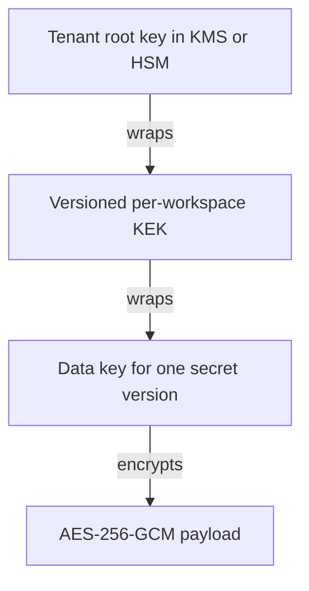

**Implemented** for this chain, with two substitutions a reader has to keep in mind. The root key is the dev file or the in-memory provider, not a cloud KMS or an HSM. `SealedSecret` stores the payload ciphertext, the wrapped data key, both nonces, and the algorithm labels. There is no `wrap_mode` column and no `e2e_encapsulation` column in the running store, so every row is gateway-wrapped under the workspace KEK.

### CRD1 associated data

**Implemented.** Writers emit magic `CRD1` only. Payload associated data is 54 bytes: `CRD1`, purpose `0x01`, workspace id, secret id, version id, algorithm `0x01` (`aes-256-gcm-v1`). The version id is the version row's UUID. The integer version and the secret name are not in the associated data, so a rename or a rewrap leaves the payload bytes unchanged. Data-key wrap associated data is 74 bytes and adds the KEK id and the KEK version. Swapping ciphertext or a wrapped data key across a workspace, a secret, or a version fails authentication. The known-answer vectors live in [ENCRYPTION.md](ENCRYPTION.md) section 5 and are tested in `crates/crypto/src/aad.rs`.

### Rotation by rewrapping

**Implemented** inside `Gateway::rotate_kek`. A new KEK version becomes active, the previous version becomes `decrypt_only`, each data key is unwrapped and wrapped again under the new KEK with a new nonce, and the payload ciphertext and payload nonce stay byte-for-byte the same. The request then marks the old KEK `retired`. A background rewrap job, the seven-day retention of a retired wrap, and rotation of the tenant root onto a new key id are **planned (M1)**.

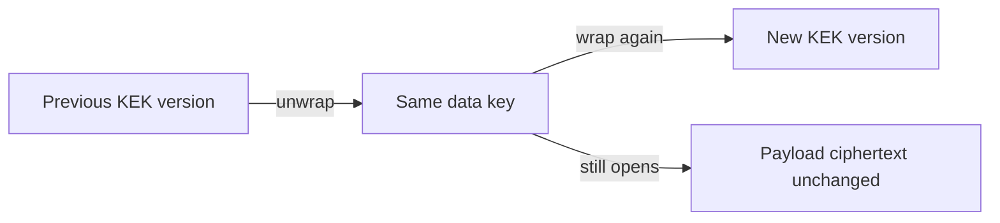

Unwrapped KEKs sit in a process-local cache for 60 seconds, keyed by KEK id. Plaintext and data keys are not cached. They are wiped with `zeroize` at the end of the open. The cache is a property of the gateway-decrypts process. The **planned (M3)** control plane does not keep it.

### Crypto-shredding on tenant delete

Destroying the tenant root key is what makes gateway-wrapped backups unreadable. Deleting rows is hygiene.

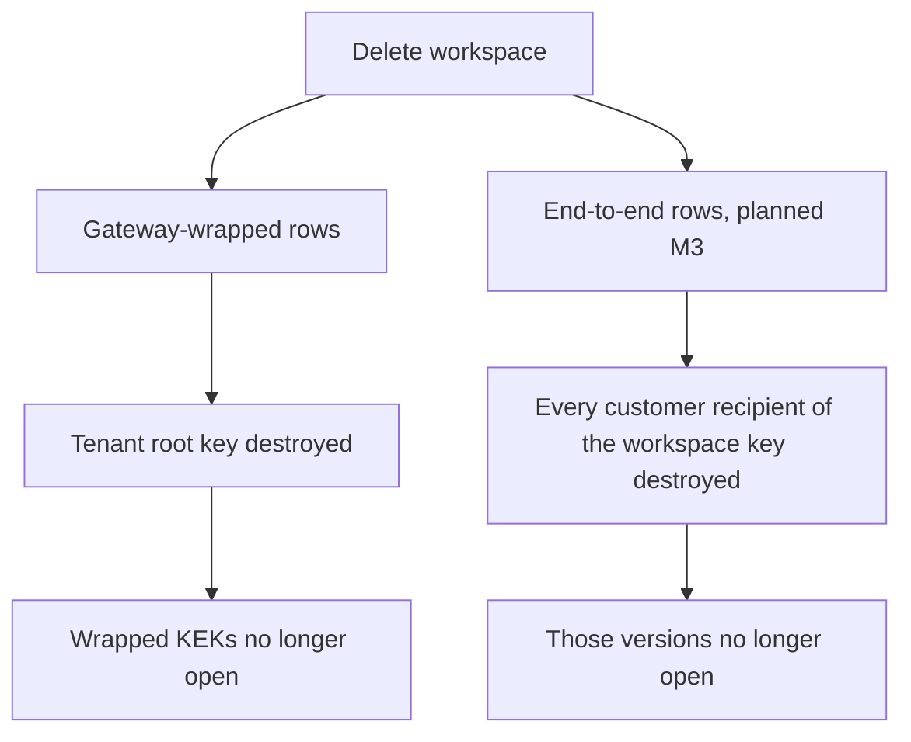

**Implemented**, in part, for the gateway-wrapped path. `Gateway::delete_workspace` requires the caller to confirm the workspace id, sets status to `deleting`, schedules root-key destruction seven days out, drops that workspace's KEK cache entries, and appends `tenant.delete.scheduled`. After `not_before`, the dev provider refuses decrypt. Inject against a workspace that is not `active` fails before `Decrypt`.

Not in this build, **planned (M1)**: revoking every session and workspace credential, deleting secret and KEK rows after the schedule, a poller that sets `shredded`, and cancel-deletion while the key is still pending. Audit rows are not encrypted under the tenant root, so the delete event survives the shred.

**Planned (M3).** End-to-end versions are wrapped to the customer workspace key, not to the tenant KEK. Destroying the KMS root does not shred them. Shredding them means destroying every customer recipient that can open the workspace key. A backup of any one recipient undoes that shred.

The target hierarchy for that mode is in section 4. The control plane stores the payload ciphertext and a wrapped data key. The key that opens those data keys is the workspace key. A customer client seals and opens. Production writes are sealed before they reach the control plane, which has no copy of the workspace key to unwrap.

## 3. Injection

### 3.1 Current v1 inject flow

**Implemented.** This is the path in `Gateway::inject`. The public listener only reaches it with `local_channel` set false, so `env` and `header` are refused there. Proxy is the flow below.

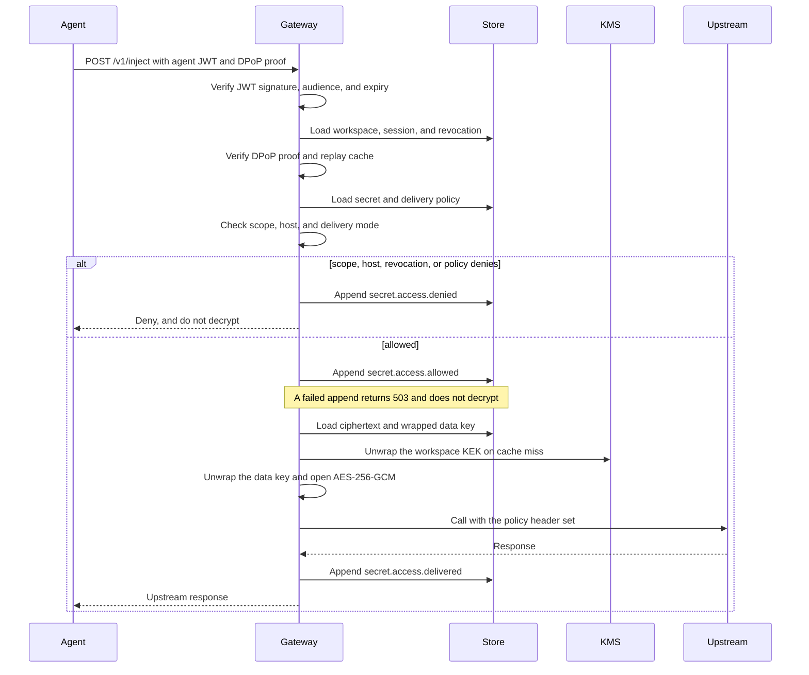

Order on the allowed path: agent token, DPoP, scope check, audit append, decrypt, inject. The token check and the unwrap are separate functions. They run in the same process, and the process sees plaintext between decrypt and the upstream call. A failed DPoP proof, a replayed DPoP `jti`, or a disabled agent returns 401 before any audit append, and those paths skip decrypt too. Scope, host, revocation, and policy denials append `secret.access.denied` first. `cargo run` uses an HTTPS upstream client. It overwrites the policy header, does not follow redirects, and does not copy that header back. Tests use `RecordingUpstream`.

A denied request does not call `RootKeyProvider::decrypt`. That is covered by tests. On a GCM or KMS failure after the allow event, the gateway appends `secret.access.failed` and returns a generic error. The client-facing decrypt error does not say whether the tag, the nonce, or the associated data was wrong.

### 3.2 Target zero-knowledge flow

**Planned (M3).** The control plane returns ciphertext and policy. It does not call `open_secret`. The customer-run injector, or the attested enclave in section 3.3, decapsulates with X-Wing (X25519 + ML-KEM-768) and injects.

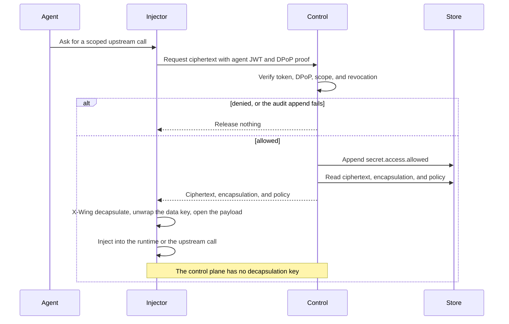

X-Wing here is the construction in `draft-connolly-cfrg-xwing-kem`: a hybrid of X25519 and ML-KEM-768. The library call already exists in `crates/crypto/src/hybrid.rs` and is unused by the gateway. Wiring it into stored secret versions, and persisting `e2e_encapsulation`, is the M3 work. The associated data that `hybrid.rs` uses today (`credentials.hybrid.wrap.v1`) is the library wrap of a 32-byte key. It is not yet the stored secret format. M3 writes that format down as `CRD2`.

Revocation on this path stops the supported injector, because the injector has to fetch ciphertext from the control plane, and the control plane checks the session and the audit append first. Revocation does not stop a party that already copied the workspace key and the ciphertext. Token lifetime does not close that hole.

### 3.3 Hosted enclave key release

**Planned (M3)**, and only if a hosted beta offers operator-side proxy injection, **planned (M5)**. Callers who can run a sidecar use section 3.2. Hosted injection, when it exists, runs inside a confidential-computing enclave such as an AWS Nitro Enclave or an AMD SEV-SNP guest. The control plane outside the enclave still stores ciphertext, policy, tokens, and audit, and it still has no unwrap key.

Key release is bound to the attestation measurement. The customer, or a release service the customer trusts, checks the measurement before the workspace key enters the enclave. The measurement is the image identity and the configuration that measurement commits to. Operator staff and the parent host see the host-side process. A substituted binary does not match the pin, and the key is not released.

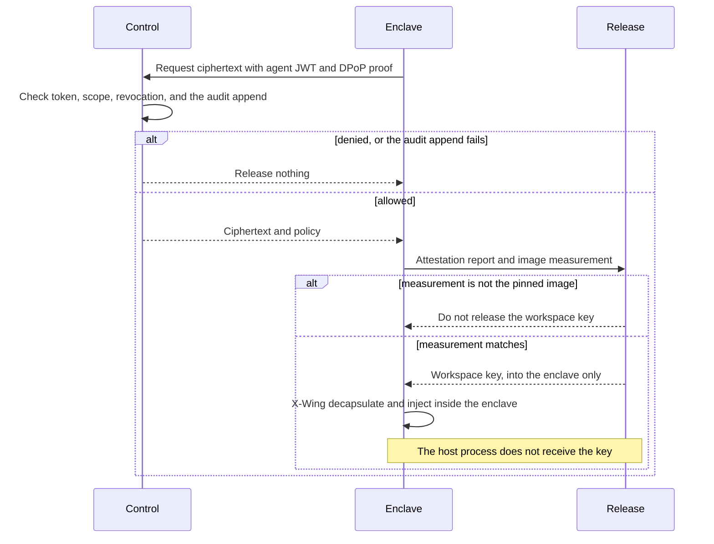

The current Axum binary cannot be dropped into an enclave and treated as zero-knowledge. `Gateway::inject`, the KEK cache, and `DevFileRootKeys` assume a normal process whose memory the host can read. The enclave image has to be a small unwrap-and-inject path. Attestation trusts the CPU vendor and the measurement the customer pinned. It does not stop the host from refusing to schedule the enclave. If this path is not ready, hosted production still uses the customer-run injector. It does not fall back to a normal process that decrypts.

## 4. Account-bound key recovery

**Implemented** as wraps the customer produces and the control plane stores. Device and teammate wraps are X-Wing. A passkey wrap is AES-256-GCM under a 32-byte PRF output the client evaluates and does not upload. The offline kit is Argon2id then AES-256-GCM. There is no operator recipient. The first client does not speak WebAuthn or CTAP; it accepts a PRF output the caller already has. This section is still the design those wraps follow.

The customer's workspace key is the X-Wing decapsulation key that opens secret data keys. It is 32 bytes, matching the decapsulation key `hybrid.rs` already generates. The matching encapsulation key is public. The customer registers it so a customer client can wrap data keys to the workspace. Production writes are sealed on that client: the control plane receives ciphertext, the encapsulation, and the wrapped data key. It does not receive the plaintext or the decapsulation key. The dev gateway does the opposite today. `create_secret` takes the plaintext and seals it in process.

That workspace key is wrapped, separately, to each recipient the customer controls:

| Recipient | How the wrap is made | Where the opening secret lives |
| --- | --- | --- |
| Each enrolled device | X-Wing to that device's encapsulation key. Only the encapsulation key is registered. | The device's decapsulation key, in a keystore on that device. |
| Passkeys, via the WebAuthn PRF extension | AES-256-GCM under the 32-byte PRF output for a stored salt. The salt is not secret. | The authenticator. The PRF output is computed on the client and is not uploaded. |
| Offline recovery code or kit | AES-256-GCM under a key derived on the client from a high-entropy secret shown once. The KDF parameters are stored. The secret is not. | With the customer, offline. |
| Admin teammates, optional | X-Wing to that person's device or passkey recipient, produced when an existing recipient re-shares. | With that teammate, who is another customer-controlled holder. |

There is no operator recipient. The wrap set does not include Tactico, the control-plane operator, a KMS key the operator can decrypt, or a login session. A client that already holds the workspace key produces every new wrap. The control plane stores the wrapped blob and the recipient's public material. It cannot re-wrap, because it does not have the workspace key.

Logging in does not recover keys. A workspace credential, **implemented** as a 32-byte bearer whose SHA-256 is stored, authorizes admin calls. A future human session, **planned (M6)**, does the same kind of job. Either one is an authorization token. It is not an input to unwrap. WebAuthn makes the split concrete: an assertion signature proves the authenticator was present, and the relying party can check that signature without ever seeing the PRF output. The PRF extension (`prf` in WebAuthn, backed by the CTAP `hmac-secret` extension) returns a deterministic 32-byte value to the client for a salt. The client uses that value locally as the AES-256-GCM key around the workspace key. A ceremony that only signs in, and a session minted from that ceremony, leaves the workspace key wrapped.

Enrollment generates the workspace key on the customer client, wraps it to the enrolling device, and wraps it to a recovery kit generated in the same ceremony, before any temporary copy is dropped. The kit is shown once. The customer can add passkeys and teammates afterwards. The client wraps only to recipients the customer chose, and it shows which recipients those are, so a control plane that offered its own encapsulation key would not silently become a recipient.

Device and teammate wraps use X-Wing, the same hybrid as section 8. Passkey and recovery-kit wraps are symmetric AES-256-GCM under a client-only 32-byte key. Data keys stay random. They are not derived from the recovery secret, the PRF output, or a password. That keeps the v1 rule in [ENCRYPTION.md](ENCRYPTION.md): a data key is random or it is unwrapped, and it is not derived from a passphrase.

### Adding a device

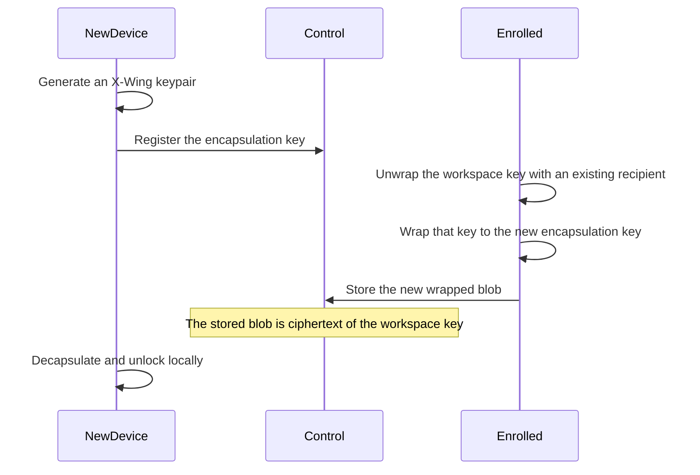

The existing recipient can be another enrolled device, a passkey PRF evaluation, the recovery kit, or an admin teammate. The control plane never sees the workspace key during the handoff.

### Recovering after a lost device

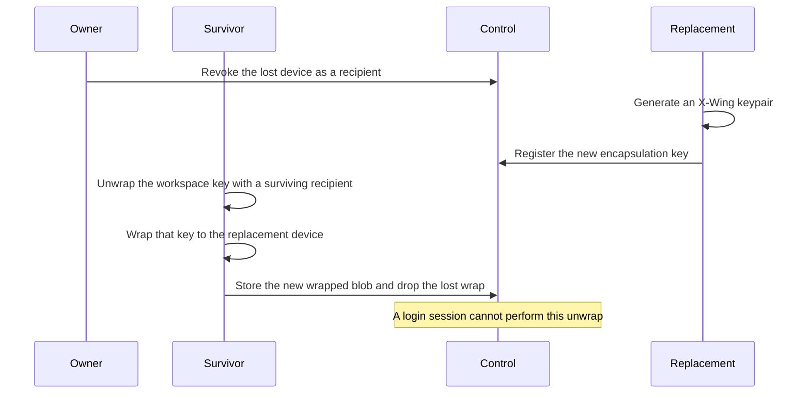

The surviving recipient is another device, a passkey, the recovery kit, or an admin teammate. Revoking the lost device deletes its wrap so a later finder of that device is no longer a recipient. If the finder already unwrapped the workspace key before the revoke, they hold a copy. Revocation cannot reach a copy that already left. That is the same limit as section 3.2.

### Why the operator cannot recover

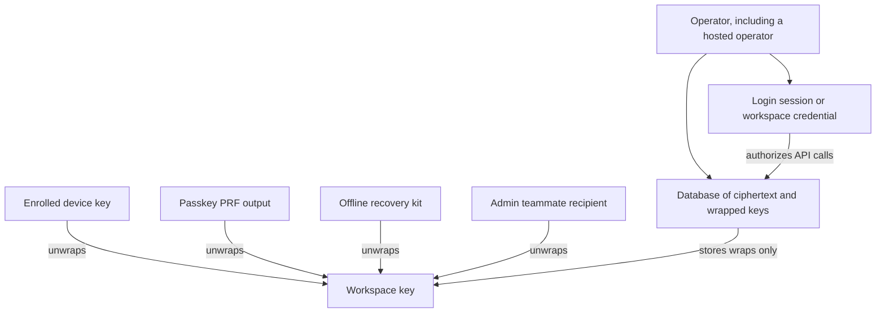

The operator can read every row: payload ciphertext, wrapped data keys, wrapped copies of the workspace key, encapsulation public keys, PRF salts, KDF parameters, policy, secret names, and the audit log. None of those rows are the workspace key. The login session authorizes API calls against that database. It has no edge to the workspace key. Producing a new wrap requires a recipient that already unwraps, and the operator is not one of those recipients.

A hosted page that the operator can change is not a safe place to evaluate the PRF or type the recovery kit. The page would see the output. Unwrap for the hosted service happens in the customer-run injector or in the attested enclave, which the operator does not rewrite. A synced passkey is only as private as the passkey provider that syncs it. That provider is outside Credentials. An offline recovery kit does not depend on that sync. Neither one is an operator-held key.

### Threat model and the tradeoff

The customer trades operator access for exclusive custody.

- A database thief gets ciphertext and wrapped blobs. Opening them requires a customer recipient.
- A compromised control-plane host gets the same rows, plus whatever a login session can authorize. It still cannot unwrap.
- A compromised injector host, or a stolen device that is still enrolled, can open the secrets that holder can unwrap. That is the customer's trust domain.
- An admin teammate who is a recipient can open secrets and can re-share. Adding a teammate is a decision to widen that set.
- A malicious control plane can refuse to store a wrap, or can substitute ciphertext. It cannot address a wrap to itself without the workspace key, provided the client wraps only to keys the customer selected.

Losing every recipient means losing the data. If the devices, the passkeys, the recovery kit, and every teammate wrap are gone, the workspace key is gone with them. The operator cannot reconstruct it, and a backup of the database does not help. That irreversibility is the same property crypto-shredding wants, and it is also the failure mode of a lost kit. Enrollment shows the kit once so the customer can store it somewhere the control plane does not.

## 5. Tokens and identity

A token is an identity, not a key. **Implemented.**

Agent tokens are signed JWTs. This build signs them with an in-process Ed25519 key, `DevSigner`, generated at startup. A production issuer uses KMS Sign and does not export the private key. **Planned (M4).** `CREDENTIALS_ENV=production` refuses this signer because `Gateway::new` will not start.

| Claim | This build |
| --- | --- |
| `aud` | `credentials-gateway`. Any other audience is rejected. **Implemented.** |
| Lifetime | Default 5 minutes (`DEFAULT_TTL_SECS` is 300). Hard maximum 15 minutes. The reference client requests 300 seconds. **Implemented.** |
| Possession | `cnf.jkt` is the RFC 7638 thumbprint of the session's Ed25519 DPoP key. Each inject carries a DPoP proof over method, URI, and the access-token hash. **Implemented.** |
| Revocation | On every inject the gateway loads the session from the store and rejects a set `revoked_at`, a mismatched workspace, agent, or thumbprint, and an expired session. There is no long-lived allow cache. **Implemented** for the session row. A `revoked_jtis` table for a single token is specified and not built. |
| Key material | The claims are issuer, audience, subject, times, `jti`, workspace, agent, session, scopes, and `cnf.jkt`. No secret, data key, KEK, or value that derives them. **Implemented.** |

Verification and decryption are separate steps. The code that verifies the JWT does not call the KMS, and the code that unwraps a data key does not read a key out of the JWT. A stolen token cannot open a database dump. A stolen token together with its DPoP key can call inject inside its scope until expiry or revocation. That is use of the secret through the gateway, which is audited. It is not offline decryption.

Two pre-alpha limits of the check, both still to close before the API is called stable, **planned (M2)**:

- The HTTP handler passes DPoP `htm` as `POST` and takes `htu` from the `x-dpop-htu` header, defaulting to `https://credentials.local/v1/inject`, rather than from the URL the socket received. The verifier does check the values it is given.
- Workspace creation on the loopback listener does not require a credential. Admin routes after that use the workspace credential as `Authorization: Bearer`. The credential is not a JWT and is not accepted as a substitute for an agent token on inject.

Agent sessions may only hold `secret:inject:...` scopes. `*` matches one path segment. There is no `**`. `secret:admin:*` is rejected on agent sessions. The effective permission is the intersection of the token scope and the secret's delivery policy. The agent does not get to add a host.

In the **planned (M3)** split, the control plane still performs this check and still does not decrypt. Authorization stays a property of the token. Decryption stays a property of the workspace key.

## 6. Audit

**Implemented** for the hash chain and the fail-closed allow. **Planned (M1)** for signatures and the anchor.

Each workspace has one sequence. Each agent's events also form a chain. The body encoding is the one in [ENCRYPTION.md](ENCRYPTION.md) section 9, and `agent_prev_hash` sits inside the body, so the workspace chain commits to the per-agent links.

```text
hash       = SHA-256(prev_hash || body)
agent_hash = SHA-256(body)    when the event has an agent
```

`verify_chain` recomputes both and is run before an audit read is returned. The dev process signs the tip with its Ed25519 signer and appends the signature to a local anchor file. A production signer would use KMS Sign, which is **planned (M4)**. A hosted retention-locked bucket is **planned (M5)**.

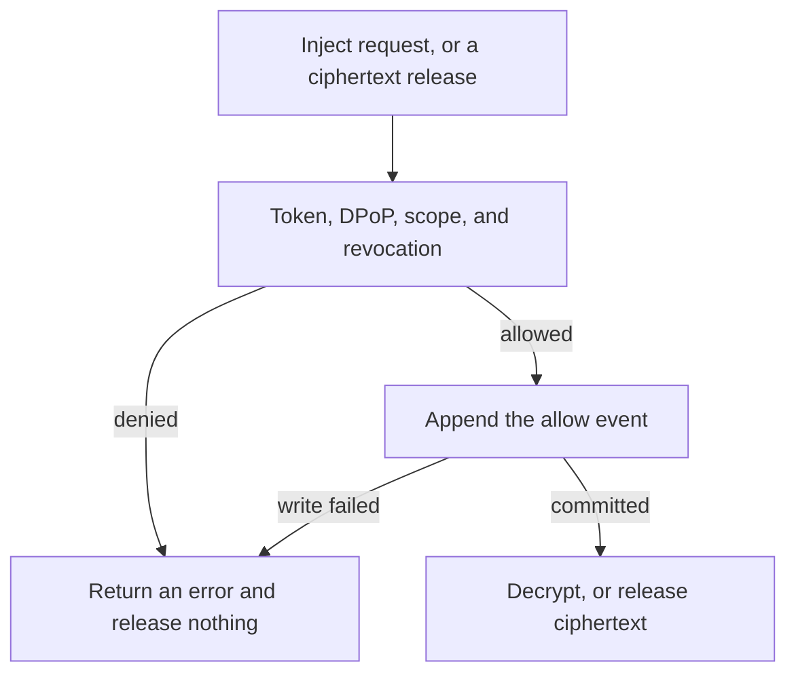

The allow insert is fail-closed. `audit_or_fail` runs before `unwrap_kek`. If the append returns an error, the handler returns 503 `audit_failed` and does not decrypt. Tests can force that failure on `MemoryStore`. The later events `secret.access.delivered` and `secret.access.failed` are appended on a best-effort basis in this build: a failure there is ignored. The spec's rule is about the allow event, and that rule holds.

**Planned (M3)** does not make the chain observe every decrypt in the world. It stays enforceable for requests that still go through the control plane. The control plane can refuse to release ciphertext when the allow event cannot be written. It cannot prove that a sidecar which already had the workspace key and a copy of the ciphertext refrained from opening it. What the operator keeps is authorization, DPoP, scope, and an audit log of the supported path. What the operator gives up is the ability to inject from the control plane and the ability to debug by reading a secret.

Payloads are metadata: secret id, version id, name, delivery mode, upstream host, session, `jti`, and a reason code. They do not contain secret values, key bytes, or tokens. Secret names are stored in the clear so the control plane can authorize before anyone opens a value. Zero-knowledge here is about plaintext and unwrap keys.

## 7. Threat model

Who can see plaintext, keys, and metadata. "Today" is the implemented gateway-decrypts process. "Target" is **planned (M3)** for a self-hosted production deployment and for a Tactico-hosted control plane. The dev loopback process remains the today column, and it keeps refusing `CREDENTIALS_ENV=production`.

| Actor | Today, implemented | Target, planned M3 |
| --- | --- | --- |
| Operator | Reads the database. The gateway process decrypts, so anyone who can read that process, dump its memory, change its code, or read `.credentials-dev-keys.json` can read plaintext while it serves traffic. The production guard refuses to start this provider. It does not hide plaintext from an operator who runs the dev process. | Reads ciphertext, policy, secret names, wrapped workspace-key blobs, public encapsulation keys, PRF salts, tokens, and audit metadata. Does not receive the workspace key, a device decapsulation key, a PRF output, or the recovery kit. Tactico, when hosting, is this operator. **Planned (M5)** has no hosted mode that decrypts. |
| Compromised database | Holds ciphertext, nonces, wrapped data keys, wrapped KEKs, key ids, names, policy, credential hashes, and the audit chain. The root key is not in the database. A swapped row fails AES-GCM because CRD1 binds workspace, secret, and version. Reading plaintext also requires the dev key file or a KMS decrypt role. | Holds the same payload ciphertext, plus recipient wraps of the workspace key. Those wraps open only with a customer recipient. A dump plus control-plane credentials is not enough. |
| Compromised gateway host | Sees plaintext, data keys, and cached KEKs in process memory. The KEK cache lives up to 60 seconds. This host is the operator's host in the current design. | The control-plane host sees the database rows and not the opened secret. The customer injector host sees plaintext of secrets it opens. That host is the customer's. An enclave's parent host sees the host-side process. The workspace key is released only into an image whose measurement matches the pin. A wrong measurement gets no key. This trusts the CPU vendor and the pin. Crash dumps and a host-visible swap of enclave memory would break the claim, so the enclave image does not use them. |
| Agent | On proxy injection, sees the upstream response. The gateway sets the secret on the upstream request. The public listener refuses env and header delivery. A compromised agent can cause calls inside its scope until the session ends. It does not receive a data key or a KEK. Keeping echoed tool output out of the prompt is the runtime's job. Credentials does not write the model context. | The same delivery split, performed by the customer injector or the enclave. Proxy remains the default for API keys. Env delivery, on the local channel only, places a value where a process that can read its environment can copy it. An agent that is not the injector still does not receive proxy secrets. |

A network attacker who can see and modify public traffic, and who has neither a token nor a DPoP key, gets neither plaintext nor a usable session. This build does not terminate TLS. The loopback listener is cleartext on purpose. Public TLS with the hybrid group is **planned (M4)**.

## 8. Post-quantum

Symmetric encryption of secret payloads is AES-256-GCM. **Implemented.** AES-256 is the data cipher because a quadratic quantum search still leaves it around 128-bit security. AES-128 is not used. The quantum exposure is the asymmetric cryptography: TLS key exchange, application key transport, and signatures.

| Hop | Construction | Status |
| --- | --- | --- |
| Secret payload at rest | AES-256-GCM, 32-byte data key, 12-byte nonce, 16-byte tag | **Implemented.** |
| TLS | TLS 1.3 group `X25519MLKEM768`, RFC 10024, code point 4588 | **Planned (M4).** This build has no TLS stack. `credentials-client` is built without a TLS backend. Hosted production sets `TLS_REQUIRE_HYBRID=true`. |
| Application key wrapping | X-Wing, X25519 + ML-KEM-768, `draft-connolly-cfrg-xwing-kem` | The library path is **implemented** in `crates/crypto/src/hybrid.rs`: generate a keypair, wrap a 32-byte key, unwrap it. Encapsulation keys are 1216 bytes and encapsulations are 1120 bytes, and tests check those lengths. The gateway-decrypts path does not call it. Using it for the workspace key, device wraps, and data-key wraps is **planned (M3)**. |
| JWT and DPoP signatures | Ed25519 | **Implemented.** Hybrid signatures, Ed25519 plus ML-DSA-65, are an open question tracked toward **planned (M7)**. Forging those signatures would mint or replay tokens. It would not open stored ciphertext. |

X-Wing stays secure if either X25519 or ML-KEM-768 falls. The crate is RustCrypto `x-wing`. This repository calls it and does not restate the combiner. The module comment records that the published crate's combiner label matches the draft-11 label. Token lifetimes stay minutes either way, and revocation does not depend on the signature scheme.

## 9. Where this tree is behind the words around it

The points below are easy to miss if a reader treats [ENCRYPTION.md](ENCRYPTION.md) or the README as a description of the running binary. This document is the map. The spec remains the normative text for the envelope that is implemented.

- [ENCRYPTION.md](ENCRYPTION.md) names Rust as the implementation language of record. The Go TLS notes are guidance for the hosted and self-hosted TLS stack, not a second codebase.
- [ENCRYPTION.md](ENCRYPTION.md) section 10, and the README bullet about keeping secrets in Infisical, 1Password, or Doppler, still describe a live fetch at inject time. The roadmap's direction is one-shot import into native ciphertext, **planned (M6)**. No import code and no live backend client exist in this tree. This document follows the roadmap.
- The README still names Momentum as the first client. The public API is client-agnostic, and the in-tree client is `credentials-client`. Naming no house client in the integrator docs is **planned (M2)**.
- `SealedSecret` has no `wrap_mode` and no `e2e_encapsulation`. Writers cannot yet store an end-to-end row, and the running store has nowhere to put one.
- DPoP `htu` is taken from a request header, as section 5 describes. Per-token `jti` revocation is specified and not built. A disabled agent, a failed DPoP proof, or a replayed DPoP `jti` returns 401 without an audit row. `secret.access.delivered` and `secret.access.failed` ignore an append error. The allow event does not.
- Workspace delete does not revoke sessions, delete secret rows, or set `shredded`. KEK rotation runs inside the request. There is no rewrap-job table.
- The public listener refuses env and header. The local socket (`CREDENTIALS_LOCAL_DIR`, mode `0700`, same-uid peer check) returns `{ env_name, value }` or `{ header_name, value }` and does not forward header delivery through `Upstream`.
- There is no cloud KMS, no HSM, no public TLS listener, no WebAuthn, and no device or recovery-kit enrollment. Durable storage and a dev audit anchor are in the tree. The hosted anchor is not.

## 10. Related documents

- [ENCRYPTION.md](ENCRYPTION.md) — envelope, CRD1, rotation, crypto-shredding, tokens, injection, audit encoding, and the earlier end-to-end sketch in section 12.
- [ROADMAP.md](ROADMAP.md) — milestone order. Account-bound recovery is an M3 deliverable. M4 and M5 require the M3 trust model. M5 is an optional hosted beta and still makes no compliance claim.
