# Architecture

Status: public pre-alpha.
This document describes the system in the repository today and the target design in [ROADMAP.md](ROADMAP.md).
It claims no customers, no SOC 2, and no certification.

Audience: a reader who wants the structure of Credentials.

Credentials is an open-source secrets provider.
Any client can use the public API.
Agents and other runtimes receive a scoped session.
The session is short-lived.
The dev gateway or the injector places the secret into a runtime or an upstream call.
The secret does not enter prompts, transcripts, or model context.
The public HTTP API is the only integration surface.
Credentials competes with Infisical, Doppler, and 1Password.
A team imports a secret one time, and Credentials stores it.
The licence today is Apache-2.0.
A later licence or naming decision is [planned (M7)](ROADMAP.md).

Zero-knowledge against the operator is required for self-host production and for a Tactico-hosted control plane.
The operator is whoever administers the control plane.
Tactico is the operator when Tactico hosts the control plane.
The dev gateway decrypts `wrap_mode=gateway` in process.
The production control plane uses `RejectingRootKeys` and does not open an e2e secret.
`revoked_jtis` and `dpop_replay` are durable.
A restart still rejects a revoked token and a replayed DPoP proof.
`credentials-injector` opens an e2e secret.
The sections below say **implemented** or **planned (Mx)** for each piece.
[ENCRYPTION.md](ENCRYPTION.md) is normative for the envelope, associated data, tokens, and the audit encoding.
Where this document and that spec disagree, the disagreement is named.
Milestone order and exit criteria are in [ROADMAP.md](ROADMAP.md).

## 1. System overview

An agent or a runtime calls the public API.
The control plane authorizes the call and writes the audit log.
The dev gateway or the injector holds the unwrap keys and then injects the secret.
Storage holds ciphertext.
A KMS or an HSM holds non-exportable signing keys on the target path.
The dev gateway is one loopback process.
That process stores rows and holds the dev root key.
The production control plane and the injector are separate.

The diagram below keeps its original labels.
The paragraphs state the current tree.

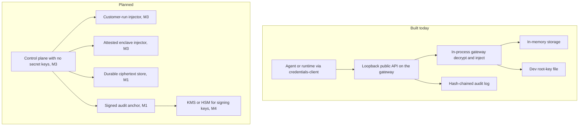

| Piece | Today | Target |
| --- | --- | --- |
| Agent or runtime | **Implemented.** `credentials-client` can call a loopback dev gateway and can use TLS 1.3. Inject requests carry DPoP proofs. | Any runtime uses the same public API. The API names no one product. A stable documented surface is **planned (M2)**. TLS is **implemented**. |
| Public API and control plane | **Implemented.** The dev gateway is one Axum process and can open `wrap_mode=gateway`. Loopback `POST /v1/workspaces` has no credential. The default issuer is `https://credentials.local/v1`. `Gateway::control_plane` uses `RejectingRootKeys` and does not open an e2e secret. | The control plane stores ciphertext, policy, tokens, and the audit log. It holds no key that opens a secret. Authenticated bootstrap is **planned (M2)**. A Tactico-hosted control plane is **planned (M5)**. There is no live hosted service. |
| Gateway or injector | **Implemented.** Dev `Gateway::inject` unwraps the workspace KEK, opens a `wrap_mode=gateway` payload, and injects. Proxy is the public delivery mode. `credentials-injector` opens `wrap_mode=e2e`. | The injector is the production opener. An attested enclave is **not a live path**. The operator does not decrypt in production. |
| Storage | **Implemented.** `SqlStore` uses SQLite for a local run and Postgres for production. `MemoryStore` remains for unit tests. An e2e row stores CRD2 ciphertext. The control plane does not open it. | The production control plane starts with `RejectingRootKeys`. |
| KMS or HSM | **Implemented** for the dev file and for memory keys. `DevFileRootKeys` writes a raw 32-byte tenant root key to `.credentials-dev-keys.json`. `CREDENTIALS_DEV_KEYS` overrides that path. Unix mode is `0600`. `MemoryRootKeys` holds that key in memory. `CREDENTIALS_ENV=production` rejects both. `credentials-edge` has Vault Transit and AWS KMS adapters. `Gateway::control_plane` does not call them. | Non-exportable signing keys in a cloud KMS are **planned (M4)**. PKCS#11 is later. The production control plane has no `Decrypt` on a key that wraps a secret data key. |
| Audit log | **Implemented.** Each workspace has a hash chain. Each agent has a chain. The allow event is appended before decrypt. A failed append skips decrypt. The dev process signs the tip into a local `AuditAnchor`. `CREDENTIALS_ENV=production` rejects that dev anchor. A lagged anchor makes inject return 503 before decrypt. | A retention-locked object store is **planned (M5)**. Default CI does not use S3 Object Lock. Section 6 states the limit after the customer holds the key. |

Self-host production means the customer runs the control plane and still cannot open a secret from that process.
The workload owner runs the injector, with the workspace key, in a separate trust domain.

## 2. Key hierarchy

Each secret version has its own random 256-bit data key.
AES-256-GCM encrypts the raw secret bytes under that key, with a fresh 96-bit nonce.
A versioned per-workspace KEK wraps the data key for `wrap_mode=gateway`.
A per-workspace tenant root key wraps that KEK.
The database holds ciphertext, nonces, and wrapped keys.
It does not hold the tenant root key.

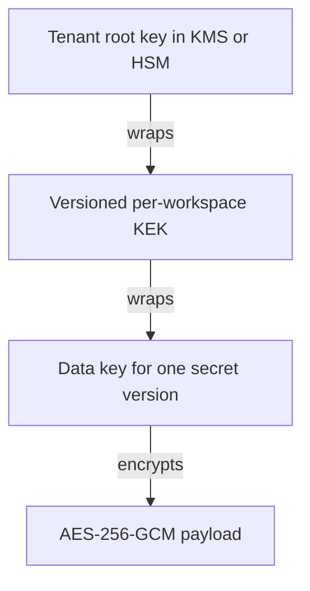

**Implemented** for the dev chain, with these substitutions.
The dev root key is the file provider or the memory provider.
It is not a cloud KMS and it is not an HSM.
`SealedSecret` stores the payload ciphertext, the wrapped data key, both nonces, and the algorithm labels.
Rows also store `wrap_mode` and `e2e_encapsulation`.
`wrap_mode=gateway` is wrapped under the workspace KEK.
`wrap_mode=e2e` is CRD2.
The production control plane does not open an e2e row.

### CRD1 associated data

**Implemented.** Writers emit magic `CRD1` for `wrap_mode=gateway`.
Payload associated data is 54 bytes.
The bytes are `CRD1`, purpose `0x01`, the workspace id, the secret id, the version id, and algorithm `0x01` (`aes-256-gcm-v1`).
The version id is the version row UUID.
The integer version and the secret name are not in the associated data.
A rename or a rewrap leaves the payload bytes unchanged.
Data-key wrap associated data is 74 bytes and adds the KEK id and the KEK version.
A swap of ciphertext or a wrapped data key across a workspace, a secret, or a version fails authentication.
The known-answer vectors are in [ENCRYPTION.md](ENCRYPTION.md) section 5.
`crates/crypto/src/aad.rs` tests them.
E2e rows use magic `CRD2`.

### Rotation by rewrapping

**Implemented** inside `Gateway::rotate_kek`.
A new KEK version becomes `active`.
The previous version becomes `decrypt_only`.
Each data key is unwrapped and wrapped again under the new KEK with a new nonce.
The payload ciphertext and the payload nonce stay the same bytes.
The request then marks the old KEK `retired`.
The encryption spec also requires a seven-day hold for a retired wrap.
It also requires tenant-root rotation onto a new key id.

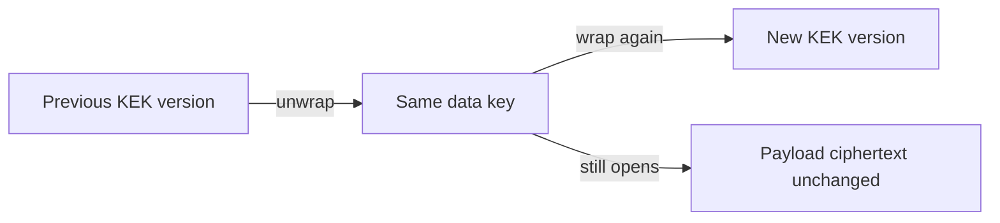

Unwrapped KEKs sit in a process-local cache for 60 seconds, keyed by KEK id.
Plaintext and data keys are not cached.
`zeroize` wipes them at the end of the open.
The cache belongs to the dev gateway.
The production control plane does not keep that cache for secret keys.

### Crypto-shredding on tenant delete

Destruction of the tenant root key makes `wrap_mode=gateway` backups unreadable.
Deletion of rows is hygiene.

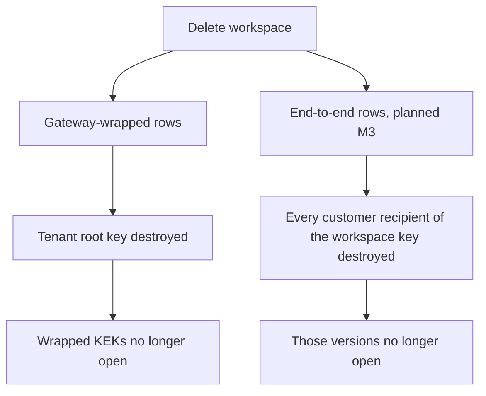

**Implemented** for the `wrap_mode=gateway` path.
`Gateway::delete_workspace` requires the caller to confirm the workspace id.
It sets status to `deleting`.
It schedules tenant-root destruction seven days out.
It drops that workspace's KEK cache entries.
It revokes sessions.
It deletes secret rows.
It appends `tenant.delete.scheduled`.
After `not_before`, the dev provider rejects decrypt.
Inject against a workspace that is not `active` fails before `Decrypt`.
Cancel is allowed only while destruction is still pending.
A poller sets `shredded` and appends `tenant.shredded`.
Audit rows are not encrypted under the tenant root, so the delete event survives the shred.

**Implemented** for e2e rows as a different shred.
An e2e version is wrapped for the customer workspace key, not for the tenant KEK.
Destruction of the KMS root does not shred those versions.
Shred them by destroying every customer recipient that can open the workspace key.
A backup of any one recipient undoes that shred.

The target hierarchy for that mode is in section 4.
The control plane stores the payload ciphertext and a wrapped data key.
The workspace key opens those data keys.
A customer client seals and opens.
Production writes are sealed before they reach the control plane.
The control plane has no copy of the workspace key.

## 3. Injection

### 3.1 Current v1 inject flow

**Implemented** for `wrap_mode=gateway` on the dev gateway.
The public listener reaches this path with `local_channel` false, so `env` and `header` are rejected there.
Proxy is the flow below.

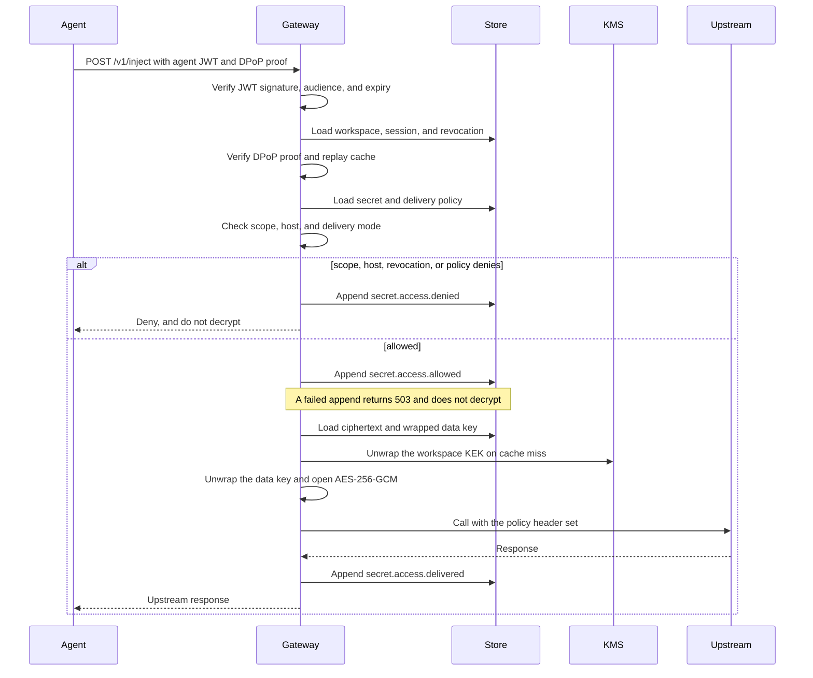

Order on the allowed path: agent token, DPoP, scope check, audit append, decrypt, inject.
The token check and the unwrap are separate functions.
They run in the same dev-gateway process.
That process sees plaintext between decrypt and the upstream call.
A failed DPoP proof, a replayed DPoP `jti`, or a disabled agent returns 401 before any audit append.
Those paths skip decrypt too.
Scope, host, revocation, and policy denials append `secret.access.denied` first.
`cargo run` uses an HTTPS upstream client.
It replaces the policy header.
It does not follow a redirect.
It does not copy that header back.
Tests use `RecordingUpstream`.

A denied request does not call `RootKeyProvider::decrypt`.
Tests cover that rule.
On a GCM or KMS failure after the allow event, the dev gateway appends `secret.access.failed` and returns a generic error.
The client-facing decrypt error does not say whether the tag, the nonce, or the associated data was wrong.

`wrap_mode=e2e` does not follow the decrypt steps on the production control plane.
That process releases ciphertext.
Section 3.2 states that path.

### 3.2 Target zero-knowledge flow

**Implemented** for `wrap_mode=e2e`.
The control plane returns ciphertext and policy.
It does not call `open_secret`.
`credentials-injector` decapsulates with X-Wing (X25519 + ML-KEM-768) and opens the secret.
An attested enclave is not a live path.
Section 3.3 describes that future path.

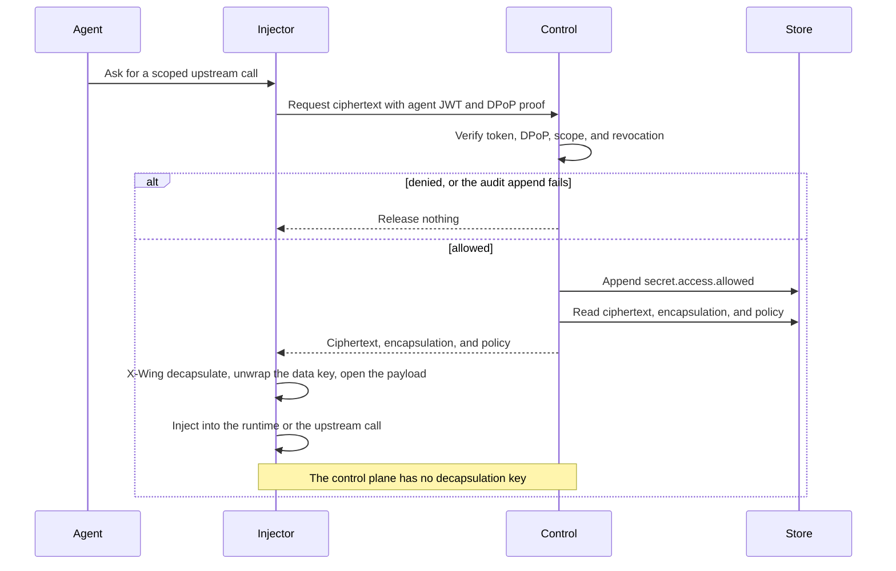

X-Wing here is the construction in `draft-connolly-cfrg-xwing-kem`.
It is a hybrid of X25519 and ML-KEM-768.
The library call is in `crates/crypto/src/hybrid.rs`.
CRD2 stores `e2e_encapsulation`.
The associated data `credentials.hybrid.wrap.v1` is the library wrap of a 32-byte key.
It is not the stored secret format.
`CRD2` is that stored format.
The tree includes the draft-11 X-Wing test vectors.

Revocation on this path stops the supported injector.
The injector must fetch ciphertext from the control plane.
The control plane checks the session and the audit append first.
Revocation does not stop a party that already copied the workspace key and the ciphertext.
Token lifetime does not close that hole.

### 3.3 Hosted enclave key release

**Not a live path.**
Hosted proxy injection inside an enclave is **planned (M3)**.
Offer it in a hosted beta only as **planned (M5)**.
There is no live hosted service.
Callers who can run the injector use section 3.2.
A future hosted inject path runs inside a confidential-computing enclave.
An AWS Nitro Enclave or an AMD SEV-SNP guest is an example.
The control plane outside the enclave stores ciphertext, policy, tokens, and the audit log.
It has no unwrap key.

Key release is bound to the attestation measurement.
The customer, or a release service the customer trusts, checks the measurement before the workspace key enters the enclave.
The measurement is the image identity and the configuration that measurement commits to.
Operator staff and the parent host see the host-side process.
A substituted binary does not match the pin.
The key is not released.

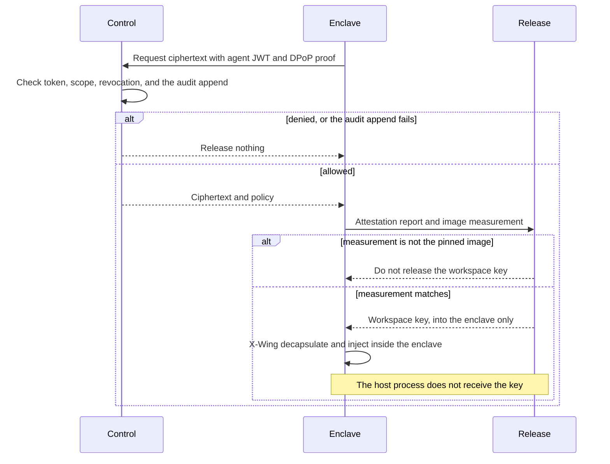

The current Axum binary is not an enclave and is not zero-knowledge by itself.
`Gateway::inject`, the KEK cache, and `DevFileRootKeys` assume a normal process.
The host can read that memory.
The enclave image has to be a small unwrap-and-inject path.
Attestation trusts the CPU vendor and the measurement the customer pinned.
It does not stop the host from a refusal to schedule the enclave.
`credentials-edge` checks a test PCR document.
The tree has no Nitro EIF.
The tree has no full `COSE_Sign1` AWS chain verifier.
If this path is not ready, hosted production uses the injector.
It does not use a normal process that decrypts.

## 4. Account-bound key recovery

**Implemented** as wraps the customer produces and the control plane stores.
Device wraps and teammate wraps are X-Wing.
A passkey wrap is AES-256-GCM under a 32-byte PRF output.
The client evaluates that output and does not upload it.
The offline kit is Argon2id and then AES-256-GCM.
There is no operator recipient.
`credentials-edge` has a WebAuthn software authenticator.
SAML is not implemented.
The dashboard HTML does not decrypt a secret.
The control plane does not evaluate the PRF.

The customer workspace key is the X-Wing decapsulation key that opens secret data keys.
It is 32 bytes, the same size `hybrid.rs` already generates.
The matching encapsulation key is public.
The customer registers it so a customer client can wrap data keys for the workspace.
Production writes are sealed on that client.
The control plane receives ciphertext, the encapsulation, and the wrapped data key.
It does not receive the plaintext or the decapsulation key.
The dev gateway seals plaintext in process for `wrap_mode=gateway`.
The production control plane rejects plaintext on `POST /v1/secrets`.
The caller sends a sealed e2e secret.

The workspace key is wrapped, separately, for each recipient the customer controls:

| Recipient | How the wrap is made | Where the opening secret lives |
| --- | --- | --- |
| Each enrolled device | X-Wing wrap for that device encapsulation key. Only the encapsulation key is registered. | The device decapsulation key, in a keystore on that device. |
| Passkeys, WebAuthn PRF extension | AES-256-GCM under the 32-byte PRF output for a stored salt. The salt is not a secret. | The authenticator. The client computes the PRF output and does not upload it. |
| Offline recovery kit | AES-256-GCM under a key from a high-entropy secret. The client derives that key. The kit is displayed one time. The KDF parameters are stored. The secret is not stored. | With the customer, offline. |
| Admin teammates, optional | X-Wing wrap for that person's device or passkey recipient. An existing recipient produces the wrap. | With that teammate. The teammate is another customer-controlled holder. |

There is no operator recipient.
The wrap set does not include Tactico or the control-plane operator.
It does not include a KMS key the operator can decrypt.
It does not include a login session.
A client that already holds the workspace key produces every new wrap.
The control plane stores the wrapped blob and the recipient public material.
It cannot make a new wrap, because it does not have the workspace key.

Authentication does not recover keys.
A workspace credential is **implemented** as a 32-byte bearer.
The store keeps the SHA-256 of that bearer.
The credential authorizes admin calls.
A human session is **planned (M6)** for the same authorization job.
`credentials-edge` has OIDC PKCE helpers.
Either credential is an authorization token.
It is not an input to unwrap.
WebAuthn separates the two proofs.
An assertion signature proves the authenticator was present.
The relying party can check that signature and still not see the PRF output.
The PRF extension (`prf` in WebAuthn) uses the CTAP `hmac-secret` extension.
It returns a deterministic 32-byte value to the client for a salt.
The client uses that value locally as the AES-256-GCM key around the workspace key.
A ceremony that only authenticates leaves the workspace key wrapped.
A session from that ceremony also leaves the workspace key wrapped.

Enrollment generates the workspace key on the customer client.
It wraps that key for the enrolling device.
It wraps that key for a recovery kit from the same ceremony, before any temporary copy is discarded.
The kit is displayed one time.
The customer can add passkeys and teammates afterwards.
The client wraps only for recipients the customer chose.
The client shows those recipients.
A control plane encapsulation key must not become a recipient in silence.

Device wraps and teammate wraps use X-Wing, the same hybrid as section 8.
Passkey wraps and recovery-kit wraps are AES-256-GCM under a client-only 32-byte key.
Data keys stay random.
They are not derived from the recovery secret, the PRF output, or a password.
That keeps the v1 rule in [ENCRYPTION.md](ENCRYPTION.md).
A data key is random, or it is unwrapped.
It is not derived from a passphrase.

### Adding a device

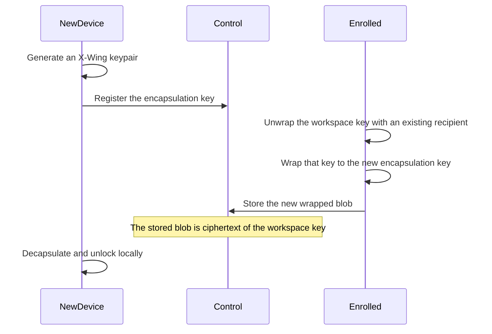

The existing recipient can be another enrolled device, a passkey PRF evaluation, the recovery kit, or an admin teammate.
The control plane never sees the workspace key during that exchange.

### Recovering after a lost device

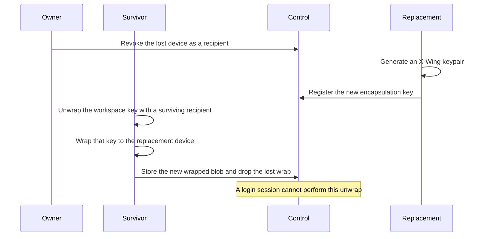

The surviving recipient is another device, a passkey, the recovery kit, or an admin teammate.
Revocation of the lost device deletes its wrap.
A later finder of that device is no longer a recipient.
If the finder already unwrapped the workspace key before the revoke, that finder holds a copy.
Revocation cannot reach a copy that already left.
That is the same limit as section 3.2.

### Why the operator cannot recover

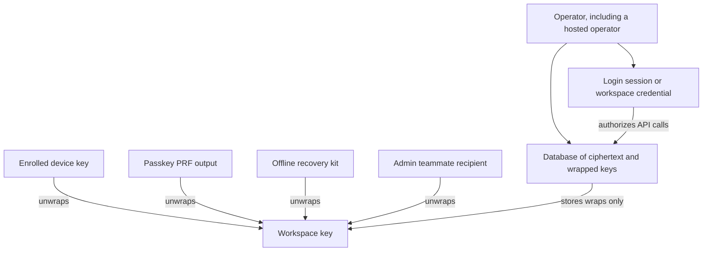

The operator can read every row.
Those rows are payload ciphertext, wrapped data keys, wrapped copies of the workspace key, and encapsulation public keys.
They also include PRF salts, KDF parameters, policy, secret names, and the audit log.
None of those rows is the workspace key.
The login session authorizes API calls against that database.
It has no path to the workspace key.
A new wrap requires a recipient that already unwraps.
The operator is not one of those recipients.

Do not evaluate the PRF on a hosted page the operator can change.
Do not type the recovery kit on that page.
The page would see the output.
The dashboard HTML does not decrypt a secret.
Unwrap for a hosted service happens in the injector or in the attested enclave.
The operator does not rewrite that component.
The attested enclave is not a live path.
A synced passkey is only as private as the passkey provider that syncs it.
That provider is outside Credentials.
An offline recovery kit does not depend on that sync.
Neither one is an operator-held key.

### Threat model and the tradeoff

The customer keeps exclusive custody of plaintext.

- A database thief gets ciphertext and wrapped blobs. Opening them requires a customer recipient.
- A compromised control-plane host gets the same rows, plus whatever a login session can authorize. It still cannot unwrap.
- A compromised injector host, or a stolen device that is still enrolled, can open the secrets that holder can unwrap. That host is in the customer trust domain.
- An admin teammate who is a recipient can open secrets and can share a new wrap. Adding a teammate widens that set.
- A malicious control plane can refuse to store a wrap, or can substitute ciphertext. It cannot address a wrap to itself without the workspace key.
That limit holds when the client wraps only for keys the customer selected.

Loss of every recipient means loss of the data.
If the devices, the passkeys, the recovery kit, and every teammate wrap are gone, the workspace key is gone.
The operator cannot reconstruct it.
A backup of the database does not restore it.
That irreversibility is the property crypto-shred wants.
It is also the failure mode of a lost kit.
Enrollment displays the kit one time, so the customer can store it outside the control plane.

## 5. Tokens and identity

A token is an identity, not a key.
**Implemented.**

Agent tokens are signed JWTs.
This build signs them with an in-process Ed25519 key, `DevSigner`, generated at startup.
A production issuer uses KMS Sign and does not export the private key.
**Planned (M4).**
The dev gateway rejects `CREDENTIALS_ENV=production`.
`Gateway::control_plane` uses `RejectingRootKeys`.
That constructor still takes a `DevSigner`.

| Claim | This build |
| --- | --- |
| `aud` | `credentials-gateway`. Any other audience is rejected. **Implemented.** |
| Lifetime | Default 5 minutes. `DEFAULT_TTL_SECS` is 300. Hard maximum 15 minutes. The reference client requests 300 seconds. **Implemented.** |
| Possession | `cnf.jkt` is the RFC 7638 thumbprint of the session Ed25519 DPoP key. Each inject carries a DPoP proof over method, URI, and the access-token hash. **Implemented.** |
| Revocation | On every inject the dev gateway loads the session and rejects a set `revoked_at`. It also rejects a mismatched workspace, agent, or thumbprint, and an expired session. There is no long-lived allow cache. **Implemented** for the session row. The migration creates `revoked_jtis`. The gateway code does not read that table yet. |
| Key material | The claims are issuer, audience, subject, times, `jti`, workspace, agent, session, scopes, and `cnf.jkt`. No secret, data key, KEK, or value that derives them. **Implemented.** |

Verification and decryption are separate steps.
The code that verifies the JWT does not call the KMS.
The code that unwraps a data key does not read a key from the JWT.
A stolen token cannot open a database dump.
A stolen token together with its DPoP key can call inject inside its scope until expiry or revocation.
That use calls the dev gateway or requests a ciphertext release. The audit log records it.
It is not offline decryption.

The handler builds DPoP `htu` from the host header and the TLS flag.
It does not read `x-dpop-htu`.
The verifier checks the `htu` value it receives.

Workspace creation on the loopback listener does not require a credential.
Admin routes after that use the workspace credential as `Authorization: Bearer`.
The credential is not a JWT.
It is not accepted as a substitute for an agent token on inject.

An agent session may hold only `secret:inject:...` scopes.
`*` matches one path segment.
There is no `**`.
`secret:admin:*` is rejected on an agent session.
The effective permission is the intersection of the token scope and the secret delivery policy.
The agent cannot add a host.

In the production split, the control plane still performs this check and still does not decrypt an e2e secret.
Authorization stays a property of the token.
Decryption stays a property of the workspace key.

## 6. Audit

**Implemented** for the hash chain, the fail-closed allow, the dev signature, and the dev anchor file.
A retention-locked hosted bucket is **planned (M5)**.
Default CI does not use S3 Object Lock.

Each workspace has one sequence.
Each agent also has a chain.
The body encoding is the one in [ENCRYPTION.md](ENCRYPTION.md) section 9.
`agent_prev_hash` sits inside the body, so the workspace chain commits to the per-agent links.

```text
hash       = SHA-256(prev_hash || body)
agent_hash = SHA-256(body)    when the event has an agent
```

`verify_chain` recomputes both hashes and runs before an audit read is returned.
The dev process signs the tip with its Ed25519 signer and appends the signature to a local anchor file.
A production signer would use KMS Sign, which is **planned (M4)**.
`Gateway::control_plane` still takes a `DevSigner`.

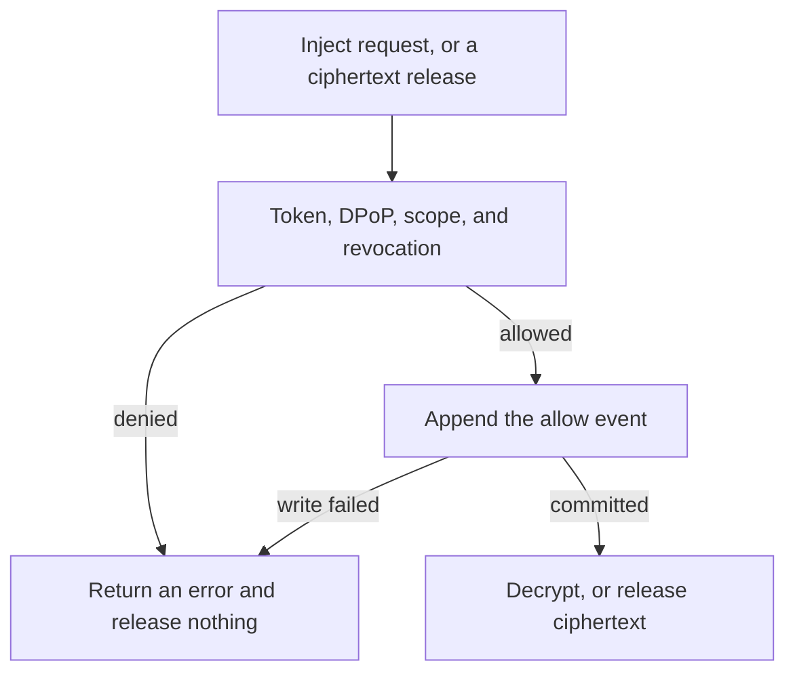

The allow insert stops the request on failure.
`audit_or_fail` runs before `unwrap_kek` on the dev path.
If the append returns an error, the handler returns 503 `audit_failed` and does not decrypt.
Tests can force that failure on `MemoryStore`.
The later events `secret.access.delivered` and `secret.access.failed` ignore an append error in this build.
The spec rule is about the allow event.
That rule holds.

The production split does not make the chain observe every decrypt in the world.
The chain stays enforceable for requests that the control plane handles.
The control plane can refuse ciphertext when the allow event cannot be written.
It cannot prove that an injector which already had the workspace key and a ciphertext copy did not open it.
The operator keeps authorization, DPoP, scope, and an audit log of the supported path.
The operator cannot inject from the control plane. The operator cannot debug by reading a secret.

Payloads are metadata.
They hold the secret id, the version id, the name, and the delivery mode.
They also hold the upstream host, the session, the `jti`, and a reason code.
They do not contain secret plaintext, key bytes, or tokens.
Secret names are stored in the clear so the control plane can authorize before anyone opens a secret.
Zero-knowledge here covers plaintext and unwrap keys.

## 7. Threat model

This table states who can see plaintext, keys, and metadata.
The dev column is the dev gateway, which opens `wrap_mode=gateway` and rejects `CREDENTIALS_ENV=production`.
The target column is the production control plane for self-host and for a Tactico host.
There is no live hosted service.

| Actor | Today, dev gateway | Target, production control plane |
| --- | --- | --- |
| Operator | The operator reads the database. The dev gateway decrypts `wrap_mode=gateway`. A reader of that process can read plaintext while it serves traffic. A reader of its memory, its code, or `.credentials-dev-keys.json` can do the same. The production guard rejects this provider. It does not hide plaintext from an operator who runs the dev gateway. | The operator reads ciphertext, policy, secret names, wrapped workspace-key blobs, public encapsulation keys, PRF salts, tokens, and audit metadata. The operator does not receive the workspace key, a device decapsulation key, a PRF output, or the recovery kit. Tactico, when hosting, is this operator. No hosted mode decrypts. |
| Compromised database | The database holds ciphertext, nonces, wrapped data keys, and wrapped KEKs. It also holds key ids, names, policy, credential hashes, and the audit chain. The tenant root key is not in the database. A swapped row fails AES-GCM because CRD1 binds the workspace, the secret, and the version. `wrap_mode=gateway` plaintext also needs the dev key file or a KMS decrypt role. An e2e row needs a customer recipient. | The database holds the same payload ciphertext, plus recipient wraps of the workspace key. Those wraps open only with a customer recipient. A dump plus control-plane credentials is not enough. |
| Compromised host | The dev host sees plaintext, data keys, and cached KEKs in process memory. The KEK cache TTL is 60 seconds. This host is the operator host for the dev gateway. | The control-plane host sees the database rows and not the opened secret. The injector host sees plaintext of secrets it opens. That host belongs to the customer. An enclave parent would see the host-side process. The workspace key would enter only an image whose measurement matches the pin. A wrong measurement gets no key. This trusts the CPU vendor and the pin. A crash dump of enclave memory would break the claim. A host-visible swap of that memory would break the claim. The enclave image must not use either one. That enclave path is not live. |
| Agent | On proxy injection, the agent sees the upstream response. The dev gateway sets the secret on the upstream request. The public listener rejects env and header delivery. A compromised agent can cause calls inside its scope until the session ends. It does not receive a data key or a KEK. The runtime must exclude echoed tool output from the prompt. Credentials does not write the model context. | The injector performs the same delivery split. Proxy remains the default for an API key. Env delivery is only on the local channel. It places a secret where a process that can read its environment can copy it. An agent that is not the injector does not receive a proxy secret. |

A network attacker can see and change public traffic. With no token and no DPoP key, that attacker gets no plaintext and no usable session.
The dev loopback listener can be cleartext.
Public TLS 1.3 is **implemented** with rustls and aws-lc-rs.
The group is `X25519MLKEM768`, code point 4588.
`TLS_REQUIRE_HYBRID` defaults to on in production and then offers only that group.

## 8. Post-quantum

Symmetric encryption of secret payloads is AES-256-GCM.
**Implemented.**
AES-256 is the data cipher because a quadratic quantum search still leaves about 128-bit security.
AES-128 is not used.
The quantum exposure is the asymmetric cryptography.
That exposure is TLS key exchange, application key transport, and signatures.

| Hop | Construction | Status |
| --- | --- | --- |
| Secret payload at rest | AES-256-GCM, 32-byte data key, 12-byte nonce, 16-byte tag | **Implemented.** |
| TLS | TLS 1.3 group `X25519MLKEM768`, RFC 10024, code point 4588 | **Implemented.** rustls with aws-lc-rs negotiates group 4588. `TLS_REQUIRE_HYBRID` defaults to on in production and offers only that group. |
| Application key wrapping | X-Wing, X25519 + ML-KEM-768, `draft-connolly-cfrg-xwing-kem` | **Implemented** in `crates/crypto/src/hybrid.rs` and in CRD2. Encapsulation keys are 1216 bytes. Encapsulations are 1120 bytes. Tests check those lengths. The dev gateway does not call X-Wing for `wrap_mode=gateway`. The injector uses it for the workspace key, device wraps, and e2e data-key wraps. |
| JWT and DPoP signatures | Ed25519 | **Implemented.** Hybrid signatures, Ed25519 plus ML-DSA-65, are an open question for **planned (M7)**. Forgery of those signatures would mint or replay tokens. It would not open stored ciphertext. |

X-Wing stays secure if either X25519 or ML-KEM-768 falls.
The crate is RustCrypto `x-wing`.
This repository calls it and does not restate the combiner.
The module comment records that the published crate combiner label matches the draft-11 label.
Token lifetimes stay minutes either way.
Revocation does not depend on the signature scheme.

## 9. Where this tree is behind the words around it

The points below are easy to miss if a reader treats an older sentence as the running binary.
This document is the map.
The encryption spec remains normative for the envelope.

- [ENCRYPTION.md](ENCRYPTION.md) names Rust as the implementation language. TLS uses rustls and aws-lc-rs. The Go TLS notes are not a second codebase.
- Import HTTP readers for Infisical, Doppler, 1Password Connect, and Vault KV exist in `credentials-edge`. Default CI does not call those live APIs. Inject does not fetch those products. The injector seals a native version and discards the source bytes.
- The public API is client-agnostic. The in-tree client is `credentials-client`.
- `wrap_mode` and `e2e_encapsulation` exist. `wrap_mode=e2e` stores CRD2. The production control plane does not open those rows. `credentials-injector` opens them.
- DPoP `htu` comes from the request host and the TLS flag. The handler does not read `x-dpop-htu`. The migration creates `revoked_jtis`. The gateway code does not read that table yet. A disabled agent, a failed DPoP proof, or a replayed DPoP `jti` returns 401 without an audit row. `secret.access.delivered` and `secret.access.failed` ignore an append error. The allow event does not.
- Workspace delete revokes sessions, deletes secret rows, and schedules shred. A poller sets `shredded`. Cancel exists while destruction is pending. The migration creates `rewrap_jobs`. KEK rotation rewraps data keys in the gateway process.
- The public listener rejects `env` and `header`. The local socket (`CREDENTIALS_LOCAL_DIR`, mode `0700`, same-uid peer check) returns `{ env_name, value }` or `{ header_name, value }`. It does not forward header delivery through `Upstream`.
- `credentials-edge` has Vault Transit, AWS KMS, a WebAuthn software authenticator, and OIDC PKCE helpers. `Gateway::control_plane` does not call the KMS adapters. SAML is not implemented. The dashboard HTML does not decrypt. There is no live hosted service. Default CI does not use S3 Object Lock. There is no Nitro EIF. There is no full `COSE_Sign1` AWS chain verifier. The edge crate checks a test PCR document, not a live enclave. PKCS#11 is not in the tree. The production signer is still a `DevSigner` argument on `Gateway::control_plane`.

## 10. Related documents

- [ENCRYPTION.md](ENCRYPTION.md) specifies the envelope, CRD1, CRD2, rotation, crypto-shred, tokens, injection, and the audit encoding.
- [ROADMAP.md](ROADMAP.md) states milestone order. Account-bound recovery is an M3 deliverable. M4 and M5 require the M3 trust model. M5 is an optional hosted beta and claims no certification. There is no live hosted service.
