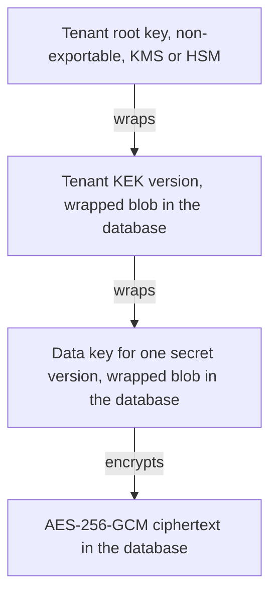
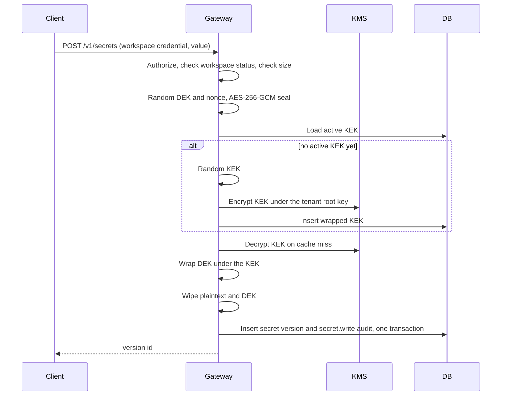
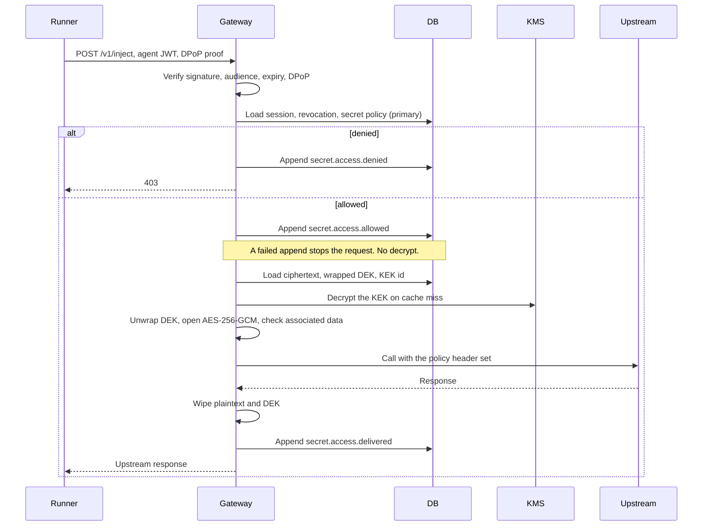

# Encryption and key management

Status: implementation spec.
The envelope, the dev root-key provider, tokens, injection, and the hash-chained audit log are implemented in Rust in this repository.
`wrap_mode=gateway` and `wrap_mode=e2e` both exist.
This file remains the spec.
It claims no customers, no SOC 2, and no certification.

Audience: the person who builds Credentials.

Language: “must”, “must not”, and “required” are normative.
“Should” is a recommendation.
Deviate from a recommendation only with a written reason in the PR.

Credentials is an agent-native secrets provider.
An agent receives a scoped session.
The session is short-lived.
The dev gateway or the injector places the secret at runtime.
The modes are environment, proxy, and header.
Secret plaintext does not enter prompts, transcripts, or model context.
Every access is written to the audit log for that agent.
The service is a standalone API.
Momentum is the first named client and uses that public API.

This document specifies encryption, key management, agent authentication for decryption, injection, and the audit log.
Build it as written.
Product surfaces that this file does not specify need their own docs.
Those surfaces include human login, billing, and a dashboard.
`credentials-edge` has a WebAuthn software authenticator and OIDC PKCE helpers.
SAML is not implemented.
The dashboard HTML does not decrypt a secret.

The design is safe to publish.
Credentials may ship as open core.
Security depends on key custody, identity, and policy.
Security does not depend on hiding this document or the source.

## 1. Decisions

These choices are closed.
Do not reopen one of them in a passing change.

1. **Envelope encryption.** Each secret version has its own random 256-bit data key (DEK). AES-256-GCM encrypts the secret under that DEK with a unique 96-bit nonce. The workspace id, the secret id, and the version id are associated data. A versioned per-workspace key-encryption key (KEK) wraps the DEK for `wrap_mode=gateway`. A tenant root key in a KMS or an HSM wraps that KEK. The tenant root key is non-exportable. The database never stores the tenant root key. The database holds ciphertext, nonces, and wrapped keys.
2. **Rotation rewraps keys.** A new KEK version wraps each existing DEK again. The payload ciphertext stays unchanged. A new tenant root key wraps each existing KEK again. The payload ciphertext and the DEKs stay unchanged.
3. **Deleting a workspace crypto-shreds `wrap_mode=gateway` rows.**
Production gives each workspace its own tenant root key.
It schedules destruction of that key in the KMS. After the KMS destroys it, database backups no longer decrypt those rows. Deleting rows is hygiene. Deleting rows is not the shred. E2e rows follow section 12.
4. **Symmetric encryption stays AES-256-GCM.** AES-256 is the data cipher. Grover’s algorithm is a quadratic speedup, so AES-256 has about 128-bit security against a quantum search. AES-128 would fall to about 64-bit security. Do not use AES-128. The quantum exposure in this system is asymmetric cryptography. That exposure is key exchange and key transport.
5. **Key transport is hybrid.** Use a hybrid of X25519 and ML-KEM-768 (FIPS 203) wherever a key is exchanged or transported. The hybrid stays secure if either primitive falls. The places include TLS, a later hop between processes, a client channel, and `wrap_mode=e2e`. TLS uses the `X25519MLKEM768` group (RFC 10024, code point 4588). Application wrapping uses X-Wing (`draft-connolly-cfrg-xwing-kem-11`) from a reviewed library. Call that library. Do not invent the primitive in this repository.
6. **A token is an identity, not a key.** Agent tokens are signed JWTs. They are audience-bound, scoped, and bound to proof of possession (DPoP, RFC 9449). The default lifetime is 5 minutes. The hard maximum is 15 minutes. The token does not contain a secret, a DEK, a KEK, or a value that derives any of those. Check revocation on every request against the primary database. A stolen token cannot decrypt a database dump.
7. **Two open paths exist.** The dev gateway unwraps keys, decrypts `wrap_mode=gateway`, and injects the plaintext. The agent process does not receive key material on that path. The dev gateway rejects `CREDENTIALS_ENV=production`. The production control plane uses `RejectingRootKeys`. It does not open an e2e secret. `credentials-injector` opens an e2e secret. Section 12 specifies that mode.
8. **The audit log is append-only and tamper-evident.** Each workspace has a hash-chained log. Each agent’s events also form a chain. Sign the tips with a KMS-held key and copy them to an anchor the database role cannot rewrite. If the access event cannot be appended, do not decrypt and do not release ciphertext.
9. **The crypto domain is the workspace.** Projects are path prefixes inside a workspace. Token scopes enforce those prefixes. Projects do not get separate KEKs in v1.

## 2. Goals and non-goals

### Goals

- A database copy, taken at any time, is not sufficient to recover secret plaintext.
- A swap of ciphertext, wrapped DEKs, or wrapped KEKs across workspaces, secrets, or versions fails authentication.
- Rotation of a KEK or a tenant root key does not re-encrypt secret payloads.
- Destruction of a workspace tenant root key makes every `wrap_mode=gateway` version unreadable.
- That rule includes copies in backups and replicas.
- An agent token authorizes one injection. It is not a decryption key. Revoke it before it expires when that is required.
- Inject secret plaintext into a runtime or an upstream call. Do not return it on the public API. Do not place it in model context.
- Every allowed, denied, and failed access names an agent.
- That record survives a later edit of the database when the external audit anchor is present.
- An independent implementation can interoperate from this document alone.

### Non-goals for v1

- End-to-end mode for the dev gateway. Section 12 is implemented for `wrap_mode=e2e`. The dev gateway still opens `wrap_mode=gateway` and rejects `CREDENTIALS_ENV=production`. The production control plane releases ciphertext and does not open it.
- A custom cipher, KEM, combiner, MAC, or signature scheme. Section 4 lists the allowed libraries.
- A cache of plaintext, in memory beyond the request or in any other place.
- A cache of unwrapped DEKs across requests.
- A share of unwrapped KEKs across nodes.
- A share of unwrapped KEKs through Redis or any store other than the process that called the KMS.
- Multi-region active-active KMS. v1 is one region. The KMS is a hard availability dependency for `wrap_mode=gateway`.
- Human identity, SSO, and the dashboard as part of this crypto spec. The workspace credential below is only the bootstrap admin credential. `credentials-edge` has OIDC PKCE helpers and a WebAuthn software authenticator. SAML is not implemented. The dashboard HTML does not decrypt a secret.
- A live call to Infisical, 1Password, Doppler, or Vault at injection time. A team imports a secret one time. Credentials stores that secret under the native envelope. HTTP readers for those products exist in `credentials-edge`. Default CI does not call those live APIs. Zero-knowledge against the operator is required for production. The dev gateway decrypts `wrap_mode=gateway`. The production control plane must not decrypt an e2e secret.

## 3. Threat model

### Assets

| Asset | Where it may exist |
| --- | --- |
| Secret plaintext | Dev-gateway memory during a `wrap_mode=gateway` request. Injector memory during an e2e open. The injection target, which is an upstream header or a local supervisor. Nowhere else. |
| DEK | Memory of the process that opens the secret, during the request. At rest, only as a wrapped blob. |
| KEK | Dev-gateway memory for at most the cache TTL. At rest, only as a KMS-wrapped blob. The production control plane does not unwrap it. |
| Tenant root key | Inside the KMS or HSM for the dev path. Non-exportable. `RejectingRootKeys` holds no such key for the production control plane. |
| Token signing key, audit signing key | Inside the KMS, non-exportable, used through the Sign API. This tree still passes a `DevSigner` into `Gateway::control_plane`. |
| Agent token | Runner memory, and the `jti` in the database when revoked. |
| Audit history | The database, plus signed tips in the external anchor. |

### Adversaries

| Adversary | Capability assumed |
| --- | --- |
| Network attacker | Sees and modifies traffic on the public network. Does not have a token or a KMS role. |
| Database thief | Reads or restores a full database snapshot, including backups. Does not have the KMS role or a customer recipient. |
| Token thief | Holds a bearer token. May or may not hold the DPoP private key. |
| Compromised agent | Controls the agent process for the life of a session. The cause may be prompt injection with a tool, or code execution in that process. |
| Operator | Can read the database, change the deployed code, or use production credentials. KMS admin and database admin are separate roles. One person may still hold both over time. |
| KMS outage | The KMS returns errors or cannot be reached. This is an availability failure for `wrap_mode=gateway`. |

Assume the attacker has this document and the source code.

### Database leak

The snapshot contains ciphertext, GCM nonces, wrapped DEKs, wrapped KEKs, key ids, and the encryption-context fields.
It does not contain a tenant root key.
Unwrap of a KEK requires `Decrypt` on that workspace tenant root key.
The call must use the matching encryption context and the dev-gateway role.
Those credentials are instance or workload identity.
They are not stored in the database.
The production control plane uses `RejectingRootKeys` and cannot perform that unwrap.

A swapped row fails AES-GCM.
The associated data commits to the workspace id, the secret id, and the version id.
For a wrapped DEK, it also commits to the KEK id and the KEK version.
For `wrap_mode=e2e`, section 12 names the associated data.

Residual risk for `wrap_mode=gateway` remains.
An attacker who later obtains the dev-gateway KMS role can decrypt every workspace whose tenant root key is still enabled.
Use a KMS key policy that allows `Encrypt` and `Decrypt` only for that role.
Use a separate role that can schedule key destruction and cannot decrypt.
Use VPC-restricted KMS endpoints where the provider supports them.
Alert on `Decrypt` volume and on key-policy changes.
The audit anchor lives in an account the database role cannot write.
A database thief cannot silently rebuild history.
An e2e row still needs a customer recipient.

### Token leak

Verification of a token yields an agent id, a workspace id, a session id, and a scope list.
It yields no key bytes.
Do not derive keys from token claims, token bytes, or the DPoP key.

Reject a token that has no matching DPoP proof.
A token plus its DPoP key can call the inject API inside its scope until expiry or revocation.
That is use of the secret through the dev gateway, or a ciphertext release, and the audit log records it.
It is not offline decryption.
Revocation is a write to the session row or the `jti` table on the primary database.
The next request observes it.
Do not keep a long-lived cache of an allow decision.

Residual risk remains until the runner revokes the session.
A thief who also has the DPoP key can use the scoped capability until that revocation.
The lifetime is at most 15 minutes.
The default is 5 minutes.

### Compromised agent

Two deliveries behave differently.
Both are in v1.

- **Proxy injection.** The injecting process sends the secret to the upstream host. The agent receives the upstream response and does not receive the secret. A compromised agent can still cause calls to allowed hosts for the life of the session. The allowed hosts are the intersection of the token scope and the delivery policy. That is the capability the session was granted. The agent cannot leave with a reusable copy of the secret.
- **Environment or header injection.**
A local supervisor or the injector receives the plaintext over the local channel.
It places the plaintext in the environment or on an outbound header. A process that can read its own environment, or that memory, can copy the secret. Scope and lifetime limit which secrets are present. This delivery exists for an integration that cannot use the proxy. Proxy is the default. Momentum should use proxy for an outbound API key.

In both cases Credentials does not write the model context.
The client must not copy an injected secret, or an API response that echoes it, into a prompt.
Credentials cannot enforce that rule inside a third-party model loop.
The runner must exclude secrets from the prompt builder.
Treat tool output that echoes an environment dump as a defect in the runner.

A compromised agent is not, by itself, a database decryptor.
It never sees a DEK or a KEK.

### Insider and operator

The production control plane must not read secret plaintext.
Section 12 is that path.
The control plane authorizes and releases ciphertext.
The injector opens it.
The dev gateway can still open `wrap_mode=gateway`.
That process rejects `CREDENTIALS_ENV=production`.

On the dev gateway, an operator who can change the code can read secrets while the process serves traffic.
An operator who can dump that memory can read those secrets.
An operator who can call the KMS with the dev-gateway role can read those secrets.
The dev path accepts that exposure.
The hosted operator and a self-host production operator do not.
Controls that make the dev window small and visible:

- KMS `Decrypt` and database administration are different IAM roles.
- The token signing key and the audit signing key are non-exportable KMS keys. Application code never loads those private keys. This tree still uses `DevSigner` until M4 replaces it.
- Unwrapped KEKs live only in dev-gateway process memory, for at most 60 seconds (section 6). Wipe plaintext and DEKs at the end of the request. Do not cache them.
- Production images do not include a success path for the dev root-key provider. Startup fails if that provider is selected.
- The cloud provider logs KMS `Decrypt`. Anomalous volume is an alert.
- Code review is on the public design. Obfuscation is not a control.

An operator with database access and no KMS access cannot read a `wrap_mode=gateway` secret.
An operator with KMS admin access and no database access has nothing to decrypt.
A key-policy change is an alert.
An operator with the database and the control-plane credentials cannot open an e2e secret.
That open needs a customer recipient.

### KMS outage

If the KMS cannot unwrap a KEK, the dev gateway cannot decrypt `wrap_mode=gateway`.
Behavior:

- Do not decrypt from a plaintext cache. There is no plaintext cache.
- A KEK already unwrapped in that process may be used until its cache TTL ends. The default is 60 seconds. The hard maximum is 5 minutes. After that, the request fails.
- The failure is HTTP 503 `kms_unavailable`. Mark the process not ready so a load balancer can drain it.
- Do not select a local key, a previous tenant root key stored in the database, or a hardcoded key.
- Pause rewrap and shred jobs, then resume them. They are idempotent (section 6).

A single-region KMS is a single point of failure for `wrap_mode=gateway`.
v1 accepts that limit.
Availability does not outrank the property that a database copy is useless without the KMS for those rows.
E2e open does not call that KMS.

### Other cases the design closes

| Case | What happens |
| --- | --- |
| Cut-and-paste of ciphertext between rows | GCM authentication fails. Associated data includes the row ids. |
| Nonce reuse | A DEK encrypts exactly one payload. A KEK wrap of a given DEK uses one nonce. A rewrap generates a new DEK wrap under the new KEK with a new nonce. The CSPRNG supplies each random 96-bit nonce. |
| Replay of an inject request | The process caches the DPoP `jti` for the token lifetime. The proof binds the method and the URI. |
| Algorithm downgrade | Writers emit only `aes-256-gcm-v1` for `wrap_mode=gateway`. Readers accept only that algorithm for those rows. The algorithm id is inside the associated data. Section 12 names the e2e label. |
| Restore of a shredded workspace | The KMS rejects decrypt after the tenant root key is destroyed. A database restore does not restore the key. E2e shred follows section 12. |
| Secret value in logs, traces, or errors | Logging uses the redaction list in section 13. A GCM failure returns a generic error to the client and a security alert internally. The client-facing error does not say whether the tag, the nonce, or the associated data was wrong. |
| Workspace id reuse after deletion | Ids are UUIDv7 and are never reused. |

## 4. Cryptography and libraries

Rust is the implementation language of record.
The dev gateway runs the `wrap_mode=gateway` operations in one process.
The production control plane does not open an e2e secret.
The injector opens an e2e secret.
An implementation must pass the same test vectors and must use libraries of the same class.
Do not split the cryptographic core across languages.
Earlier notes named Go `crypto/tls`.
This tree does not use that stack for TLS.

`getrandom` supplies random bytes. `random_bytes` returns those bytes.
If the read fails, fail the request.
Do not use a non-crypto RNG for a key, a nonce, a token, or an id.

### Primitives

| Use | Primitive | Notes |
| --- | --- | --- |
| Secret payload | AES-256-GCM | 32-byte DEK, 12-byte nonce, 16-byte tag. NIST SP 800-38D. |
| DEK wrap | AES-256-GCM | Same primitive, different associated data, so one reviewed implementation covers both. |
| KEK wrap | KMS Encrypt | Opaque blob. The KMS holds the tenant root key. The production control plane does not call this for an e2e secret. |
| KEK, DEK | 256-bit random | One DEK per secret version. One active KEK per workspace on the dev path. |
| TLS | TLS 1.3 with `X25519MLKEM768` | RFC 10024, group 4588. rustls with aws-lc-rs. |
| Application key transport | X-Wing | X25519 + ML-KEM-768, `draft-connolly-cfrg-xwing-kem-11`. Library only. |
| Agent JWT | EdDSA (Ed25519) or ES256 | Whichever the KMS can sign without exporting the private key. `alg` is explicit. This tree signs with `ed25519-dalek` in `DevSigner`. |
| DPoP proof key | Ed25519 | Generated on the runner. RFC 9449. |
| Audit hash | SHA-256 | Over the encoding in section 9. |
| Audit and token signatures | KMS Sign | Non-exportable asymmetric key. `DevSigner` remains until that signer ships. |
| Workspace credential lookup | SHA-256 | Hash of a 256-bit random value. Not a password hash. The input already has full entropy. |

Wrap a DEK with AES-256-GCM.
AES-KW cannot bind associated data.
The associated data includes the workspace, the secret, the version, the KEK id, and the KEK version.
The DEK is a fresh 256-bit key, which is a valid GCM plaintext.

### Libraries

Use these libraries.
Do not reimplement them.
Do not copy a combiner into this repository to avoid a dependency.

- **AES-256-GCM:** the `aes-gcm` crate.
- **SHA-256:** the `sha2` crate.
- **Ed25519:** `ed25519-dalek`.
- **X-Wing:** RustCrypto `x-wing`.
- **Wipe:** `zeroize`.
- **Argon2id:** the `argon2` crate, for the recovery kit in section 12.
- **UUID:** the `uuid` crate, version 7.
- **HKDF:** not used in v1. Add it only if a later feature truly needs it, with a written reason.
- **TLS:** rustls with aws-lc-rs. Set the minimum version to TLS 1.3 on every public listener. Leave `X25519MLKEM768` enabled. Do not disable group 4588 in production. Do not set `GODEBUG=tlsmlkem=0`. This tree does not use that Go switch.
- **Classical key exchange:** allow a classical-only group only when the peer offers no hybrid group and `TLS_REQUIRE_HYBRID` is off. Record `tls_classical_kex_total`. `TLS_REQUIRE_HYBRID` defaults to on in production and then offers only group 4588. A dev process may leave the flag off so an older local tool can connect. Spec test 16 checks group 4588.
- **X-Wing library rule:** use a library listed in Appendix A of `draft-connolly-cfrg-xwing-kem-11` whose test vectors match that draft. This tree uses `x-wing` 0.1.1. Its combiner label matches the draft-11 label. Pin the crate version. The X-Wing combiner is specific to ML-KEM-768 and this construction. A different KEM, or a different concatenation, drops the security argument. `wrap_mode=gateway` storage does not call X-Wing. TLS and CRD2 do. The draft-11 vectors are in `crates/crypto`. Do not add a second unused copy.
- **KMS:** the cloud provider SDK, behind `RootKeyProvider` in section 6. `credentials-edge` has Vault Transit and AWS KMS adapters for a customer process or a dev process. `Gateway::control_plane` does not call them. PKCS#11 is a later adapter of the same interface.
- **UUID bytes:** UUIDv7 (RFC 9562). The 16 bytes in this document are the canonical decoding of the 32 hex digits.
Read those digits from left to right.
Ignore the hyphens.

Reject these for this system.
Reject AES-128 and AES-GCM with a 64-bit tag.
Reject RSA key wrap.
Reject raw X25519 as the only key transport.
Reject raw ML-KEM as the only key transport.
Reject Kyber draft code points (`X25519Kyber768Draft00`).
Reject `alg: none`.
Reject HMAC-signed JWTs (`HS256` and the other `HS*` algorithms).
Reject any temporary hand-rolled XOR, hash, or stream cipher.

### Memory

Keep plaintext, a DEK, and a KEK in a byte buffer.
Call `zeroize` after use.
Do not log these buffers.
Do not put them in an error value.
Do not store them on a request context that outlives the call.
A runtime may copy memory.
The control this spec relies on is a short lifetime and no plaintext cache.
Do not claim that RAM was provably cleared.

## 5. Wire format and associated data

### Identifiers inside cryptography

Use UUIDv7.
Never reuse an id.
The ids cover a workspace, a secret, a secret version, and a KEK.
The ids also cover an agent, a session, a token `jti`, and a request.

Secret names are metadata.
Store them in the clear, because the control plane looks up the name before anyone decrypts.
A name is unique per workspace.
A name is not a secret.
A customer who needs the name itself to be confidential uses an opaque name.

### Payload

For secret version `V` of secret `S` in workspace `W`, with DEK `K` (32 bytes) and nonce `N` (12 bytes):

```
ciphertext = AES-256-GCM.Seal(key = K, nonce = N, plaintext = raw secret bytes, aad = AAD_payload)
```

`ciphertext` is the GCM output and includes the 16-byte tag.
Store the nonce beside it.
Do not prepend the nonce.

Plaintext is the raw secret bytes.
It is not JSON, not a string with a length prefix, and not padded.
The column `plaintext_len` stores the original length.
GCM already leaks the length through the ciphertext size.
The column does not make that leak worse.

Size limits: minimum 1 byte, default maximum 65,536 bytes, hard ceiling 1,048,576 bytes (`MAX_SECRET_BYTES`).
Do not configure a maximum above the ceiling.
Reject an empty value.

### Associated data, payload

`AAD_payload` is exactly 54 bytes:

| Offset | Length | Content |
| --- | --- | --- |
| 0 | 4 | ASCII `CRD1` (`43 52 44 31`) |
| 4 | 1 | purpose `0x01` |
| 5 | 16 | workspace id |
| 21 | 16 | secret id |
| 37 | 16 | version id (the version row’s UUID, not the integer version) |
| 53 | 1 | algorithm `0x01` for `aes-256-gcm-v1` |

The integer version and the secret name are not in the associated data.
A rename, or a DEK rewrap, must not require a new payload encryption.
The version UUID is immutable.

Known answer (54 bytes, hex):

```
435244310100000000000070008000000000000001000000000000700080000000000000020000000000007000800000000000000301
```

built from workspace `00000000-0000-7000-8000-000000000001`, secret `00000000-0000-7000-8000-000000000002`, version `00000000-0000-7000-8000-000000000003`.

### Associated data, DEK wrap

```
wrapped_dek = AES-256-GCM.Seal(key = KEK, nonce = N_wrap, plaintext = DEK, aad = AAD_dek)
```

`AAD_dek` is exactly 74 bytes:

| Offset | Length | Content |
| --- | --- | --- |
| 0 | 4 | ASCII `CRD1` |
| 4 | 1 | purpose `0x02` |
| 5 | 16 | workspace id |
| 21 | 16 | secret id |
| 37 | 16 | version id |
| 53 | 16 | KEK id |
| 69 | 4 | KEK version, uint32 big-endian |
| 73 | 1 | algorithm `0x01` |

The purpose byte stops a payload ciphertext from being presented as a wrapped DEK, and the reverse.
The KEK id and the KEK version are in the DEK associated data.
They are not in the payload associated data.
A KEK rotation rewraps the DEK and leaves the payload bytes unchanged.

Known answer (74 bytes, hex), same ids as above, KEK `00000000-0000-7000-8000-000000000004`, KEK version `1`:

```
4352443102000000000000700080000000000000010000000000007000800000000000000200000000000070008000000000000003000000000000700080000000000000040000000101
```

### KEK wrap

The KEK is 32 random bytes.
Wrap it by calling KMS `Encrypt` on the workspace tenant root key.
The encryption context is this exact string map:

| Key | Value |
| --- | --- |
| `purpose` | `credentials.kek.v1` |
| `workspace_id` | canonical lowercase UUID |
| `kek_id` | canonical lowercase UUID |
| `kek_version` | decimal integer, no leading zeros |

Decrypt passes the same map.
Build the map from the columns of `kek_versions`.
Do not build it from a JSON blob that might reorder or retype values.
One function builds the map.
Encrypt and decrypt both call that function.
The KMS blob is opaque and provider-specific.
Store it as bytes.
Do not parse it.

### Algorithm labels stored on rows

| Column | Only legal value in v1 |
| --- | --- |
| `payload_alg` | `aes-256-gcm-v1` |
| `dek_wrap_alg` | `aes-256-gcm-v1` |
| KEK wrapping | implied by the KMS provider; the context purpose string is the label |

A row with any other `wrap_mode=gateway` label is an integrity failure.
Refuse to decrypt.
Increment `crypto_integrity_failure_total`.
Return a generic 500.

Magic `CRD1` is the associated-data version for `wrap_mode=gateway`.
`wrap_mode=e2e` uses magic `CRD2`.
A reader switches on the magic.
Writers of `wrap_mode=gateway` emit `CRD1` only.
Writers of `wrap_mode=e2e` emit `CRD2` as section 12 states.

## 6. Key hierarchy and operations



Two more keys exist per environment, and they are not in this chain:

- A token-signing key, KMS Sign only, used by the issuer.
- An audit-signing key, KMS Sign only, used by the audit publisher.

A platform KMS key wraps or holds those keys.
That platform key is not a tenant root key.
Scheduling destruction of a tenant root key must be unable to destroy the platform key.
Distinct keys and distinct IAM permissions are required.

### Why each workspace has its own root key

One platform-wide root that wraps every KEK cannot crypto-shred one workspace.
The wrapped KEK would still be present in database backups, and the shared root would still unwrap it.
Production therefore creates a non-exportable KMS key per workspace and uses that key only for that workspace’s KEKs.
The monthly cost of a customer-managed key is part of operating that dev or customer KMS path.
The production control plane does not hold that decrypt role.

`kms_key_ref` is an opaque reference, for example a cloud key ARN.
It may name a key Credentials created.
It may name a customer-owned key the dev gateway is allowed to use.
The encrypt and decrypt calls are the same either way.
Crypto-shred of a customer-owned key is destruction of that key by whoever administers it.

The dev provider is the exception for a laptop and for unit tests.
It stores a random 32-byte tenant root key per workspace in a file of mode `0600`.
It implements the same interface, including destruction.
If `CREDENTIALS_ENV=production`, the process must refuse to start when the configured provider is the dev provider.
No production flag turns the dev provider back on.
`Gateway::control_plane` uses `RejectingRootKeys`.

### `RootKeyProvider`

```text
CreateTenantRoot(workspaceID) (keyRef, error)
Encrypt(keyRef, plaintext, context) (blob, error)
Decrypt(keyRef, blob, context) (plaintext, error)
ScheduleDestruction(keyRef, notBefore) error
CancelDestruction(keyRef) error
```

`context` is `map[string]string` and must match exactly.
Implementations:

| Implementation | When |
| --- | --- |
| In-memory fake | Unit tests. No network. |
| Dev file | Local runs. Refuses production. |
| `RejectingRootKeys` | Production control plane. Encrypt and decrypt fail. |
| Cloud KMS in `credentials-edge` | Vault Transit or AWS KMS, for a customer process or a dev process. Not called by `Gateway::control_plane`. |
| PKCS#11 HSM | Later. Same interface. Not required to ship v1. |

`ScheduleDestruction` uses the provider waiting period.
AWS KMS requires at least 7 days.
Record the scheduled time on the workspace.
During the waiting period, `CancelDestruction` plus a status change back to `active` restores service.
A database restore from that window is still decryptable for `wrap_mode=gateway`.
After the key is destroyed, recovery of those rows is impossible.
That irreversibility is the point of crypto-shred.
The waiting period is the safety delay.
State this in plain language at deletion time, in the product text and in the API.

IAM for a process that wraps KEKs:

| Role | KMS permissions |
| --- | --- |
| Dev gateway | `Encrypt` and `Decrypt` on tenant root keys. No schedule-deletion. No key administration. |
| Production control plane | No `Decrypt` and no `Encrypt` on keys that wrap secret data. `RejectingRootKeys` enforces that refusal. |
| Workspace lifecycle | `CreateKey`, `ScheduleKeyDeletion`, and `CancelKeyDeletion`. No `Decrypt`. |
| Issuer | `Sign` and `GetPublicKey` on the token-signing key. |
| Audit publisher | `Sign` and `GetPublicKey` on the audit-signing key. |
| Database role | No KMS permissions. |

### Creating a workspace

1. Call `CreateTenantRoot` on the dev path.
2. Store `kms_key_ref` and set `status` to `active`.
3. Generate the first KEK (version 1) as below.
4. Read 32 bytes from `random_bytes` for the workspace credential.
5. Return that credential one time as base64url.
6. Store the SHA-256 of the raw bytes.

On the production control plane, do not call `CreateTenantRoot`.
Store a non-decrypting key reference.
The schema still needs a KEK row.
That row is not a wrapping key for an e2e secret.
The credential mints a session and writes a secret.
The credential does not decrypt anything by itself.

### Creating a KEK

1. Read 32 bytes from `random_bytes`.
2. Allocate a UUIDv7.
3. Allocate the next integer version. Use 1 for the first KEK.
4. Call `Encrypt` under the tenant root key with the context in section 5.
5. Wipe the 32 bytes.
6. Insert `kek_versions` with `status` set to `active`.

A partial unique index allows one `active` row per workspace.
If two creators race, the loser of the unique index discards its KMS blob.
Nothing was wrapped with that discarded KEK.
The loser uses the winner row.

### Writing a secret version

1. Authorize the write with the workspace credential, or with an agent token whose scope allows `write` on that name.
2. Reject a workspace whose status is not `active`.
3. On a first write, reject an invalid delivery policy with 400 `invalid_policy` before any key material is generated.
4. Allocate the secret id on the first write.
5. Allocate a new version UUID.
6. Allocate the next integer version.
7. Start integer versions at 1. Add 1 for each new version under a per-secret transaction lock.
8. Generate a DEK.
9. Generate a 12-byte payload nonce.
10. Seal the payload with `AAD_payload`.
11. Load the active KEK.
12. On a cache miss, call `Decrypt`.
13. Check that the plaintext is exactly 32 bytes.
14. Cache that key by KEK id.
15. Generate a 12-byte wrap nonce.
16. Seal the DEK with `AAD_dek`.
17. Wipe the plaintext, the DEK, and any temporary KEK copy that will not remain in the cache.
18. Insert `secret_versions` with `wrap_mode` set to `gateway` and `e2e_encapsulation` set to NULL.
19. On the first version, insert `secrets` and `secret_delivery_policies` in the same transaction.
20. Append the audit event `secret.write` in that same transaction.
21. If the transaction fails, store nothing.
22. Retry with a new version UUID.

For `wrap_mode=e2e`, follow section 12.
The production control plane does not accept plaintext on this write path.

A new version does not overwrite ciphertext in place.
Injection uses the highest integer version whose secret row is `active`.
The audit event records the version UUID that was used.

Set `secrets.status` to `disabled` to make injection fail authorization before any KMS call.
Existing ciphertext stays until the secret or the workspace is deleted.
Deleting one version deletes that row.
That removes the wrapped DEK from the primary database.
Copies in backups remain readable until those backups expire, because the KEK still exists.
Deletion of one secret is not crypto-shred.
Only destruction of the tenant root key shreds `wrap_mode=gateway` rows.
Section 12 shreds e2e rows.

### Reading and injecting

Run authorization and the audit append before any KMS call.
A denied request does not touch the KMS and does not load ciphertext.
The full sequence is section 10.
For `wrap_mode=e2e`, release ciphertext and do not call `open_secret`.

On a GCM failure of the payload or the DEK wrap, wipe the buffers.
Emit `crypto_integrity_failure_total`.
Append `secret.access.failed`.
Return a generic 500.
Do the same if the opened DEK is not exactly 32 bytes.
Do the same if the nonce is not exactly 12 bytes.
Do the same if `workspace_id` on the version row disagrees with the secret row.
Do the same if the KEK row workspace disagrees with the secret.

### KEK cache

- Use process memory only. Never serialize the cache.
- Key the cache by KEK id. The value is the 32-byte key.
- Use a default TTL of 60 seconds. The TTL is configurable. The hard maximum is 5 minutes.
- Use singleflight per KEK id so a burst causes one `Decrypt`.
- Drop the entry when the workspace status is no longer `active`. Drop every entry on process shutdown.
- Two versions may be cached during a rewrap. Those versions are the old `decrypt_only` KEK and the new `active` KEK.
- Do not keep this cache in the production control plane.

### KEK rotation

Rotation is an online operation.
Do not rewrite payloads.

1. Take a per-workspace advisory lock so two rotations do not run at once.
2. Create a new KEK with `version` set to the previous version plus 1, and with status `active`.
3. Set the previous row to `decrypt_only`.
4. Commit that change.
5. Enqueue a rewrap job from the previous KEK id to the new KEK id.

The job reads `secret_versions` where `kek_id` is the old id, in id order.
For each row:

1. Unwrap the DEK with the old KEK. The associated data uses the old KEK id and version.
2. Wrap that same DEK with the new KEK and a fresh nonce. The associated data uses the new KEK id and version.
3. Run `UPDATE secret_versions SET dek_wrapped = ?, dek_wrap_nonce = ?, kek_id = ? WHERE id = ? AND kek_id = ?`.
4. Wipe the DEK.

The conditional update makes the job safe to retry and safe against a concurrent writer.
The payload columns are not in the `UPDATE`.
After no rows remain, set the old KEK to `retired`.
Keep the wrapped blob for 7 days in case a replica still presents it.
Then set status to `destroyed`, set `wrapped_kek` to NULL, and wipe any cache entry.
Destruction of a retired KEK does not replace destruction of the tenant root key.

A write that arrives during the job uses the active KEK.
New rows are not part of the old-id scan.

### Tenant root rotation

Two situations:

- **Provider-managed rotation** keeps old key material available for decrypt inside the KMS. AWS automatic key rotation behaves this way. Run no application job. Record the key id. Keep the same `kms_key_ref`.
- **A move to a new key id** uses a new ARN, or leaves a provider. For each non-destroyed KEK of that workspace, call `Decrypt` with the old key and the stored context. Call `Encrypt` with the new key and the same context. Wipe the plaintext KEK. Conditional-update the blob and `kms_key_ref`. Leave DEKs and payloads unchanged. When no row still names the old key id, schedule destruction of the old key.

The production control plane does not perform these decrypt steps.

### Crypto-shred on tenant deletion

`DeleteWorkspace` takes the workspace id and a confirmation field.
The confirmation must equal that id.

1. Set `status` to `deleting`. From this moment, create, inject, and decrypt for this workspace fail.
2. Revoke every session and every workspace credential.
3. Drop cached KEKs for the workspace.
4. Call `ScheduleDestruction` on `kms_key_ref` for a `wrap_mode=gateway` tenant root key.
5. Append `tenant.delete.scheduled` as a normal row in this workspace audit log (section 9). Audit rows are not encrypted under the tenant root key, so the event survives the shred.
6. Delete `secret_versions`.
7. Delete `secrets` and the delivery policies.
8. Delete `kek_versions`.
9. Keep the audit rows.
10. Leave backup ciphertext until backup expiry.
11. Treat that ciphertext as unreadable after the KMS finishes destruction.
12. Treat the `DELETE` as hygiene.
13. Run a poller.
14. When that poller observes the destroyed key, set `status` to `shredded`.

`CancelWorkspaceDeletion` is allowed only while the KMS still reports the key as pending destruction.
Call `CancelDestruction`.
Set `status` to `active`.

E2e versions are not shredded by step 4.
Section 12 states that shred.

A production configuration that uses one shared root key for every workspace does not comply with this section.
Do not add a silent substitute.
A future free-tier exception must be an explicit provider mode.
That mode reports `crypto_shred: false` on the workspace.
That mode must refuse a shred request.
It must not pretend that shredding succeeded.

## 7. Data model

Logical schema.
Types are Postgres.
SQLite is acceptable when the uniqueness rules, the byte columns, and the transactions stay the same.
This tree implements both.
Store bytes exactly.
Do not store base64 in the database.

```sql
CREATE TABLE workspaces (
    id                   uuid PRIMARY KEY,
    status               text NOT NULL CHECK (status IN ('active', 'deleting', 'shredded')),
    kms_key_ref          text NOT NULL,
    audit_seq            bigint NOT NULL DEFAULT 0,
    audit_retention_days integer NOT NULL DEFAULT 90,
    created_at           timestamptz NOT NULL,
    deleting_at          timestamptz,
    shredded_at          timestamptz
);

CREATE TABLE kek_versions (
    id            uuid PRIMARY KEY,
    workspace_id  uuid NOT NULL REFERENCES workspaces (id),
    version       integer NOT NULL CHECK (version >= 1),
    status        text NOT NULL CHECK (status IN ('active', 'decrypt_only', 'retired', 'destroyed')),
    wrapped_kek   bytea, -- NULL once destroyed
    kms_key_ref   text NOT NULL,
    created_at    timestamptz NOT NULL,
    UNIQUE (workspace_id, version)
);

CREATE UNIQUE INDEX kek_one_active
    ON kek_versions (workspace_id)
    WHERE status = 'active';

CREATE TABLE secrets (
    id            uuid PRIMARY KEY,
    workspace_id  uuid NOT NULL REFERENCES workspaces (id),
    name          text NOT NULL,
    status        text NOT NULL CHECK (status IN ('active', 'disabled')),
    created_at    timestamptz NOT NULL,
    UNIQUE (workspace_id, name)
);

CREATE TABLE secret_delivery_policies (
    secret_id     uuid PRIMARY KEY REFERENCES secrets (id),
    header_name   text,          -- required for proxy and header delivery
    header_format text,          -- exactly one "{value}" placeholder
    env_name      text,          -- required for env delivery
    hosts         text[] NOT NULL DEFAULT '{}',
    allow_proxy   boolean NOT NULL DEFAULT true,
    allow_header  boolean NOT NULL DEFAULT false,
    allow_env     boolean NOT NULL DEFAULT false
);

CREATE TABLE secret_versions (
    id                  uuid PRIMARY KEY,
    secret_id           uuid NOT NULL REFERENCES secrets (id),
    workspace_id        uuid NOT NULL,
    version             integer NOT NULL CHECK (version >= 1),
    payload_alg         text NOT NULL,
    payload_nonce       bytea NOT NULL, -- 12 bytes
    payload_ciphertext  bytea NOT NULL, -- GCM ciphertext || tag
    dek_wrap_alg        text NOT NULL,
    dek_wrap_nonce      bytea NOT NULL, -- 12 bytes
    dek_wrapped         bytea NOT NULL,
    kek_id              uuid NOT NULL REFERENCES kek_versions (id),
    wrap_mode           text NOT NULL CHECK (wrap_mode IN ('gateway', 'e2e')),
    e2e_encapsulation   bytea,          -- reserved, NULL in v1
    plaintext_len       integer NOT NULL,
    created_at          timestamptz NOT NULL,
    UNIQUE (secret_id, version)
);

CREATE INDEX secret_versions_by_kek ON secret_versions (kek_id);

CREATE TABLE rewrap_jobs (
    id            uuid PRIMARY KEY,
    workspace_id  uuid NOT NULL,
    from_kek_id   uuid NOT NULL,
    to_kek_id     uuid NOT NULL,
    status        text NOT NULL CHECK (status IN ('pending', 'running', 'done', 'failed')),
    cursor_id     uuid,
    wrapped_count bigint NOT NULL DEFAULT 0,
    error         text,
    started_at    timestamptz,
    finished_at   timestamptz
);

CREATE TABLE audit_events (
    workspace_id    uuid NOT NULL,
    seq             bigint NOT NULL,
    agent_id        uuid,
    agent_seq       bigint,
    event_type      text NOT NULL,
    occurred_at     timestamptz NOT NULL,
    payload         jsonb NOT NULL,
    prev_hash       bytea NOT NULL, -- 32 bytes
    hash            bytea NOT NULL, -- 32 bytes
    agent_prev_hash bytea,          -- 32 bytes when agent_id is set
    agent_hash      bytea,
    PRIMARY KEY (workspace_id, seq)
);

CREATE INDEX audit_events_by_agent
    ON audit_events (workspace_id, agent_id, agent_seq);

CREATE TABLE audit_checkpoints (
    workspace_id uuid NOT NULL,
    seq          bigint NOT NULL,
    tip_hash     bytea NOT NULL,
    kid          text NOT NULL,
    signature    bytea NOT NULL,
    anchored_at  timestamptz,
    PRIMARY KEY (workspace_id, seq)
);

CREATE TABLE signing_keys (
    kid          text PRIMARY KEY,
    purpose      text NOT NULL CHECK (purpose IN ('token', 'audit')),
    alg          text NOT NULL CHECK (alg IN ('EdDSA', 'ES256')),
    public_key   bytea NOT NULL,
    status       text NOT NULL CHECK (status IN ('active', 'verify_only', 'retired')),
    kms_key_ref  text NOT NULL,
    created_at   timestamptz NOT NULL
);

CREATE TABLE workspace_credentials (
    id           uuid PRIMARY KEY,
    workspace_id uuid NOT NULL REFERENCES workspaces (id),
    secret_hash  bytea NOT NULL UNIQUE, -- SHA-256, 32 bytes
    created_at   timestamptz NOT NULL,
    revoked_at   timestamptz
);

CREATE TABLE agents (
    id           uuid PRIMARY KEY,
    workspace_id uuid NOT NULL REFERENCES workspaces (id),
    display_name text NOT NULL,
    status       text NOT NULL CHECK (status IN ('active', 'disabled')),
    created_at   timestamptz NOT NULL
);

CREATE TABLE agent_sessions (
    id           uuid PRIMARY KEY,
    workspace_id uuid NOT NULL,
    agent_id     uuid NOT NULL REFERENCES agents (id),
    dpop_jkt     bytea NOT NULL, -- RFC 7638 thumbprint, 32 bytes
    scopes       jsonb NOT NULL,
    expires_at   timestamptz NOT NULL,
    revoked_at   timestamptz
);

CREATE TABLE revoked_jtis (
    jti          uuid PRIMARY KEY,
    workspace_id uuid NOT NULL,
    expires_at   timestamptz NOT NULL
);
```

Name grammar uses 1 to 256 bytes of lowercase ASCII.
The pattern is `^[a-z0-9][a-z0-9_./-]{0,255}$`.
Reject an empty path segment, a `.` segment, a `..` segment, and a leading slash.
Examples: `prod/openai/api_key`, `momentum/local/db`.

`header_format` contains the substring `{value}` exactly once and no other `{`.
The admin sets it when the secret is created.
`Bearer {value}` is the usual format.
The agent does not send a format.

`hosts` entries are registrable hostnames.
Compare them in ASCII case-insensitive form.
They have no port, no path, and no wildcard in v1.
An empty host list means proxy and header delivery cannot be authorized.
Environment delivery does not use hosts.

Creating a secret writes its delivery policy in the same transaction as the first version.
At least one of `allow_proxy`, `allow_header`, and `allow_env` is true.
Proxy or header requires a non-empty `hosts` list and a `header_format` that contains `{value}` once.
Env requires `env_name`.
A policy that fails these checks is a 400 `invalid_policy`.
Return that error before any key is generated.

No table stores a plaintext secret, a DEK, or a KEK.
No table stores a tenant root key, a signing private key, or a workspace credential.
A column that would hold one of those is a defect.
`e2e_encapsulation` stores ciphertext.
It does not store a decapsulation key.

## 8. Agent authentication

Authentication and decryption are separate steps.
The code that verifies a JWT must not call the KMS.
The code that unwraps a DEK must not accept a key from a JWT.

### Two credentials

| Credential | Lifetime | Proves | Storage |
| --- | --- | --- | --- |
| Workspace credential | Until revoked. Rotate it. | The caller may administer that workspace and mint a session. | SHA-256 of 32 random bytes. Shown one time. |
| Agent token | Default 5 minutes, maximum 15. | A session may inject inside its scopes, with its DPoP key. | Not stored. Store `jti` only if revoked. The session row is stored. |

Present the workspace credential as `Authorization: Bearer <base64url>` on session routes and on secret-admin routes.
Compare by the hash.
It is not a JWT.
Do not accept it on `POST /v1/inject`.

The workspace credential and a decryption key are different objects.
A leaked admin credential leaves a database dump opaque.
A leaked database dump does not reveal the admin credential.
The dump has only the hash, which is not reversible for a 256-bit input.

### Agent token

Use a signed JWT (RFC 7519).
Header `alg` is `EdDSA` or `ES256`, matching `signing_keys`, and `kid` selects the key.
Reject `alg: none` and every HMAC `alg` before signature verification.
The public key comes from `signing_keys` or from a JWKS document generated from that table.
The control plane verifies.
It does not sign with an exported private key.
`DevSigner` is the current in-process signer and is rejected for the dev provider when `CREDENTIALS_ENV=production`.

Claims:

| Claim | Value |
| --- | --- |
| `iss` | Credentials issuer URL for this environment. The default in this tree is `https://credentials.local/v1`. |
| `aud` | `credentials-gateway`. Reject any other audience, including a Momentum audience. |
| `sub` | `agent:<agent uuid>` |
| `iat`, `nbf`, `exp` | Required. `exp - iat` is at most 15 minutes. Clock skew leeway is 30 seconds. |
| `jti` | UUIDv7. |
| `workspace_id` | One workspace. |
| `agent_id` | Must match `sub`. |
| `session_id` | The `agent_sessions` row. |
| `scopes` | Array of scope strings. |
| `cnf` | `{ "jkt": "<RFC 7638 thumbprint of the DPoP key>" }`. Required. |

Do not read any other claim.
Ignore an unknown claim.
Do not add a claim that carries secret material.

Verification order on every inject:

1. Check the signature, `kid`, `alg`, `iss`, `aud`, and the time window.
2. Load the session from the primary database. It must exist. It must match `workspace_id`, `agent_id`, and `dpop_jkt`. `revoked_at` must be unset. The agent must be `active`. The workspace must be `active`.
3. Require that `jti` is absent from `revoked_jtis`.
4. Check the DPoP proof, as below.
5. Check the scope against the secret name and the delivery policy.
6. Append the audit event.
7. Only then unwrap and decrypt a `wrap_mode=gateway` row. For `wrap_mode=e2e`, release ciphertext and do not unwrap.

Steps 2 and 3 are primary-database reads.
Do not serve them from a replica.
Do not cache an allow decision.
A revocation written to the primary is visible on the next request.
That is instant revocation in this spec.
The propagation delay is the primary commit latency.
The migration creates `revoked_jtis`.
The gateway code does not read that table yet.
Add that read before the check is called done.

A request that never resolves to a workspace has nowhere to append a workspace audit row.
Examples are a bad signature, an unknown credential, or a garbage bearer token.
Increment `token_denied_total` and return 401.
Once the workspace is known, a denial is an audit event.
If that insert fails, return 503 `audit_failed` as well.
A denial that was not recorded is not a successful denial.

To revoke before expiry, set `agent_sessions.revoked_at` or insert `revoked_jtis`.
`revoked_at` kills every token of that session.
`revoked_jtis` kills one token.
Disabling the agent kills every session as soon as step 2 runs.
Delete an expired `revoked_jtis` row after `expires_at`.
The JWT would fail the time check anyway.

### DPoP

RFC 9449, with these product rules.

- The runner generates an Ed25519 key pair per session and sends the public JWK when it creates the session. The server stores the JWK thumbprint on the session and copies it into `cnf.jkt`.
- Each inject request carries a DPoP proof JWT in the `DPoP` header. That key signs the proof. The proof has `htm`, `htu`, `iat`, `ath` (base64url of SHA-256 over the ASCII access token), and a unique `jti`.
- Check the proof signature, the `jkt` match, and `htm` and `htu` against the actual request. Check `ath` against the presented token. Check `iat` within 60 seconds plus 30 seconds of skew. Check `jti` uniqueness in an in-process cache that retains entries for the maximum token lifetime.
- Build `htu` from the request the server received. Do not read a client-supplied `x-dpop-htu` header.
- A bearer token replayed from another process fails the proof check.

DPoP keys are classical Ed25519.
A future cryptographically relevant quantum computer could forge proofs.
Token lifetime is minutes, and the keys do not wrap data.
Hybrid signatures (Ed25519 plus ML-DSA) are an open question in section 14.
They are not a v1 blocker.
Do not invent a hybrid signature format in v1.

### Scopes

```text
scope      = "secret:" action ":" path
action     = "inject" / "write" / "admin"
path       = segment *( "/" segment )
segment    = "*" / id-segment
id-segment = 1*(lowercase letter / digit / "_" / "-" / ".")
```

`*` matches one path segment.
There is no `**`.
`secret:admin:*` is the only form that spans arbitrary depth.
Mint it only onto a workspace-admin session.
Never mint it onto an agent session that runs a model.

`inject` allows injection.
`write` allows a new version.
`admin` allows disable, delete, rotation, and session minting for that path.
An agent token minted for a model run carries `inject` only.

The effective permission is the intersection of the token scope and `secret_delivery_policies`.
The host on the inject request must appear in that secret `hosts` list.
Hosts live on the policy.
An admin sets them when the secret is created.
The agent token cannot add a host.

Check the scope grammar at mint time.
Reject `admin` and `write` on an agent token created for a run.
A separate admin session may hold `write`.
Momentum uses that admin session in its control plane.
Do not place that session in the model process.

### What the runner does

Momentum, as the first named client, calls the public HTTP API.
It does not link Credentials code and does not share a database.

- The Momentum control plane holds the workspace credential. Store that credential as a Credentials secret after a bootstrap workspace exists.
For the first credential, store it in Momentum’s own secret store.
- For a run, the control plane creates an agent session with `inject` scopes for the secrets that run needs. It receives an agent token and gives the token to the runner process.
- Do not give the model loop the workspace credential. Prefer that the model loop also does not receive the agent token. The runner proxy holds the token and attaches it when it forwards. If a particular agent forces the token into the agent process, DPoP and the 5-minute lifetime still apply. Use delivery mode `proxy` so the process never sees the secret plaintext.

## 9. Audit log

The log records which agent used which secret, when, and how it was delivered.
It is append-only.
Tamper evidence comes from a hash chain plus signatures anchored outside the database.
A hash chain beside the protected rows does not stop an attacker who can rewrite both.

### Events

| `event_type` | When | Agent |
| --- | --- | --- |
| `secret.write` | A version was stored. | Set if an agent token wrote it. Otherwise null. |
| `secret.access.allowed` | Authorization succeeded. Write it before unwrap or ciphertext release. | Required. |
| `secret.access.delivered` | Injection finished. | Required. |
| `secret.access.denied` | Authorization failed. | Set when the token identified an agent. |
| `secret.access.failed` | Unwrap, decrypt, or the upstream failed after an allow. | Required. |
| `token.issued` | A session was minted. | The new agent. |
| `token.revoked` | A session or a `jti` was revoked. | The target agent. |
| `kek.rotated` | A new KEK became active. | Null. |
| `tenant.delete.scheduled` | Shred was scheduled. | Null. |
| `tenant.delete.cancelled` | Shred was cancelled during the waiting period. | Null. |
| `tenant.shredded` | The KMS key is gone, or the e2e recipients are destroyed. | Null. |

Payload fields, all of which are metadata:

- `secret_id` and `version_id`, as UUIDs, when a secret is involved
- `secret_name`, the path, which is metadata
- `delivery`, one of `proxy`, `header`, or `env`
- `upstream_host`
- `session_id` and `jti`
- `reason` on deny or failure: `scope`, `host`, `expired`, `revoked`, `dpop`, `workspace_inactive`, `secret_disabled`, `kms`, `integrity`, `upstream`, or `audit`
- `request_id`

Payloads must not contain secret plaintext, key bytes, wrapped keys, authorization headers, DPoP proofs, or tokens.
`jti` is the token identifier and is allowed.

### Order relative to decryption

Commit `secret.access.allowed` before KMS unwrap and before an e2e ciphertext release.
If that insert fails, return 503 `audit_failed`.
Do not decrypt.
Do not release ciphertext.
`secret.access.delivered` and `secret.access.failed` are further appends.
A crash between allow and unwrap reports an access that may not have completed.
It does not hide an injection that happened.
That direction is the required direction.

The allow insert is its own transaction.
Do not leave it open across the KMS call or the upstream HTTP call.

### Hash chain

`audit_seq` on the workspace row allocates `seq`.
The insert locks the workspace row, increments `audit_seq`, and writes the event in that same transaction.
Sequences start at 1 and have no gaps.
The order of the log is `seq`, not the wall clock.
One writer sequence per workspace is a throughput ceiling.
It is acceptable for v1 (see section 14).

Allocate `agent_seq` the same way, per `(workspace_id, agent_id)`, only when `agent_id` is set.

Let `body` be the canonical byte string:

```text
version              0x01
seq                  uint64 big-endian
workspace_id         16 bytes
agent_id             16 bytes, or 16 zero bytes
agent_seq            uint64 big-endian, or 0
agent_prev_hash      32 bytes, or 32 zero bytes when there is no agent
occurred_at          uint64 big-endian, Unix nanoseconds
event_type           uint16 big-endian byte length, then UTF-8
field_count          uint16 big-endian
repeated, keys sorted by raw UTF-8 bytes:
    key              uint16 big-endian byte length, then UTF-8
    type             one byte
    value            as the type requires
```

Value type `0x01` is a string (`uint32` big-endian length, then UTF-8).
Value type `0x02` is a UUID (16 bytes).
Value type `0x03` is a uint64 big-endian value.
Value type `0x04` is a bool (`0x00` or `0x01`).
No floats.
No nested objects.
A payload that does not fit these types is a programming error.
Do not insert it.

`agent_prev_hash` sits inside `body`, so the workspace chain commits to the per-agent links.
An edit of an agent chain that does not break the workspace chain is not possible.

```text
hash       = SHA-256(prev_hash || body)
agent_hash = SHA-256(body)    -- only when agent_id is set
```

`prev_hash` for `seq = 1` is 32 zero bytes.
`agent_prev_hash` for `agent_seq = 1` is 32 zero bytes.
`body` is shared, so the two chains commit to the same event content.
The stored `payload` JSON is a display copy.
The hash is over `body`, not over JSON, so key order in JSON cannot change the hash.
Build `body` from the typed fields.
Then store JSON derived from those same fields.

The workspace chain is the completeness record.
Removal of an agent event breaks it.
The agent chain lets a per-agent export be checked on its own for edits.
A proof that an export contains every event for that agent still requires the workspace chain.
That is where an omitted event would have sat.

### Signatures and the anchor

Every 1,000 events or 60 seconds, whichever comes first, and on process shutdown, the publisher signs the current tip:

```text
message   = ASCII "credentials.audit.checkpoint.v1\n"
            || workspace_id (16) || seq (uint64 BE) || hash (32)
signature = KMS.Sign(audit signing key, message)
```

Insert the row into `audit_checkpoints`.
Write the same bytes to the anchor.

The hosted anchor is an object store with a retention lock (S3 Object Lock or the equivalent), keyed by `{workspace_id}/{seq}`.
The publisher IAM role can put objects and cannot delete them.
The database role has no permission on the bucket.
Default CI does not use S3 Object Lock.
`credentials-edge` can send an object with compliance-mode headers.
Default CI does not start that store.
A self-hosted deployment supplies an `AuditAnchor` implementation.
The dev implementation appends to a local file and is rejected when `CREDENTIALS_ENV=production`, the same rule as the dev KMS.

Verification recomputes each `hash` from `seq = 1`, or from a trusted checkpoint plus the following events.
It checks the signature against `signing_keys` for purpose `audit`.
It compares the tip to the anchor.
A mismatch is a security alert.

If the anchor is unreachable, keep serving for up to 15 minutes while paging.
After 15 minutes of continuous failure, inject returns 503 `audit_anchor_unavailable`.
The local chain is still written during that window.
The residual risk is a database rewrite during the gap.
The 15 minutes is configuration (`AUDIT_ANCHOR_MAX_LAG`).
Hosted production uses the default.
There is no live hosted service.

### Retention

Do not encrypt audit rows with the tenant root key.
They contain no secret plaintext, so they can outlive a shred.
The default retention after `tenant.shredded` is 90 days.
Then delete that workspace audit rows.
The signed anchors follow the anchor bucket retention policy.
Keep that retention for at least 90 days unless a written contract says otherwise.
Whether a customer contract requires zero retention after deletion is an open question (section 14).
Until that is decided, implement the 90-day default.
Make the retention period a per-workspace setting so it can be set to zero without a schema change.

### Reading the log

`GET /v1/audit?agent_id=<uuid>` returns that agent’s events in `agent_seq` order.
The caller must hold `secret:admin:*` on the workspace.
The response includes the hashes so a client can recompute the agent chain.
It includes the latest checkpoint signature.
It does not include secret plaintext, because the log never stored that plaintext.

## 10. Injection and request flow

### Delivery modes

| Mode | Who sees the plaintext | When to use it |
| --- | --- | --- |
| `proxy` | The injecting process and the upstream host. The agent sees the upstream response. | Default. API keys. Momentum should use this mode. |
| `header` | The local injector, which sets one header on a connection to an allowed host. | The process must open the socket itself and cannot use the proxy. |
| `env` | A local supervisor, which sets one environment variable and then starts the child. | A tool that only reads an environment variable. |

Serve `proxy` on the public TLS listener.
The response body is the upstream response.
Do not copy the secret header back.
If the upstream response contains the secret, do not special-case it.
Choose the delivery policy with that exposure in mind.

Reject `env` and `header` on the public listener.
They require a local channel.
Use a Unix socket in a directory of mode `0700`, and check the peer uid (`SO_PEERCRED` or the platform equivalent).
Or use TLS to a loopback address with a client certificate for that session.
The plaintext crosses only that channel.
A shared multi-tenant host must not enable `env` or `header`.
A hosted multi-tenant control plane serves `proxy` only, and it releases ciphertext for `wrap_mode=e2e`.
The injector on the user machine, or on a single-tenant worker, may open the local channel.
This tree implements the local socket with mode `0700` and the same uid.

Replace the configured header.
Do not append to a header the agent already set.
The URL host must be in the intersection of `hosts` and the secrets the token allows.
The URL scheme must be `https`.
Do not follow a redirect automatically.
A redirect to another host would drop the host binding.
The agent does not choose `header_name` or `header_format`.

### API used by the crypto path

Admin routes use the workspace credential:

```text
POST /v1/workspaces
    response: { id, credential }          -- credential returned once

POST /v1/secrets
    body: { name, value, policy }
    response: { id, version }

POST /v1/secrets/{name}/versions
    body: { value }
    response: { id, version }

POST /v1/agents
    body: { display_name }

POST /v1/agent-sessions
    body: { agent_id, scopes, ttl_seconds, dpop_jwk }
    response: { session_id, token, expires_at }

POST /v1/agent-sessions/{id}/revoke

POST /v1/workspaces/{id}/deletion
    body: { confirm: "<workspace id>" }

POST /v1/workspaces/{id}/deletion/cancel
```

Inject uses the agent token and DPoP.
The workspace credential is never enough for inject.

```text
POST /v1/inject
    body: {
      secret: "prod/openai/api_key",
      delivery: "proxy",
      request: { method, url, headers, body }
    }
    response: the upstream status, headers, and body
```

The local channel uses the same authorization plus the peer check:

```text
POST /v1/inject     delivery = "env" | "header"
    env response:    { env_name, value }     -- one shot, over the local channel
    header response: { header_name, value }
```

Errors:

| HTTP | `code` | When |
| --- | --- | --- |
| 400 | `invalid_policy` | The delivery policy failed the checks in section 7. |
| 401 | `unauthenticated` | The token is missing or bad, or the DPoP proof is bad. |
| 403 | `forbidden` | Scope, host, delivery mode, or a disabled secret. Use this same code for each case so the token cannot probe. |
| 404 | `not_found` | The secret is unknown in this workspace, or the secret is in another workspace. Do not distinguish the two cases. |
| 409 | `workspace_deleting` | Status is `deleting` or `shredded`. |
| 413 | `payload_too_large` | The value exceeds the maximum. |
| 500 | `decrypt_failed` | Any integrity failure. Use a generic body. |
| 502 | `upstream_failed` | The proxy did not complete the upstream call. The secret was already unwrapped. Append `secret.access.failed`. |
| 503 | `kms_unavailable` | The KMS failed and no cached KEK is available. |
| 503 | `audit_failed` | The allow event could not be written. |
| 503 | `audit_anchor_unavailable` | Anchor lag passed the maximum. |

### Store a version



### Inject



On a KMS or GCM failure after the allow event, append `secret.access.failed`.
Wipe the buffers.
Return 503 or 500 as in the table.
Do not call the upstream.
On `wrap_mode=e2e`, do not run the decrypt steps.
Release ciphertext after the allow event, or release nothing if the append fails.

### Import, not a live backend

Credentials stores the secret.
A team moves a secret in one time, from Infisical, 1Password Connect, Doppler, Vault KV, or a `.env` file.
HTTP readers for Infisical, Doppler, 1Password Connect, and Vault KV exist in `credentials-edge`.
Default CI does not call those live APIs.
The injector seals a native secret version under the envelope and discards the source bytes.
Injection then uses only that ciphertext.
The control plane does not call those products at inject time.
It does not keep a backend credential for them.
A failed import must not leave plaintext on the control plane.

## 11. Post-quantum posture

AES-256-GCM protects data at rest.
That choice is the quantum-resistant one for symmetric encryption.
The parts that would fall to a cryptographically relevant quantum computer are the asymmetric ones.
Those parts are TLS key exchange and any later transport of a key between processes.
They also include DPoP signatures, JWT signatures, and e2e wrapping keys.

What v1 does about that:

- Public TLS uses TLS 1.3 and prefers `X25519MLKEM768`. `TLS_REQUIRE_HYBRID` defaults to on in production and then offers only that group. The classical half is X25519.
The post-quantum half is ML-KEM-768.
The handshake stays confidential if one of the two is broken. rustls and aws-lc-rs implement this hybrid. Credentials code does not invent the group. Spec test 16 negotiates group 4588.
- v1 does not transport DEKs or KEKs between gateway nodes. Each dev-gateway node unwraps through the KMS itself. If a later feature must send a key to a peer, wrap it with X-Wing to that peer encapsulation key. Encrypt the payload under the resulting 32-byte shared secret with AES-256-GCM. Do not send a raw DEK over TLS and treat that as application-level key transport. Do not send a DEK at all unless a feature cannot call the KMS.
- Token and DPoP signatures stay Ed25519 or ES256, through KMS where the key is ours. Forgery of those signatures under a future quantum computer would let an attacker mint or replay tokens. It would not unwrap stored ciphertext. Lifetimes are minutes. Revocation does not depend on the signature scheme. A move to Ed25519 plus ML-DSA-65 (FIPS 204) is tracked in section 14. It requires a reviewed implementation and a KMS that can sign it, or a carefully stored wrapped private key. It is not a reason to delay the envelope.

A deployment that needs a FIPS 140-3 module turns that module on and still leaves the hybrid group enabled.

## 12. End-to-end mode

CRD2 is implemented.
The dev gateway opens `wrap_mode=gateway` and rejects `CREDENTIALS_ENV=production`.
A hosted or self-hosted control plane releases ciphertext for `wrap_mode=e2e` and does not call `open_secret` on those rows.
`credentials-injector` opens them.
There is no operator recovery recipient.
An attested enclave is not built as a live path.
`credentials-edge` checks a test PCR document.
`credentials-edge` verifies a `COSE_Sign1` ES384 document against a caller-pinned root. CI uses a test root. The tree has no Nitro EIF.
There is no live hosted service.
Hosted injection uses the injector.

Each workspace that uses this mode generates an X-Wing key pair on a client the operator does not control (`draft-connolly-cfrg-xwing-kem-11`).
The decapsulation key is 32 bytes.
The encapsulation key is 1216 bytes.
Register the encapsulation key with the server.
The decapsulation key stays on the client.
Account-bound recovery in section 4 of [ARCHITECTURE.md](ARCHITECTURE.md) wraps that key.
The server never receives the passphrase or the decapsulation key.

A secret version in this mode has `wrap_mode` set to `e2e`.
The tenant KEK does not wrap the DEK.
CRD2 selects the wrap, not the option that uses the shared secret as the DEK.
X-Wing encapsulation to the client key stores the 1120-byte ciphertext in `e2e_encapsulation`.
The 32-byte shared secret is the AES-256-GCM key that wraps a random 32-byte DEK.
The payload associated data is the CRD1 layout with magic `CRD2`.
The DEK-wrap associated data uses magic `CRD2`, the workspace-key id in place of a KEK id, and generation `1`.
`dek_wrap_alg` is `crd2-xwing-aes-256-gcm-v1`.
The server stores ciphertext it cannot open.
`kek_id` stays populated because the schema requires a KEK row.
That KEK is not the wrapping key.

Consequences:

- The hosted operator, a database thief, and a compromised control plane cannot read the secret. That is the property.
- The control plane cannot inject the secret, because it cannot decrypt it. Injection requires the injector, which holds the unlocked decapsulation key and performs env, header, or proxy injection. If that component is locked or offline, the agent gets nothing.
- Loss of every recipient loses the secrets. A recipient is a device, a WebAuthn PRF output, an offline Argon2id kit, or a teammate. The control plane stores those wraps. There is no operator recipient. The operator cannot reconstruct the key.
- A move of an existing `wrap_mode=gateway` secret into this mode requires the plaintext one time. The client decrypts through the dev gateway, rewraps to the client key, and then the gateway-wrapped DEK row is replaced. That one read is visible in the audit log. After it, the operator cannot read that version.

The dev path still creates a tenant root key and a KEK for every workspace.
The production control plane does not call `CreateTenantRoot`.
`wrap_mode=gateway` and `wrap_mode=e2e` can coexist.
Accept `wrap_mode=e2e` only when the encapsulation is 1120 bytes and the wrap label is the CRD2 label.
Reject a malformed row.
The offline kit uses Argon2id (RFC 9106) and then AES-256-GCM.
Choose KDF parameters that are current when the kit is built.
Do not upload the kit secret.

## 13. Open core and implementation rules

Anyone can read this design and the code.
The following are forbidden because they would work only if the code stayed secret:

- A tenant root key, a pepper, or a nonce mask compiled into the binary or checked into the repository.
- A DEK or a KEK derived from a passphrase, a token, a name, or `workspace_id`.
- HKDF, or a similar function, for that derivation. Keys are random, or they are unwrapped from the KMS or from the customer key. HKDF is not used in v1.
- An unpublished algorithm.
- A tweaked constant in SHA-256 or AES.
- A custom associated-data padding scheme other than section 5 and section 12.
- A security check that logs and continues.
- An integrity failure must stop the decrypt.
- An audit-append failure must stop the decrypt.
- An audit-append failure must stop the ciphertext release.
- An anchor failure past the lag window must stop the decrypt.
- An anchor failure past the lag window must stop the ciphertext release.
- A production code path that selects the dev root-key provider or the dev audit anchor.

### Logging and metrics

Compare field names in any letter case.
Before a log line or a trace span is emitted, drop a field on this list.
The names are `value`, `secret`, `plaintext`, `password`, `token`, and `authorization`.
The names also include `dpop`, `dek`, `kek`, `wrapped_kek`, `dek_wrapped`, `payload_ciphertext`, and `credential`.
Also drop the request body and the response body of `POST /v1/secrets` and of `POST /v1/secrets/{name}/versions`.
Also drop the local-channel inject response.
A test feeds a known canary through a rejected request and through a successful store.
The test fails if the canary appears in the log sink.

Metrics, with workspace id as a label only where the cardinality is acceptable.
Secret names are not metric labels.

- `kms_decrypt_seconds`, `kms_errors_total`
- `kek_cache_hit_total`, `kek_cache_miss_total`
- `crypto_integrity_failure_total`
- `inject_total`, labeled by delivery and result
- `token_denied_total`, labeled by reason
- `tls_classical_kex_total`
- `audit_anchor_lag_seconds`
- `rewrap_wrapped_total`

Alert on any increase of `crypto_integrity_failure_total`.
Alert on a KMS access-denied error.
Treat throttle as a different error.
Alert on anchor lag over the threshold.
Alert on a failed revocation read.

### Tests that must exist before the feature is called done

These tests are part of the spec.
They run against the in-memory `RootKeyProvider` and do not need cloud credentials.

1. The payload associated-data vector in section 5 is produced byte for byte, and the DEK vector too.
2. Seal then open returns the original bytes.
3. A flip of any ciphertext bit, any associated-data bit, or any nonce bit makes open fail.
4. Ciphertext from version A does not open as version B. Ciphertext from workspace A does not open as workspace B. A wrapped DEK moved onto another version row does not open.
5. After KEK rotation, `payload_ciphertext` and `payload_nonce` are the same bits, `kek_id` has changed, and open returns the original bytes.
6. A wrong KMS encryption context fails decrypt.
7. A token for workspace A is rejected for a secret in workspace B. An expired token is rejected. A revoked session is rejected on the next call. A token without a DPoP proof is rejected. A DPoP proof signed by the wrong key is rejected.
8. A denied inject causes zero calls to `Decrypt` on the provider.
9. When the audit insert returns an error, `Decrypt` is not called and the upstream is not called. An e2e release also returns nothing.
10. With the KEK cache empty, a KMS error returns 503 and no plaintext.
11. `CREDENTIALS_ENV=production` with the dev provider fails startup.
12. A workspace in `deleting` fails inject before `Decrypt`.
13. A nonce length other than 12, or an unknown `payload_alg`, makes the open fail.
14. The log canary from the logging section does not appear.
15. A second rewrap wraps zero rows and leaves the ciphertext unchanged.
16. A test client that offers `X25519MLKEM768` negotiates group 4588. The TLS listener exists. rustls and aws-lc-rs perform that handshake.

The tree includes the draft-11 X-Wing test vectors for CRD2.
Do not add them again as unused code.

### Suggested build order

1. Build `RootKeyProvider`, the in-memory fake, the dev file provider, and the production guard.
2. Build the associated-data builders, AES-GCM seal and open, wiping, and tests 1–4.
3. Build workspace create, KEK create, secret-version write and read, and tests 5, 6, 12, and 13.
4. Build KEK rotation and the rewrap job, including the retry test.
5. Build tenant-root creation and scheduled destruction, with the fake provider simulating the waiting period.
6. Build workspace credentials, agent tokens, DPoP, revocation, and tests 7 and 8.
7. Build delivery policies and proxy inject. Build local `env` and `header` behind the peer-credential channel.
8. Build the audit hash chain, checkpoints, the anchor interface, and tests 9, 10, and 14.
9. Build the TLS configuration and test 16.
10. Build one real KMS adapter, an integration test that needs credentials, and the IAM roles in section 6. Default CI does not call a live KMS.

Each step can be tested on its own.
Do not start at the HTTP layer and add encryption afterwards.
Build seal and open first.

## 14. Open questions

These items are unresolved.
Build the defaults in the rest of this document until they are decided.
None of them blocks the envelope, the token check, or the audit chain.

| Topic | What to build now | What might change |
| --- | --- | --- |
| Audit retention after shred | 90 days, as a per-workspace setting. | A contract that requires immediate deletion of audit metadata. A retention-locked anchor may be impossible to delete. Put that constraint in the contract. Default CI does not use S3 Object Lock. |
| Second person to approve shred | One confirmation field equal to the workspace id, plus the KMS waiting period. | A two-person rule. The waiting period already covers an accidental shred. |
| Hybrid signatures on tokens | Ed25519 or ES256 through KMS Sign. `DevSigner` is the current signer. | Ed25519 plus ML-DSA-65 after a reviewed library and a signing-key story exist. `alg` and `kid` are already on the token, so a verifier can add a second algorithm. |
| Multi-region | One region. A KMS outage fails the `wrap_mode=gateway` request. | A replica key, and a rule for which region may decrypt. Do not copy tenant root key material into the database to get there. |
| Free tier without a KMS key per workspace | Not offered. Every dev workspace gets a tenant root key. The production control plane uses `RejectingRootKeys`. | An explicit non-shredding mode, labeled as such, if the key cost is unacceptable. It must refuse to report that shredding succeeded. |
| Audit throughput | One sequence lock per workspace. | A sharded log if a workspace outgrows one writer. The hash chain would need a new construction, for example a tree of chains. Do not drop the chain to raise throughput. |
| End-to-end recovery | `wrap_mode=e2e` is implemented. Recovery is account-bound. There is no operator recipient. Loss of every recipient loses the data. | The exact recovery-kit encoding, and which passkey transports the first client supports. `credentials-edge` has a software authenticator. |
| Customer KMS IAM | `kms_key_ref` may already name a customer key. Adapters exist in `credentials-edge` and are not called by `Gateway::control_plane`. | The cross-account policy, the onboarding steps, and the result if the customer revokes `Decrypt`. Treat that revocation as `kms_unavailable` for that workspace. |
| `reveal` for humans | The dashboard HTML does not decrypt. A human reveal exists only in the injector or in an attested enclave. The enclave path is not live. | A `secret:reveal` scope with a stronger audit reason, if a console must show a secret. An agent token must still be unable to mint that scope. |

## 15. References

- NIST SP 800-38D, Recommendation for Block Cipher Modes of Operation: Galois/Counter Mode.
- NIST FIPS 203, Module-Lattice-Based Key-Encapsulation Mechanism Standard (ML-KEM).
- NIST FIPS 204, Module-Lattice-Based Digital Signature Standard (ML-DSA). Referenced for the open signature question only.
- RFC 7748, Elliptic Curves for Security (X25519).
- RFC 10024, Post-quantum hybrid ECDHE-MLKEM Key Agreement for TLSv1.3. Group `X25519MLKEM768`, value 4588.
- `draft-connolly-cfrg-xwing-kem-11`, X-Wing: general-purpose hybrid post-quantum KEM (23 September 2026).
- RFC 7519, JSON Web Token. RFC 8037, CFRG Elliptic Curve Diffie-Hellman and Signatures in JOSE. RFC 9449, OAuth 2.0 Demonstrating Proof of Possession (DPoP). RFC 7638, JSON Web Key Thumbprint.
- RFC 9562, Universally Unique Identifiers, version 7.
- RFC 9106, Argon2, for the offline recovery kit.
- rustls and aws-lc-rs, for TLS 1.3 and group 4588 in this tree. Earlier notes named Go `crypto/tls` and `crypto/mlkem`. This tree does not use that stack.
