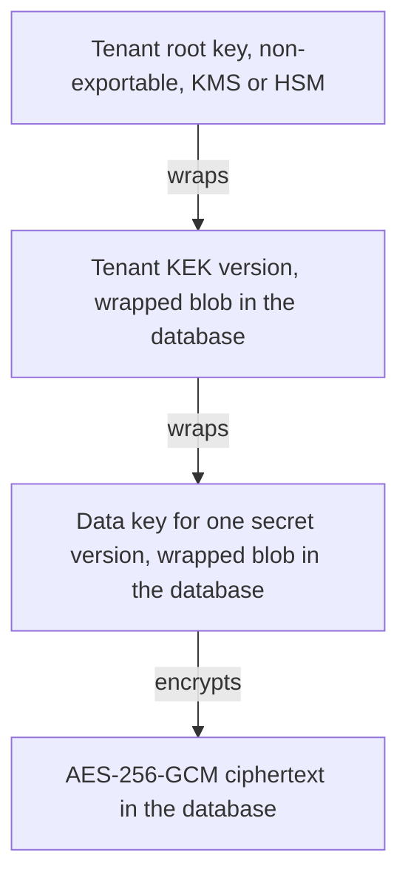
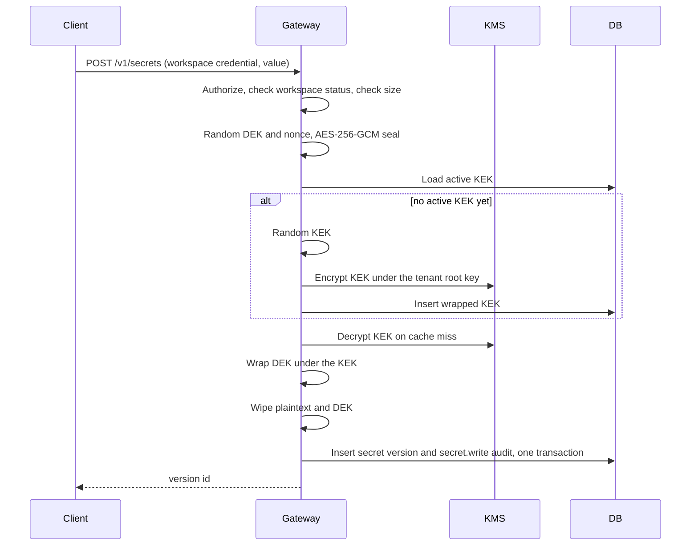
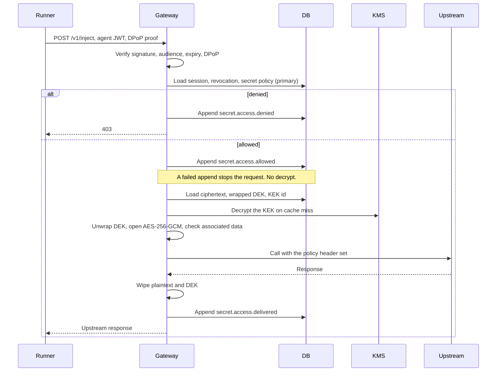

# Encryption and key management

Status: implementation spec. The envelope, the dev root-key provider, tokens, injection, and the hash-chained audit log are implemented in Rust in this repository. This file remains the spec. It makes no claim of customers, SOC 2, or any certification.
Audience: the person building Credentials.
Language: “must”, “must not”, and “required” are normative. “Should” is a recommendation that an implementer may deviate from only with a written reason in the PR.

Credentials is an agent-native secrets provider. Agents receive scoped, short-lived access. The gateway injects secret values at runtime (environment, proxy, or header). Secret values do not go into prompts, transcripts, or model context. Every access is written to a per-agent audit log. The service is a standalone API. Momentum is the first client and uses that public API.

This document is the design for encryption, key management, agent authentication as it relates to decryption, injection, and the audit log. It is meant to be built as written. Product surfaces that are not specified here (human login, billing, a dashboard) need their own docs.

The design is safe to publish. Credentials may ship as open core. Security depends on key custody, identity, and policy. It does not depend on hiding this document or the source.

## 1. Decisions

These are the choices an implementer should not relitigate in passing.

1. **Envelope encryption.** Each secret version has its own random 256-bit data key (DEK). The value is encrypted with AES-256-GCM under that DEK, with a unique 96-bit nonce. The workspace id, secret id, and version id are bound as associated data. A per-workspace key-encryption key (KEK), itself versioned, wraps the DEK. A tenant root key in a KMS or HSM wraps the KEK. The root key is non-exportable and is never stored in the database. The database holds ciphertext, nonces, and wrapped keys.
2. **Rotation rewraps keys.** A new KEK version wraps existing DEKs again. Payload ciphertext is left as it is. A new root key wraps existing KEKs again. Payload ciphertext and DEKs are left as they are.
3. **Deleting a tenant crypto-shreds it.** Production gives each workspace its own tenant root key and schedules that key’s destruction in the KMS. After the KMS destroys it, backups of the database no longer decrypt. Deleting rows is hygiene, and it is not the shred.
4. **Symmetric encryption stays AES-256-GCM.** AES-256 is the data cipher. Grover’s algorithm is a quadratic speedup, so AES-256 is treated as about 128-bit security against a quantum search. AES-128 would fall to about 64-bit and must not be used. The quantum exposure in this system is asymmetric cryptography: key exchange and key transport.
5. **Key transport is hybrid.** Anywhere a key is exchanged or transported — TLS, a future hop between gateway nodes, a client channel, and the later end-to-end mode — the construction is a hybrid of X25519 and ML-KEM-768 (FIPS 203). It remains secure if either primitive falls. TLS uses the `X25519MLKEM768` group (RFC 10024, code point 4588). Application-level wrapping uses X-Wing (`draft-connolly-cfrg-xwing-kem-11`) from a reviewed library. No primitive in this system is implemented in this repository.
6. **A token is an identity, not a key.** Agent tokens are signed JWTs, audience-bound, scoped, and proof-of-possession bound (DPoP, RFC 9449). Default lifetime is 5 minutes, hard maximum 15 minutes. The token does not contain a secret, a DEK, a KEK, or a value that derives any of those. Revocation is checked on every request against the primary database. A stolen token cannot decrypt a database dump.
7. **The gateway-decrypts model ships first.** The gateway unwraps keys through the KMS, decrypts, and injects the value. The agent process does not receive key material. An optional later mode wraps DEKs to a client-held X25519+ML-KEM keypair so the operator cannot read values. That mode means the gateway cannot inject unless a user-side component unlocks the keys. It is specified so the schema can reserve room, and it is not built now.
8. **The audit log is append-only and tamper-evident.** Each workspace has a hash-chained log. Each agent’s events also form a chain. Tips are signed with a KMS-held key and copied to an anchor the database role cannot rewrite. If the access event cannot be appended, the gateway does not decrypt.
9. **The crypto domain is the workspace.** Projects are path prefixes inside a workspace and are enforced with token scopes. They do not get separate KEKs in v1.

## 2. Goals and non-goals

### Goals

- A copy of the database, taken at any time, is not sufficient to recover secret plaintext.
- Swapping ciphertext, wrapped DEKs, or wrapped KEKs across workspaces, secrets, or versions fails authentication.
- Rotating a KEK or a tenant root key does not re-encrypt secret payloads.
- Destroying a workspace’s tenant root key makes every version of every secret in that workspace unreadable, including copies in backups and replicas.
- An agent token authorizes a specific injection. It is not a decryption key, and it can be revoked before it expires.
- Secret values are injected into a runtime or an upstream call. They are not returned on the public API and are not placed in model context.
- Every allowed, denied, and failed access is attributable to an agent and survives a later edit of the database, given the external audit anchor.
- An independent implementation can interoperate from this document alone.

### Non-goals for v1

- End-to-end / zero-knowledge mode for the dev gateway. Section 12 is implemented for `wrap_mode = e2e`. The dev process still opens `wrap_mode = gateway` rows and refuses `CREDENTIALS_ENV=production`. Production self-host and the hosted control plane release ciphertext and do not open it.
- A custom cipher, KEM, combiner, MAC, or signature scheme. Allowed libraries are listed in section 4.
- Caching plaintext, in memory beyond the request or anywhere else.
- Caching unwrapped DEKs across requests.
- Sharing unwrapped KEKs across nodes, through Redis, or through any store other than the process that called the KMS.
- Multi-region active-active KMS. v1 is single-region. The KMS is a hard availability dependency.
- Human identity, SSO, and the dashboard. Workspace credentials below are the bootstrap admin credential only.
- A live connection to Infisical, 1Password, or Doppler at injection time. A team imports a secret once. Credentials stores that value under the native envelope. Zero-knowledge against the operator is required for a production deployment and is not what the current gateway does. The current process decrypts. Production self-host and any hosted deployment must not.

## 3. Threat model

### Assets

| Asset | Where it may exist |
| --- | --- |
| Secret plaintext | Gateway memory during a request. The injection target (upstream header, or a local supervisor). Nowhere else. |
| DEK | Gateway memory during a request. At rest, only as a KEK-wrapped blob. |
| KEK | Gateway memory for at most the cache TTL. At rest, only as a KMS-wrapped blob. |
| Tenant root key | Inside the KMS or HSM. Non-exportable. |
| Token signing key, audit signing key | Inside the KMS, non-exportable, used through the Sign API. |
| Agent token | Runner memory, and the `jti` in the database. |
| Audit history | Database, plus signed tips in the external anchor. |

### Adversaries

| Adversary | Capability assumed |
| --- | --- |
| Network attacker | Sees and modifies traffic on the public network. Does not have a token or a KMS role. |
| Database thief | Reads or restores a full database snapshot, including backups. Does not have the KMS role. |
| Token thief | Holds a bearer token. May or may not hold the DPoP private key. |
| Compromised agent | Controls the agent process for the life of a session: prompt injection with a tool, or code execution in that process. |
| Operator | Can read the database, change the deployed code, or use production credentials. KMS admin and database admin are separate roles; one person may still hold both over time. |
| KMS outage | The KMS returns errors or cannot be reached. This is an availability failure. |

The attacker is assumed to have this document and the source code.

### Database leak

The snapshot contains ciphertext, GCM nonces, wrapped DEKs, wrapped KEKs, key ids, and the encryption-context fields. It does not contain a root key. Unwrap of a KEK requires `Decrypt` on that workspace’s tenant root key, with the matching encryption context, under the gateway’s IAM role. Those credentials are instance or workload identity, and they are not stored in the database.

A swapped row fails AES-GCM because the associated data commits to the workspace, secret, and version ids (and, for a wrapped DEK, the KEK id and KEK version).

Residual risk: an attacker who later also obtains the gateway’s KMS role can decrypt every workspace whose root key is still enabled. Mitigations are a KMS key policy that allows `Encrypt` and `Decrypt` only for the gateway role, a separate role that can schedule key destruction and cannot decrypt, VPC-restricted KMS endpoints where the provider supports them, and alerts on `Decrypt` volume and on key-policy changes. The audit anchor lives in an account the database role cannot write to, so a database thief cannot silently rebuild history.

### Token leak

Verification of a token yields an agent id, a workspace id, a session id, and a scope list. It yields no key bytes, and the implementation must not derive keys from token claims, token bytes, or the DPoP key.

A token presented without a matching DPoP proof is rejected. A token plus its DPoP key can call the inject API inside its scope until expiry or revocation. That is use of the secret through the gateway, which is audited. It is not offline decryption. Revocation is a write to the session row or the `jti` table on the primary database, and the next request observes it. There is no long-lived cache of “this token is allowed”.

Residual risk: until the runner revokes the session, a thief who also has the DPoP key can use the scoped capability. Lifetime is at most 15 minutes, default 5.

### Compromised agent

Two deliveries behave differently. Both are in v1.

- **Proxy injection.** The gateway sends the secret to the upstream host. The agent receives the upstream response and does not receive the secret. A compromised agent can still cause calls to hosts allowed by the intersection of the token scope and the secret’s delivery policy, for the life of the session. That is the capability the session was granted. The agent cannot leave with a reusable copy of the secret.
- **Environment or header injection.** A local supervisor or sidecar receives the plaintext over the local channel and places it in the environment or on an outbound header. A process that can read its own environment, or the sidecar’s memory, can copy the secret. Scope and lifetime limit which values are present. This delivery exists for integrations that cannot sit behind the proxy. Proxy is the default and the one Momentum should use for outbound API keys.

In both cases the model context is not a channel Credentials writes to. The client (Momentum or another runner) must not copy injected values or API responses that echo them into a prompt. Credentials cannot enforce that inside a third-party model loop. The runner integration has to keep secrets out of the prompt builder, and tool output that would echo an environment dump must be treated as a bug in the runner.

A compromised agent is not, by itself, a database decryptor. It never sees a DEK or a KEK.

### Insider and operator

In the gateway-decrypts model, the operator who can change gateway code, dump gateway memory, or call the KMS with the gateway role can read secrets while serving traffic. v1 accepts this for the hosted operator and for a customer who self-hosts (in the self-hosted case the customer is the operator). Controls that make the window small and visible:

- KMS `Decrypt` and database administration are different IAM roles.
- The token signing key and the audit signing key are non-exportable KMS keys. Application code never loads those private keys.
- Unwrapped KEKs live only in process memory, for at most 60 seconds (section 6). Plaintext and DEKs are wiped at the end of the request and are not cached.
- Production images do not include the dev root-key provider’s success path. Startup fails if it is selected.
- KMS `Decrypt` is logged by the cloud provider. Anomalous volume is an alert.
- Code review is on the public design. Obfuscation is not a control.

An operator with database access and no KMS access cannot read secrets. An operator with KMS admin access and no database access has nothing to decrypt, and a key-policy change is an alert.

The mode in which the operator cannot read secrets is section 12. It is the production path. The control plane authorizes and releases ciphertext. The customer injector opens it. The dev process can still open `wrap_mode = gateway` rows, and that process refuses `CREDENTIALS_ENV=production`.

### KMS outage

If the KMS cannot unwrap a KEK, the gateway cannot decrypt. Behavior:

- There is no plaintext cache to fall back to.
- A KEK already unwrapped in that process may be used until its cache TTL ends (default 60 seconds, hard maximum 5 minutes). After that, requests fail.
- The failure is HTTP 503 `kms_unavailable`. The process is marked not ready so a load balancer can drain it.
- The gateway must not switch to a local key, a previous root key stored in the database, or a hardcoded key.
- Rewrap and shred jobs pause and resume. They are idempotent (section 6).

A single-region KMS is a single point of failure. That is accepted in v1. Availability does not outrank the property that a database copy is useless without the KMS.

### Other cases the design closes

| Case | What happens |
| --- | --- |
| Cut-and-paste of ciphertext between rows | GCM authentication fails. Associated data includes the row’s ids. |
| Nonce reuse | A DEK encrypts exactly one payload. A KEK wrap of a given DEK uses one nonce, and a rewrap generates a new DEK wrap under the new KEK with a new nonce. Random 96-bit nonces come from the CSPRNG. |
| Replay of an inject request | DPoP `jti` is cached for the token lifetime. The method and URI are bound into the proof. |
| Algorithm downgrade | Writers emit only `aes-256-gcm-v1`. Readers accept only that algorithm for v1. The algorithm id is inside the associated data. |
| Restore of a shredded tenant | KMS refuses to decrypt once the tenant root key is destroyed. Restoring the database does not restore the key. |
| Secret value in logs, traces, or errors | Logging goes through a redaction list (section 13). A GCM failure returns a generic error to the client and a security alert internally. The client-facing error does not say whether the tag, the nonce, or the associated data was wrong. |
| Workspace id reuse after deletion | Ids are UUIDv7 and are never reused. |

## 4. Cryptography and libraries

All of this runs in the gateway process unless a sentence says otherwise. Rust is the implementation language of record. The Go notes in this section are guidance for the hosted and self-hosted TLS stack, not a second codebase. An implementation must pass the same test vectors and use libraries of the same class. Do not split the cryptographic core across languages.

Randomness is `crypto/rand` only. If the read fails, the request fails. `math/rand` must not be used for keys, nonces, tokens, or ids.

### Primitives

| Use | Primitive | Notes |
| --- | --- | --- |
| Secret payload | AES-256-GCM | 32-byte DEK, 12-byte nonce, 16-byte tag. NIST SP 800-38D. |
| DEK wrap | AES-256-GCM | Same primitive, different associated data, so one reviewed implementation covers both. |
| KEK wrap | KMS Encrypt | Opaque blob. The KMS holds the tenant root key. |
| KEK, DEK | 256-bit random | One DEK per secret version. One active KEK per workspace. |
| TLS | TLS 1.3 with `X25519MLKEM768` | RFC 10024, group 4588. Go `crypto/tls`. |
| Application key transport | X-Wing | X25519 + ML-KEM-768, `draft-connolly-cfrg-xwing-kem-11`. Library only. |
| Agent JWT | EdDSA (Ed25519) or ES256 | Whichever the KMS can sign without exporting the private key. `alg` is explicit. |
| DPoP proof key | Ed25519 | Generated on the runner. RFC 9449. |
| Audit hash | SHA-256 | Over the encoding in section 9. |
| Audit and token signatures | KMS Sign | Non-exportable asymmetric key. |
| Workspace credential lookup | SHA-256 | Hash of a 256-bit random value. Not a password hash. The input already has full entropy. |

AES-GCM is used to wrap DEKs, rather than AES-KW, because the wrap must bind associated data (workspace, secret, version, KEK id, KEK version). AES-KW does not do that. The DEK is a fresh 256-bit key, which is a valid GCM plaintext.

### Libraries

Use these. Do not reimplement them, and do not copy a combiner into this repository “to avoid a dependency”.

- **AES-256-GCM, SHA-256, Ed25519, HKDF (only if a later feature truly needs it), TLS:** Go standard library (`crypto/aes`, `crypto/cipher`, `crypto/sha256`, `crypto/ed25519`, `crypto/tls`, `crypto/mlkem`).
- **TLS hybrid group:** leave `X25519MLKEM768` enabled. Go enables it by default since 1.24. Set `MinVersion` to TLS 1.3 on every public listener. Do not set `GODEBUG=tlsmlkem=0` in production. A handshake that negotiates a classical-only group is allowed only when the peer has no hybrid group; the gateway records a metric `tls_classical_kex_total`. A configuration flag `TLS_REQUIRE_HYBRID=true` rejects classical groups. Hosted production sets that flag. Local development may leave it off so older tools can connect.
- **X-Wing:** a library listed in Appendix A of `draft-connolly-cfrg-xwing-kem-11` whose test vectors match that draft. In Go that is `github.com/cloudflare/circl/kem/xwing`. Pin the module version in `go.sum` after checking it against the draft-11 vectors. X-Wing’s combiner is specific to ML-KEM-768 and this construction; substituting another KEM, or hashing a different concatenation, drops the security argument. v1 gateway-decrypts storage does not call X-Wing. The TLS stack and the reserved end-to-end path do. Land the library when the first caller lands, not as an unused wrapper.
- **KMS:** the cloud provider’s official SDK, behind the `RootKeyProvider` interface in section 6. PKCS#11 is a later adapter of the same interface.
- **UUID:** UUIDv7 (RFC 9562). The 16 bytes used everywhere in this document are the canonical decoding of the 32 hex digits, left to right, ignoring hyphens. That is the encoding Go’s commonly used UUID libraries marshal.

Rejected, for this system: AES-128, AES-GCM with a 64-bit tag, RSA key wrap, raw X25519 as the only key transport, raw ML-KEM as the only key transport, Kyber draft code points (`X25519Kyber768Draft00`), `alg: none`, HMAC-signed JWTs (`HS256` and the other `HS*` algorithms), and any “temporary” hand-rolled XOR, hash, or stream cipher.

### Memory

Plaintext, DEKs, and KEKs are `[]byte`. They must not be converted to `string` (Go strings cannot be wiped and may be retained by the runtime). After use, set every byte to zero and `runtime.KeepAlive` the slice so the wipe is not removed as a dead store. The Go garbage collector may already have copied the slice. The guarantee we actually rely on is a short lifetime and the absence of a plaintext cache, not a claim that RAM was provably cleared. Do not log these buffers, do not put them in `error` values, and do not attach them to request contexts that outlive the call.

## 5. Wire format and associated data

### Identifiers inside cryptography

UUIDv7, never reused: workspace, secret, secret version, KEK, agent, session, token `jti`, request.

Secret names are metadata, stored in the clear, because the gateway has to look them up before it can decrypt. A name is unique per workspace. Names are not secret values. A customer who needs the name itself to be confidential uses an opaque name.

### Payload

For secret version `V` of secret `S` in workspace `W`, with DEK `K` (32 bytes) and nonce `N` (12 bytes):

```
ciphertext = AES-256-GCM.Seal(key = K, nonce = N, plaintext = raw secret bytes, aad = AAD_payload)
```

`ciphertext` is the GCM output including the 16-byte tag. The nonce is stored beside it, not prepended.

Plaintext is the raw secret bytes. It is not JSON, not a string with a length prefix, and not padded. The column `plaintext_len` stores the original length. GCM already leaks the length via the ciphertext size; the column does not make that worse.

Size limits: minimum 1 byte, default maximum 65,536 bytes, hard ceiling 1,048,576 bytes (`MAX_SECRET_BYTES`, which cannot be configured above the ceiling). Reject an empty value.

### Associated data, payload

`AAD_payload` is exactly 54 bytes:

| Offset | Length | Content |
| --- | --- | --- |
| 0 | 4 | ASCII `CRD1` (`43 52 44 31`) |
| 4 | 1 | purpose `0x01` |
| 5 | 16 | workspace id |
| 21 | 16 | secret id |
| 37 | 16 | version id (the version row’s UUID, not the integer version) |
| 53 | 1 | algorithm `0x01` for `aes-256-gcm-v1` |

The integer version and the secret name are not in the associated data. Renaming a secret, or rewrapping a DEK, must not require a new payload encryption. The version UUID is immutable.

Known answer (54 bytes, hex):

```
435244310100000000000070008000000000000001000000000000700080000000000000020000000000007000800000000000000301
```

built from workspace `00000000-0000-7000-8000-000000000001`, secret `00000000-0000-7000-8000-000000000002`, version `00000000-0000-7000-8000-000000000003`.

### Associated data, DEK wrap

```
wrapped_dek = AES-256-GCM.Seal(key = KEK, nonce = N_wrap, plaintext = DEK, aad = AAD_dek)
```

`AAD_dek` is exactly 74 bytes:

| Offset | Length | Content |
| --- | --- | --- |
| 0 | 4 | ASCII `CRD1` |
| 4 | 1 | purpose `0x02` |
| 5 | 16 | workspace id |
| 21 | 16 | secret id |
| 37 | 16 | version id |
| 53 | 16 | KEK id |
| 69 | 4 | KEK version, uint32 big-endian |
| 73 | 1 | algorithm `0x01` |

Purpose bytes stop a payload ciphertext from being presented as a wrapped DEK or the reverse. The KEK id and version are in the DEK associated data, and they are not in the payload associated data, so a KEK rotation rewraps the DEK and leaves the payload bytes unchanged.

Known answer (74 bytes, hex), same ids as above, KEK `00000000-0000-7000-8000-000000000004`, KEK version `1`:

```
4352443102000000000000700080000000000000010000000000007000800000000000000200000000000070008000000000000003000000000000700080000000000000040000000101
```

### KEK wrap

The KEK is 32 random bytes. It is wrapped by calling KMS `Encrypt` on the workspace’s tenant root key. The encryption context is this exact string map:

| Key | Value |
| --- | --- |
| `purpose` | `credentials.kek.v1` |
| `workspace_id` | canonical lowercase UUID |
| `kek_id` | canonical lowercase UUID |
| `kek_version` | decimal integer, no leading zeros |

Decrypt passes the same map, built from the columns of `kek_versions`, not from a JSON blob that might reorder or retype values. There is one function that builds the map. Encrypt and decrypt both call it. The KMS blob is opaque and provider-specific. Store it as bytes. Do not parse it.

### Algorithm labels stored on rows

| Column | Only legal value in v1 |
| --- | --- |
| `payload_alg` | `aes-256-gcm-v1` |
| `dek_wrap_alg` | `aes-256-gcm-v1` |
| KEK wrapping | implied by the KMS provider; the context purpose string is the label |

A row with any other label is an integrity failure: refuse to decrypt, increment `crypto_integrity_failure_total`, return a generic 500.

Magic `CRD1` is the associated-data version. A future encoding uses `CRD2` and a reader that switches on the magic. Writers in this version emit `CRD1` only.

## 6. Key hierarchy and operations



Two more keys exist per environment, and they are not in this chain:

- A token-signing key, KMS Sign only, used by the issuer.
- An audit-signing key, KMS Sign only, used by the audit publisher.

They are wrapped or held by a platform KMS key that is not a tenant root key. Scheduling destruction of a tenant root key must be unable to destroy the platform key. The simplest way is distinct keys and distinct IAM permissions, which is required.

### Why each workspace has its own root key

A single platform-wide root that wraps every KEK cannot crypto-shred one tenant. The wrapped KEK would still be present in database backups, and the shared root would still unwrap it. Production therefore creates a non-exportable KMS key per workspace and uses that key only for that workspace’s KEKs. The monthly cost of a customer-managed key is part of operating the service.

`kms_key_ref` is an opaque reference (for example a cloud key ARN). It may point at a key Credentials created, or at a customer-owned key the gateway is allowed to use (bring-your-own-key). The encrypt and decrypt calls are the same either way. Crypto-shred of a customer-owned key is destruction of that key by whoever administers it.

The dev provider is the exception used on a laptop and in unit tests. It stores a random 32-byte root per workspace in a file of mode `0600` and implements the same interface, including destruction. If `CREDENTIALS_ENV=production`, the process must refuse to start when the configured provider is the dev provider. There is no production flag that turns the dev provider back on.

### `RootKeyProvider`

```text
CreateTenantRoot(workspaceID) (keyRef, error)
Encrypt(keyRef, plaintext, context) (blob, error)
Decrypt(keyRef, blob, context) (plaintext, error)
ScheduleDestruction(keyRef, notBefore) error
CancelDestruction(keyRef) error
```

`context` is `map[string]string` and must match exactly. Implementations:

| Implementation | When |
| --- | --- |
| In-memory fake | Unit tests. No network. |
| Dev file | Local runs. Refuses production. |
| Cloud KMS (AWS, GCP, or Azure; one is enough for the first deployment) | Hosted and any real deployment. |
| PKCS#11 HSM | Later. Same interface. Not required to ship v1. |

`ScheduleDestruction` uses the provider’s waiting period. AWS KMS requires at least 7 days. Record the scheduled time on the workspace. During the waiting period, `CancelDestruction` plus a status change back to `active` restores service, and a database restore from that window is still decryptable. After the key is destroyed, recovery is impossible. That irreversibility is the point of crypto-shredding, and the waiting period is the safety delay. The product copy and the API should say this in plain language at deletion time.

IAM, hosted:

| Role | KMS permissions |
| --- | --- |
| Gateway | `Encrypt`, `Decrypt` on tenant root keys. No schedule-deletion, no key administration. |
| Tenant lifecycle | `CreateKey`, `ScheduleKeyDeletion`, `CancelKeyDeletion`. No `Decrypt`. |
| Issuer | `Sign`, `GetPublicKey` on the token-signing key. |
| Audit publisher | `Sign`, `GetPublicKey` on the audit-signing key. |
| Database role | No KMS permissions. |

### Creating a workspace

1. `CreateTenantRoot`. Persist `kms_key_ref` and `status = active`.
2. Generate the first KEK (version 1) as below.
3. Generate a workspace credential: 32 bytes from `crypto/rand`, return it once as base64url, store `SHA-256` of the raw bytes. This credential mints agent sessions and writes secrets. It does not decrypt anything by itself.

### Creating a KEK

1. Read 32 bytes from `crypto/rand`.
2. Allocate a UUIDv7 and the next integer version (1 for the first).
3. `Encrypt` under the tenant root with the context in section 5.
4. Wipe the 32 bytes.
5. Insert `kek_versions` with `status = active`.

A partial unique index guarantees a single `active` row per workspace. Two concurrent creators: the loser of the unique index discards its KMS blob (the KEK it generated is unrecoverable, which is fine, nothing was wrapped with it) and uses the winner’s row.

### Writing a secret version

1. Authorize a write (workspace credential, or an agent token whose scope allows `write` on that name).
2. Reject a workspace whose status is not `active`. On a first write, reject an invalid delivery policy with 400 `invalid_policy` before any key material is generated.
3. Allocate the secret id (on first write) and a new version UUID and integer version. Integer versions start at 1 and increase by 1 under a per-secret transaction lock.
4. Generate DEK and a 12-byte payload nonce. Seal the payload with `AAD_payload`.
5. Load the active KEK. On a cache miss, `Decrypt` it from the KMS, check that the plaintext is exactly 32 bytes, and cache it keyed by KEK id.
6. Generate a 12-byte wrap nonce. Seal the DEK with `AAD_dek`.
7. Wipe plaintext, DEK, and any temporary KEK copy that will not remain in the cache.
8. Insert `secret_versions` with `wrap_mode = gateway` and `e2e_encapsulation = NULL`. On the first version, insert `secrets` and `secret_delivery_policies` in the same transaction.
9. Append audit event `secret.write` in that same transaction. If the transaction fails, nothing is stored and the client retries with a new version UUID.

Updating a secret creates a new version. It does not overwrite ciphertext in place. Injection uses the highest integer version of a secret whose secret row is `active`. The audit event records the version UUID that was actually used.

Disabling a secret (`secrets.status = disabled`) makes injection fail authorization before any KMS call. Existing ciphertext stays until the secret or the workspace is deleted. Deleting a single version deletes that row. That removes the wrapped DEK from the primary database. Copies in backups remain readable until those backups expire, because the KEK still exists. Single-secret deletion is not crypto-shredding. Only tenant-root destruction is.

### Reading and injecting

Authorization and the audit append happen before any KMS call. A denied request does not touch the KMS and does not load ciphertext. The full sequence is section 10.

On GCM failure (payload or DEK wrap), wipe buffers, emit `crypto_integrity_failure_total`, append `secret.access.failed`, and return a generic 500. Do the same if the opened DEK is not exactly 32 bytes, if the nonce is not exactly 12 bytes, if `workspace_id` on the version row disagrees with the secret row, or if the KEK row’s workspace disagrees with the secret.

### KEK cache

- Process memory only. Never serialized.
- Keyed by KEK id. Value is the 32-byte key.
- TTL default 60 seconds, configurable, hard maximum 5 minutes.
- Singleflight per KEK id so a burst causes one `Decrypt`.
- Drop the entry when the workspace status is no longer `active`, and drop all entries on process shutdown.
- Two versions may be cached during a rewrap (the old `decrypt_only` KEK and the new `active` KEK).

### KEK rotation

Rotation is an online operation. Payloads are not rewritten.

1. Take a per-workspace advisory lock so two rotations do not run at once.
2. Create a new KEK with `version = previous + 1`, status `active`.
3. Set the previous row to `decrypt_only`. Commit.
4. Enqueue a rewrap job from the previous KEK id to the new one.

The job pages `secret_versions` where `kek_id` is the old id, in id order, and for each row:

1. Unwrap the DEK with the old KEK (associated data uses the old KEK id and version).
2. Wrap that same DEK with the new KEK and a fresh nonce (associated data uses the new KEK id and version).
3. `UPDATE secret_versions SET dek_wrapped = ?, dek_wrap_nonce = ?, kek_id = ? WHERE id = ? AND kek_id = ?`.
4. Wipe the DEK.

The conditional update makes the job safe to retry and safe against a concurrent writer. The payload columns are not in the `UPDATE`. After no rows remain, set the old KEK to `retired`. Keep the wrapped blob for 7 days in case a replica still presents it, then set status `destroyed`, set `wrapped_kek` to NULL, and wipe any cache entry. Destroying a retired KEK is not a substitute for destroying the tenant root key.

A write that arrives during the job uses the active KEK, so new rows are not part of the old-id scan.

### Tenant root rotation

Two situations:

- **Provider-managed rotation** that keeps old key material available for decrypt inside the KMS (AWS automatic key rotation behaves this way). No application job. Record the key id. Keep using the same `kms_key_ref`.
- **Moving to a new key id** (new ARN, or leaving a provider). For each non-destroyed KEK of that workspace: `Decrypt` with the old key and the stored context, `Encrypt` with the new key and the same context, wipe the plaintext KEK, and conditional-update the blob and `kms_key_ref`. DEKs and payloads are untouched. When no row still names the old key id, the old key may be scheduled for destruction.

### Crypto-shred on tenant deletion

`DeleteWorkspace` takes the workspace id and a confirmation field that must equal that id.

1. Set `status = deleting`. From this moment, create, inject, and decrypt for this workspace fail.
2. Revoke every session and workspace credential.
3. Drop cached KEKs for the workspace.
4. `ScheduleDestruction` on `kms_key_ref`.
5. Append `tenant.delete.scheduled` as a normal row in this workspace’s audit log (section 9). Audit rows are not encrypted under the tenant root key, so the event survives the shred.
6. Delete rows from the primary database in foreign-key order: `secret_versions`, then `secrets` and delivery policies, then `kek_versions`. Audit rows stay. Backups will still contain ciphertext until backup expiry. That ciphertext becomes permanently unreadable when the KMS finishes destruction. The `DELETE` is hygiene.
7. A poller observes the key entering the destroyed state and sets `status = shredded`.

`CancelWorkspaceDeletion` is allowed only while the KMS still reports the key as pending destruction. It calls `CancelDestruction` and sets `status = active`.

A production configuration that points every workspace at one shared root key is non-compliant with this section. Do not add a silent fallback. A future free-tier exception, if it is ever built, has to be an explicit provider mode that reports `crypto_shred: false` on the workspace and refuses a shred request rather than pretending.

## 7. Data model

Logical schema. Types are Postgres. Another engine is acceptable if the uniqueness rules, the byte columns, and the transactions stay the same. Bytes are stored exactly. No base64 in the database.

```sql
CREATE TABLE workspaces (
    id                   uuid PRIMARY KEY,
    status               text NOT NULL CHECK (status IN ('active', 'deleting', 'shredded')),
    kms_key_ref          text NOT NULL,
    audit_seq            bigint NOT NULL DEFAULT 0,
    audit_retention_days integer NOT NULL DEFAULT 90,
    created_at           timestamptz NOT NULL,
    deleting_at          timestamptz,
    shredded_at          timestamptz
);

CREATE TABLE kek_versions (
    id            uuid PRIMARY KEY,
    workspace_id  uuid NOT NULL REFERENCES workspaces (id),
    version       integer NOT NULL CHECK (version >= 1),
    status        text NOT NULL CHECK (status IN ('active', 'decrypt_only', 'retired', 'destroyed')),
    wrapped_kek   bytea, -- NULL once destroyed
    kms_key_ref   text NOT NULL,
    created_at    timestamptz NOT NULL,
    UNIQUE (workspace_id, version)
);

CREATE UNIQUE INDEX kek_one_active
    ON kek_versions (workspace_id)
    WHERE status = 'active';

CREATE TABLE secrets (
    id            uuid PRIMARY KEY,
    workspace_id  uuid NOT NULL REFERENCES workspaces (id),
    name          text NOT NULL,
    status        text NOT NULL CHECK (status IN ('active', 'disabled')),
    created_at    timestamptz NOT NULL,
    UNIQUE (workspace_id, name)
);

CREATE TABLE secret_delivery_policies (
    secret_id     uuid PRIMARY KEY REFERENCES secrets (id),
    header_name   text,          -- required for proxy and header delivery
    header_format text,          -- exactly one "{value}" placeholder
    env_name      text,          -- required for env delivery
    hosts         text[] NOT NULL DEFAULT '{}',
    allow_proxy   boolean NOT NULL DEFAULT true,
    allow_header  boolean NOT NULL DEFAULT false,
    allow_env     boolean NOT NULL DEFAULT false
);

CREATE TABLE secret_versions (
    id                  uuid PRIMARY KEY,
    secret_id           uuid NOT NULL REFERENCES secrets (id),
    workspace_id        uuid NOT NULL,
    version             integer NOT NULL CHECK (version >= 1),
    payload_alg         text NOT NULL,
    payload_nonce       bytea NOT NULL, -- 12 bytes
    payload_ciphertext  bytea NOT NULL, -- GCM ciphertext || tag
    dek_wrap_alg        text NOT NULL,
    dek_wrap_nonce      bytea NOT NULL, -- 12 bytes
    dek_wrapped         bytea NOT NULL,
    kek_id              uuid NOT NULL REFERENCES kek_versions (id),
    wrap_mode           text NOT NULL CHECK (wrap_mode IN ('gateway', 'e2e')),
    e2e_encapsulation   bytea,          -- reserved, NULL in v1
    plaintext_len       integer NOT NULL,
    created_at          timestamptz NOT NULL,
    UNIQUE (secret_id, version)
);

CREATE INDEX secret_versions_by_kek ON secret_versions (kek_id);

CREATE TABLE rewrap_jobs (
    id            uuid PRIMARY KEY,
    workspace_id  uuid NOT NULL,
    from_kek_id   uuid NOT NULL,
    to_kek_id     uuid NOT NULL,
    status        text NOT NULL CHECK (status IN ('pending', 'running', 'done', 'failed')),
    cursor_id     uuid,
    wrapped_count bigint NOT NULL DEFAULT 0,
    error         text,
    started_at    timestamptz,
    finished_at   timestamptz
);

CREATE TABLE audit_events (
    workspace_id    uuid NOT NULL,
    seq             bigint NOT NULL,
    agent_id        uuid,
    agent_seq       bigint,
    event_type      text NOT NULL,
    occurred_at     timestamptz NOT NULL,
    payload         jsonb NOT NULL,
    prev_hash       bytea NOT NULL, -- 32 bytes
    hash            bytea NOT NULL, -- 32 bytes
    agent_prev_hash bytea,          -- 32 bytes when agent_id is set
    agent_hash      bytea,
    PRIMARY KEY (workspace_id, seq)
);

CREATE INDEX audit_events_by_agent
    ON audit_events (workspace_id, agent_id, agent_seq);

CREATE TABLE audit_checkpoints (
    workspace_id uuid NOT NULL,
    seq          bigint NOT NULL,
    tip_hash     bytea NOT NULL,
    kid          text NOT NULL,
    signature    bytea NOT NULL,
    anchored_at  timestamptz,
    PRIMARY KEY (workspace_id, seq)
);

CREATE TABLE signing_keys (
    kid          text PRIMARY KEY,
    purpose      text NOT NULL CHECK (purpose IN ('token', 'audit')),
    alg          text NOT NULL CHECK (alg IN ('EdDSA', 'ES256')),
    public_key   bytea NOT NULL,
    status       text NOT NULL CHECK (status IN ('active', 'verify_only', 'retired')),
    kms_key_ref  text NOT NULL,
    created_at   timestamptz NOT NULL
);

CREATE TABLE workspace_credentials (
    id           uuid PRIMARY KEY,
    workspace_id uuid NOT NULL REFERENCES workspaces (id),
    secret_hash  bytea NOT NULL UNIQUE, -- SHA-256, 32 bytes
    created_at   timestamptz NOT NULL,
    revoked_at   timestamptz
);

CREATE TABLE agents (
    id           uuid PRIMARY KEY,
    workspace_id uuid NOT NULL REFERENCES workspaces (id),
    display_name text NOT NULL,
    status       text NOT NULL CHECK (status IN ('active', 'disabled')),
    created_at   timestamptz NOT NULL
);

CREATE TABLE agent_sessions (
    id           uuid PRIMARY KEY,
    workspace_id uuid NOT NULL,
    agent_id     uuid NOT NULL REFERENCES agents (id),
    dpop_jkt     bytea NOT NULL, -- RFC 7638 thumbprint, 32 bytes
    scopes       jsonb NOT NULL,
    expires_at   timestamptz NOT NULL,
    revoked_at   timestamptz
);

CREATE TABLE revoked_jtis (
    jti          uuid PRIMARY KEY,
    workspace_id uuid NOT NULL,
    expires_at   timestamptz NOT NULL
);
```

Name grammar: 1 to 256 bytes, lowercase ASCII matching `^[a-z0-9][a-z0-9_./-]{0,255}$`, no empty path segment, no `.` or `..` segment, no leading slash. Examples: `prod/openai/api_key`, `momentum/local/db`.

`header_format` contains the substring `{value}` exactly once and no other `{`. The admin sets it when the secret is created (`Bearer {value}` is the usual one). The agent does not send a format.

`hosts` entries are registrable hostnames, compared in ASCII case-insensitive form, with no port, no path, and no wildcard in v1. An empty host list means proxy and header delivery cannot be authorized. Environment delivery does not use hosts.

Creating a secret writes its delivery policy in the same transaction as the first version. At least one of `allow_proxy`, `allow_header`, and `allow_env` is true. Proxy or header requires a non-empty `hosts` list and a `header_format` containing `{value}` once. Env requires `env_name`. A policy that fails these checks is a 400 `invalid_policy`, returned before any key is generated.

No table stores a plaintext secret, a DEK, a KEK, a root key, a signing private key, or a workspace credential. A column that would hold one of those is a defect.

## 8. Agent authentication

Authentication and decryption are separate steps. The code that verifies a JWT must not call the KMS, and the code that unwraps a DEK must not accept a key from a JWT.

### Two credentials

| Credential | Lifetime | Proves | Storage |
| --- | --- | --- | --- |
| Workspace credential | Until revoked. Rotate it. | The caller may administer that workspace and mint sessions. | SHA-256 of 32 random bytes. Shown once. |
| Agent token | Default 5 minutes, max 15. | A session may inject inside its scopes, with its DPoP key. | Not stored. `jti` is stored only if revoked. The session row is stored. |

The workspace credential is presented as `Authorization: Bearer <base64url>` to session and secret-admin routes. Compare by looking up the hash. It is not a JWT. It is not accepted on `POST /v1/inject`.

Long-lived credentials and decryption keys are different objects so that leaking an admin token still leaves a database dump opaque, and leaking a database dump does not reveal the admin token (only its hash, which is not reversible for a 256-bit input).

### Agent token

Signed JWT (RFC 7519). Header `alg` is `EdDSA` or `ES256`, matching `signing_keys`, and `kid` selects the key. `alg: none` and every HMAC `alg` are rejected before signature verification. The public key comes from `signing_keys` or from a JWKS document generated out of that table. Gateways verify. They do not sign.

Claims:

| Claim | Value |
| --- | --- |
| `iss` | Credentials issuer URL for this environment. |
| `aud` | `credentials-gateway`. Reject any other audience, including a Momentum audience. |
| `sub` | `agent:<agent uuid>` |
| `iat`, `nbf`, `exp` | Required. `exp - iat` is at most 15 minutes. Clock skew leeway is 30 seconds. |
| `jti` | UUIDv7. |
| `workspace_id` | One workspace. |
| `agent_id` | Must match `sub`. |
| `session_id` | The `agent_sessions` row. |
| `scopes` | Array of scope strings. |
| `cnf` | `{ "jkt": "<RFC 7638 thumbprint of the DPoP key>" }`. Required. |

No other claims are read. Unknown claims are ignored. Claims must not be added that carry secret material “just for the client”.

Verification order on every inject:

1. Signature, `kid`, `alg`, `iss`, `aud`, time window.
2. Load the session from the primary database. It must exist, match `workspace_id`, `agent_id`, and `dpop_jkt`, and have `revoked_at` unset. The agent must be `active`. The workspace must be `active`.
3. `jti` must be absent from `revoked_jtis`.
4. DPoP proof, as below.
5. Scope check against the secret name and the delivery policy.
6. Append the audit event.
7. Only then unwrap and decrypt.

Steps 2 and 3 are primary-database reads. Do not serve them from a replica. Do not cache an allow decision. A revocation written to the primary is visible to the next request. That is the meaning of instant revocation in this spec. Propagation delay is the primary’s commit latency.

A request that never resolves to a workspace (bad signature, unknown credential, garbage bearer token) has nowhere to append a workspace audit row. Increment `token_denied_total` and return 401. Once the workspace is known, a denial is an audit event. If that insert fails, return 503 `audit_failed` as well: a denial that was not recorded is not a successful denial.

To revoke before expiry, set `agent_sessions.revoked_at` (kills every token of that session) or insert `revoked_jtis` (kills one token). Disabling the agent kills every session as soon as step 2 runs. Expired `revoked_jtis` rows may be deleted after `expires_at`, because the JWT would fail the time check anyway.

### DPoP

RFC 9449, with these product rules.

- The runner generates an Ed25519 keypair per session and sends the public JWK when creating the session. The server stores the JWK thumbprint on the session and copies it into `cnf.jkt`.
- Each inject request carries a DPoP proof JWT in the `DPoP` header, signed by that key, with `htm`, `htu`, `iat`, `ath` (base64url of SHA-256 over the ASCII access token), and a unique `jti`.
- The gateway checks the proof signature, the `jkt` match, `htm` and `htu` against the actual request, `ath` against the token that was presented, `iat` within 60 seconds plus 30 seconds of skew, and `jti` uniqueness in an in-process cache that retains entries for the maximum token lifetime.
- A bearer token replayed from another process fails the proof check.

DPoP keys are classical Ed25519. A future cryptographically relevant quantum computer could forge proofs. Token lifetime is minutes, and the keys do not wrap data. Hybrid signatures (Ed25519 plus ML-DSA) are an open question in section 14, not a v1 blocker. Do not invent a hybrid signature format in v1.

### Scopes

```text
scope      = "secret:" action ":" path
action     = "inject" / "write" / "admin"
path       = segment *( "/" segment )
segment    = "*" / id-segment
id-segment = 1*(lowercase letter / digit / "_" / "-" / ".")
```

`*` matches a single path segment. There is no `**`. A scope of `secret:admin:*` is the only form that spans arbitrary depth, and it may be minted only onto a workspace-admin session, never onto an agent session that runs a model.

`inject` allows injection. `write` allows creating versions. `admin` allows disable, delete, rotation, and session minting for that path. Agent tokens minted for a model run carry `inject` only.

The effective permission is the intersection of the token scope and `secret_delivery_policies`. The host on the inject request has to appear in that secret’s `hosts` list. Hosts live on the policy, which an admin sets when the secret is created. The agent token cannot add a host.

Minting checks the scope grammar and rejects `admin` and `write` on agent tokens created for a run. A separate admin session, used by the Momentum control plane and not placed in the model process, may hold `write`.

### What the runner does

Momentum, as the first client, calls the public HTTP API. It does not link Credentials code and does not share a database.

- The Momentum control plane holds the workspace credential (itself stored as a Credentials secret once a bootstrap workspace exists, or in Momentum’s own secret store for the very first credential).
- For a run, the control plane creates an agent session with `inject` scopes for the secrets that run needs, receives an agent token, and gives the token to the runner process.
- The model loop is not given the workspace credential. Prefer that it is not given the agent token either: the runner proxy holds the token and attaches it when forwarding. If the architecture of a particular agent forces the token into the agent process, DPoP and the 5-minute lifetime still apply, and the delivery mode should be `proxy` so the process never sees the secret value.

## 9. Audit log

The log is the record of which agent used which secret, when, and how it was delivered. It is append-only. Tamper evidence comes from a hash chain plus signatures anchored outside the database. A hash chain stored next to the data it protects does not, on its own, stop an attacker who can rewrite both.

### Events

| `event_type` | When | Agent |
| --- | --- | --- |
| `secret.write` | A version was stored. | Set if an agent token wrote it, otherwise null. |
| `secret.access.allowed` | Authorization succeeded. Written before unwrap. | Required. |
| `secret.access.delivered` | Injection finished. | Required. |
| `secret.access.denied` | Authorization failed. | Set when the token identified an agent. |
| `secret.access.failed` | Unwrap, decrypt, or upstream failed after an allow. | Required. |
| `token.issued` | A session was minted. | The new agent. |
| `token.revoked` | A session or `jti` was revoked. | The target agent. |
| `kek.rotated` | A new KEK became active. | Null. |
| `tenant.delete.scheduled` | Shred was scheduled. | Null. |
| `tenant.delete.cancelled` | Shred was cancelled during the waiting period. | Null. |
| `tenant.shredded` | The KMS key is gone. | Null. |

Payload fields, all of which are metadata:

- `secret_id`, `version_id` (UUIDs, when a secret is involved)
- `secret_name` (the path; it is metadata)
- `delivery` = `proxy`, `header`, or `env`
- `upstream_host`
- `session_id`, `jti`
- `reason` on deny or failure: `scope`, `host`, `expired`, `revoked`, `dpop`, `workspace_inactive`, `secret_disabled`, `kms`, `integrity`, `upstream`, `audit`
- `request_id`

Payloads must not contain secret values, key bytes, wrapped keys, authorization headers, DPoP proofs, or tokens. `jti` is the token identifier and is allowed.

### Order relative to decryption

`secret.access.allowed` is committed before KMS unwrap. If that insert fails, the handler returns 503 `audit_failed` and does not decrypt. `secret.access.delivered` and `secret.access.failed` are further appends. A crash between allow and unwrap over-reports an access and under-reports nothing that was actually injected. That direction is the one we want.

The allow insert is its own transaction. It must not stay open across the KMS call or the upstream HTTP call.

### Hash chain

`audit_seq` on the workspace row allocates `seq`. The insert locks the workspace row, increments `audit_seq`, and writes the event in that same transaction. Sequences start at 1 and have no gaps. The order of the log is `seq`, not the wall clock. One writer sequence per workspace is a throughput ceiling. It is acceptable for v1 (see section 14).

`agent_seq` is allocated the same way, per `(workspace_id, agent_id)`, only when `agent_id` is set.

Let `body` be the canonical byte string:

```text
version              0x01
seq                  uint64 big-endian
workspace_id         16 bytes
agent_id             16 bytes, or 16 zero bytes
agent_seq            uint64 big-endian, or 0
agent_prev_hash      32 bytes, or 32 zero bytes when there is no agent
occurred_at          uint64 big-endian, Unix nanoseconds
event_type           uint16 big-endian byte length, then UTF-8
field_count          uint16 big-endian
repeated, keys sorted by raw UTF-8 bytes:
    key              uint16 big-endian byte length, then UTF-8
    type             one byte
    value            as the type requires
```

Value types: `0x01` string (`uint32` big-endian length, then UTF-8), `0x02` UUID (16 bytes), `0x03` uint64 big-endian, `0x04` bool (`0x00` or `0x01`). No floats. No nested objects. A payload that does not fit these types is a programming error and must not be inserted.

`agent_prev_hash` sits inside `body`, so the workspace chain commits to the per-agent links. Rewriting an agent’s chain without breaking the workspace chain is not possible.

```text
hash       = SHA-256(prev_hash || body)
agent_hash = SHA-256(body)    -- only when agent_id is set
```

`prev_hash` for `seq = 1` is 32 zero bytes. `agent_prev_hash` for `agent_seq = 1` is 32 zero bytes. `body` is shared, so the two chains commit to the same event content. The stored `payload` JSON is a display copy. The hash is over `body`, not over JSON, so key order in JSON cannot change the hash. Build `body` from the typed fields, then store JSON derived from those same fields.

The workspace chain is the completeness record: removing an agent’s event breaks it. The agent chain lets a per-agent export be checked on its own for edits. Proving that an export contains every event for that agent still requires the workspace chain, because that is where an omitted event would have sat.

### Signatures and the anchor

Every 1,000 events or 60 seconds, whichever comes first, and on process shutdown, the publisher signs the current tip:

```text
message   = ASCII "credentials.audit.checkpoint.v1\n"
            || workspace_id (16) || seq (uint64 BE) || hash (32)
signature = KMS.Sign(audit signing key, message)
```

The row goes into `audit_checkpoints`. The same bytes are written to the anchor.

The anchor is an object store with retention lock (hosted: S3 Object Lock or the equivalent), keyed by `{workspace_id}/{seq}`. The publisher’s IAM role can put objects and cannot delete them. The gateway’s database role has no permission on the bucket. A self-hosted deployment supplies an `AuditAnchor` implementation. The dev implementation appends to a local file and is rejected when `CREDENTIALS_ENV=production`, same rule as the dev KMS.

Verification recomputes each `hash` from `seq = 1` (or from a trusted checkpoint plus the following events), checks the signature against `signing_keys` for purpose `audit`, and compares the tip to the anchor. A mismatch is a security alert.

If the anchor is unreachable, keep serving for up to 15 minutes while paging. After 15 minutes of continuous failure, inject returns 503 `audit_anchor_unavailable`. The local chain is still written during that window. The residual risk is a database rewrite during the gap. The 15 minutes is configuration (`AUDIT_ANCHOR_MAX_LAG`), and hosted production uses the default.

### Retention

Audit rows are not encrypted with the tenant root key. They contain no secret values, so they can outlive a shred. Default retention after `tenant.shredded` is 90 days, then the workspace’s audit rows are deleted. The signed anchors follow the anchor bucket’s retention policy, which should be at least 90 days. Whether a customer contract requires zero retention after deletion is an open question (section 14). Until that is decided, implement the 90-day default and make the retention period a per-workspace setting so it can be set to zero without a schema change.

### Reading the log

`GET /v1/audit?agent_id=<uuid>` returns that agent’s events in `agent_seq` order, for a caller holding `secret:admin:*` on the workspace. The response includes the hashes so a client can recompute the agent chain. It includes the latest checkpoint signature. It does not include secret values, because those were never stored in the log.

## 10. Injection and request flow

### Delivery modes

| Mode | Who sees the plaintext | When to use it |
| --- | --- | --- |
| `proxy` | The gateway and the upstream host. The agent sees the upstream response. | Default. API keys. Momentum should use this. |
| `header` | A local sidecar, which sets one header on connections to an allowed host. | The process must open the socket itself and cannot use the gateway as a proxy. |
| `env` | A local supervisor, which sets one environment variable and then execs the child. | Tools that only read an environment variable. |

`proxy` is served on the public TLS listener. The response body is the upstream response. The secret header is not copied back. If the upstream response contains the secret (unusual, and a property of the upstream), the gateway does not special-case it; choose delivery policies with that in mind.

`env` and `header` are refused on the public listener. They require a local channel: a Unix socket in a directory of mode `0700`, with the peer uid checked (`SO_PEERCRED` or the platform equivalent), or TLS to a loopback address with a client certificate issued for that session. The plaintext crosses only that channel. A shared multi-tenant host must not enable `env` or `header`. Hosted multi-tenant Credentials serves `proxy` only. Momentum’s runner, on the user’s machine or a single-tenant worker, may open the local channel.

The gateway overwrites the configured header. It does not append to a header the agent already set. The URL host must be in the intersection of `hosts` and the token’s allowed secrets. The URL scheme must be `https`. Redirects are not followed automatically; a redirect to another host would drop the host binding. The agent does not choose `header_name` or `header_format`.

### API used by the crypto path

Admin, authorized by the workspace credential:

```text
POST /v1/workspaces
    response: { id, credential }          -- credential returned once

POST /v1/secrets
    body: { name, value, policy }
    response: { id, version }

POST /v1/secrets/{name}/versions
    body: { value }
    response: { id, version }

POST /v1/agents
    body: { display_name }

POST /v1/agent-sessions
    body: { agent_id, scopes, ttl_seconds, dpop_jwk }
    response: { session_id, token, expires_at }

POST /v1/agent-sessions/{id}/revoke

POST /v1/workspaces/{id}/deletion
    body: { confirm: "<workspace id>" }

POST /v1/workspaces/{id}/deletion/cancel
```

Inject, authorized by the agent token and DPoP, never by the workspace credential:

```text
POST /v1/inject
    body: {
      secret: "prod/openai/api_key",
      delivery: "proxy",
      request: { method, url, headers, body }
    }
    response: the upstream status, headers, and body
```

Local channel, same authorization plus the peer check:

```text
POST /v1/inject     delivery = "env" | "header"
    env response:    { env_name, value }     -- one shot, over the local channel
    header response: { header_name, value }
```

Errors:

| HTTP | `code` | When |
| --- | --- | --- |
| 400 | `invalid_policy` | Delivery policy failed the checks in section 7. |
| 401 | `unauthenticated` | Missing or bad token, or bad DPoP proof. |
| 403 | `forbidden` | Scope, host, delivery mode, or disabled secret. Same code for all of these so the token cannot probe. |
| 404 | `not_found` | Unknown secret in this workspace, or a secret in another workspace. Do not distinguish. |
| 409 | `workspace_deleting` | Status is `deleting` or `shredded`. |
| 413 | `payload_too_large` | Value exceeds the maximum. |
| 500 | `decrypt_failed` | Any integrity failure. Generic body. |
| 502 | `upstream_failed` | Proxy could not complete the upstream call. The secret was already unwrapped; `secret.access.failed` is appended. |
| 503 | `kms_unavailable` | KMS failure and no cached KEK. |
| 503 | `audit_failed` | The allow event could not be written. |
| 503 | `audit_anchor_unavailable` | Anchor lag past the maximum. |

### Store a version



### Inject



On a KMS or GCM failure after the allow event, the gateway appends `secret.access.failed`, wipes buffers, and returns 503 or 500 as in the table. It does not call the upstream.

### Import, not a live backend

Credentials stores the secret itself. A team moves a value in once, from Infisical, 1Password, Doppler, Vault, or a `.env` file. The import seals a native secret version under the envelope and discards the source bytes. Injection then uses only that ciphertext. The gateway does not call those products at inject time, and it does not keep a backend credential for them.

The import tool is not in this tree yet. Until it is, the gateway only opens values that were sealed here. A failed import must not leave plaintext on the control plane.

## 11. Post-quantum posture

AES-256-GCM protects data at rest. That choice is already the quantum-resistant one for symmetric encryption. The parts of the system that would fall to a cryptographically relevant quantum computer are the asymmetric ones: TLS key exchange, any future transport of a key between processes, DPoP and JWT signatures, and the later end-to-end wrapping keys.

What v1 does about that:

- Public TLS and any internal RPC TLS use TLS 1.3 and prefer `X25519MLKEM768`. Hosted production requires the hybrid group. The classical half is X25519 and the post-quantum half is ML-KEM-768, so the handshake stays confidential if one of the two is broken. This is the hybrid in RFC 10024, implemented by the Go TLS stack, not by Credentials code.
- v1 does not transport DEKs or KEKs between gateway nodes. Each node unwraps through the KMS itself. If a later feature must send a key to a peer, the wrapping is X-Wing to that peer’s published encapsulation key, and the payload under the resulting 32-byte shared secret is AES-256-GCM. Do not send a raw DEK over TLS and call that done if the requirement was application-level key transport; do not send a DEK at all unless a feature genuinely cannot call the KMS.
- Token and DPoP signatures stay Ed25519 or ES256, via KMS where the key is ours. Forgery of those signatures under a future quantum computer would let an attacker mint or replay tokens. It would not unwrap stored ciphertext. Lifetimes are minutes, and revocation does not depend on the signature scheme. Moving these signatures to a hybrid (Ed25519 plus ML-DSA-65, FIPS 204) is tracked in section 14. It requires a reviewed implementation and a KMS that can sign it, or a carefully stored wrapped private key. It is not a reason to delay the envelope encryption.

Go’s FIPS 140-3 module can run TLS with `X25519MLKEM768`. A deployment that needs that module turns it on and still leaves the hybrid group enabled.

## 12. End-to-end mode

Implemented as CRD2. The dev gateway-decrypts path remains for `wrap_mode = gateway` and refuses `CREDENTIALS_ENV=production`. A hosted or self-hosted control plane releases ciphertext for `wrap_mode = e2e` and does not call `open_secret` on those rows. There is no operator recovery recipient. An attested enclave is not built; hosted injection uses the customer injector.

Each workspace that turns the mode on generates, on a client the operator does not control, an X-Wing keypair (`draft-connolly-cfrg-xwing-kem-11`: 32-byte decapsulation key, 1216-byte encapsulation key). The encapsulation key is registered with the server. The decapsulation key stays on the client, encrypted at rest under a passphrase with Argon2id (RFC 9106) using parameters current at the time it is built. The server never receives the passphrase or the decapsulation key.

A secret version in this mode has `wrap_mode = e2e`. The DEK is not wrapped by the tenant KEK. CRD2 picks the wrap, not the shared-secret-as-DEK option: X-Wing encapsulation to the client key stores the 1120-byte ciphertext in `e2e_encapsulation`, and the 32-byte shared secret is the AES-256-GCM key that wraps a random 32-byte DEK. The payload associated data is the CRD1 layout with magic `CRD2`. The DEK-wrap associated data uses magic `CRD2`, the workspace-key id in place of a KEK id, and generation `1`. `dek_wrap_alg` is `crd2-xwing-aes-256-gcm-v1`. The server stores ciphertext it cannot open. `kek_id` stays populated because the schema requires a KEK row; it is not the wrapping key.

Consequences, which are the product:

- The hosted operator, a database thief, and a compromised gateway cannot read the secret. That is the feature.
- The gateway cannot inject the secret, because it cannot decrypt it. Injection requires a user-side component that holds the unlocked decapsulation key, decrypts, and performs the env, header, or proxy injection locally. If that component is locked or offline, the agent gets nothing.
- Losing the decapsulation key without a recovery path loses the secrets. A recovery encapsulation key (a second X-Wing recipient, created at enrollment and held offline) is the likely answer and is not designed here.
- Moving an existing gateway-wrapped secret into this mode requires the plaintext once: the client decrypts through the gateway, rewraps to the client key, and then the gateway-wrapped DEK row is replaced. That one read is visible in the audit log. After it, the operator cannot read that version.

The dev path still creates a tenant root key and a KEK for every workspace. Gateway-wrapped and end-to-end versions can coexist. Writers accept `wrap_mode = e2e` only when the encapsulation is 1120 bytes and the wrap label is the CRD2 label. A malformed row is rejected. Recovery of the workspace decapsulation key is account-bound: a device, a WebAuthn PRF output, an offline Argon2id kit, or a teammate. The control plane stores those wraps and has no operator recipient. Losing every recipient loses the data.

## 13. Open core and implementation rules

Anyone can read this design and the code. The following are forbidden because they would only work if the code stayed secret:

- A root key, pepper, or nonce mask compiled into the binary or checked into the repository.
- Deriving a DEK or KEK from a passphrase, a token, a name, or `workspace_id` with HKDF or a similar function. Keys are random, or they are unwrapped from the KMS. HKDF is not used in v1.
- An unpublished algorithm, a tweaked constant in SHA-256 or AES, or a custom associated-data padding scheme other than section 5.
- Security checks that log and continue. Integrity failure, audit-append failure, and (past the lag window) anchor failure stop the decrypt.
- A production code path that selects the dev root-key provider or the dev audit anchor.

### Logging and metrics

Before a log line or a trace span is emitted, drop any field whose name is, case-insensitively, one of: `value`, `secret`, `plaintext`, `password`, `token`, `authorization`, `dpop`, `dek`, `kek`, `wrapped_kek`, `dek_wrapped`, `payload_ciphertext`, `credential`. Also drop request and response bodies of `POST /v1/secrets`, `POST /v1/secrets/{name}/versions`, and the local-channel inject response. A test feeds a known canary value through a rejected request and through a successful store, and fails if the canary appears in the log sink.

Metrics, with workspace id as a label only where the cardinality is acceptable; secret names are not metric labels:

- `kms_decrypt_seconds`, `kms_errors_total`
- `kek_cache_hit_total`, `kek_cache_miss_total`
- `crypto_integrity_failure_total`
- `inject_total` labeled by delivery and result
- `token_denied_total` labeled by reason
- `tls_classical_kex_total`
- `audit_anchor_lag_seconds`
- `rewrap_wrapped_total`

Alerts: any `crypto_integrity_failure_total` increase, KMS access-denied errors (distinct from throttle), anchor lag over the threshold, revocation reads failing.

### Tests that must exist before the feature is called done

These are part of the spec. They run against the in-memory `RootKeyProvider` and do not need cloud credentials.

1. The payload associated-data vector in section 5 is produced byte for byte, and the DEK vector too.
2. Seal then open returns the original bytes.
3. Flipping any ciphertext bit, any associated-data bit, or any nonce bit makes open fail.
4. Ciphertext from version A does not open as version B. Ciphertext from workspace A does not open as workspace B. A wrapped DEK moved onto another version row does not open.
5. After KEK rotation, `payload_ciphertext` and `payload_nonce` are bitwise identical, `kek_id` has changed, and open returns the original bytes.
6. A wrong KMS encryption context fails decrypt.
7. A token for workspace A is rejected for a secret in workspace B. An expired token is rejected. A revoked session is rejected on the next call. A token without a DPoP proof is rejected. A DPoP proof signed by the wrong key is rejected.
8. A denied inject causes zero calls to `Decrypt` on the provider.
9. When the audit insert returns an error, `Decrypt` is not called and the upstream is not called.
10. With the KEK cache empty, a KMS error returns 503 and no plaintext.
11. `CREDENTIALS_ENV=production` with the dev provider fails startup.
12. A workspace in `deleting` fails inject before `Decrypt`.
13. Nonce length other than 12, or an unknown `payload_alg`, fails closed.
14. The log canary from the logging section does not appear.
15. Rewrap is safe to run twice: the second run wraps zero rows and leaves ciphertext unchanged.
16. Once the TLS listener exists: a test client that offers `X25519MLKEM768` negotiates group 4588.

When the end-to-end mode is eventually built, add the draft-11 X-Wing test vectors. Do not add them as dead code in v1.

### Suggested build order

1. `RootKeyProvider`, the in-memory fake, the dev file provider, the production guard.
2. Associated-data builders, AES-GCM seal and open, wiping, tests 1–4.
3. Workspace create, KEK create, secret-version write and read, tests 5, 6, 12, 13.
4. KEK rotation and the rewrap job, including the retry test.
5. Tenant root creation and scheduled destruction, with the fake provider simulating the waiting period.
6. Workspace credentials, agent tokens, DPoP, revocation, tests 7–8.
7. Delivery policies and proxy inject. Local `env` and `header` behind the peer-credential channel.
8. Audit hash chain, checkpoints, anchor interface, tests 9–10 and 14.
9. TLS configuration and test 16.
10. One real KMS adapter, an integration test gated on credentials, and the IAM roles in section 6.

Each step is independently testable. Do not start at the HTTP layer and thread encryption through as an afterthought. The seal and open functions should be the first code.

## 14. Open questions

These are unresolved. The defaults in the rest of this document are what to build until they are decided. None of them block writing the envelope encryption, the token check, or the audit chain.

| Topic | What to build now | What might change |
| --- | --- | --- |
| Audit retention after shred | 90 days, per-workspace setting. | A contract that requires immediate deletion of audit metadata. Anchors in a retention-locked bucket may be undeletable; that constraint has to be in the contract. |
| Second person to approve shred | A single confirmation field equal to the workspace id, plus the KMS waiting period. | A two-person rule. The waiting period already covers the accidental case. |
| Hybrid signatures on tokens | Ed25519 or ES256 via KMS Sign. | Ed25519 plus ML-DSA-65 once a reviewed library and a signing-key story exist. `alg` and `kid` are already on the token so verifiers can grow a second algorithm. |
| Multi-region | One region. KMS outage fails closed. | A replica key and a story for which region is allowed to decrypt. Do not replicate root key material into the database to get there. |
| Free tier without a KMS key per workspace | Not offered. Every workspace gets a root key. | An explicit non-shredding mode, labeled as such, if the key cost is unacceptable. It must refuse to report that shredding succeeded. |
| Audit throughput | One sequence lock per workspace. | A sharded log if a workspace ever outgrows a single writer. The hash chain would need a new construction (for example a tree of chains). Do not quietly drop the chain to raise throughput. |
| End-to-end recovery | Mode not built. | A second X-Wing recipient held offline, and the enrollment UX. |
| Bring-your-own-key IAM | `kms_key_ref` may already be a customer key. | The cross-account policy, the onboarding steps, and what Credentials does if the customer revokes `Decrypt` (treat as `kms_unavailable` for that workspace). |
| `reveal` API for humans | Not built. Export and debugging go through injection or a future admin API with its own scope. | A `secret:reveal` scope with a stronger audit reason, if the console needs to show a value. Agent tokens must still be unable to mint it. |

## 15. References

- NIST SP 800-38D, Recommendation for Block Cipher Modes of Operation: Galois/Counter Mode.
- NIST FIPS 203, Module-Lattice-Based Key-Encapsulation Mechanism Standard (ML-KEM).
- NIST FIPS 204, Module-Lattice-Based Digital Signature Standard (ML-DSA). Referenced for the open signature question only.
- RFC 7748, Elliptic Curves for Security (X25519).
- RFC 10024, Post-quantum hybrid ECDHE-MLKEM Key Agreement for TLSv1.3. Group `X25519MLKEM768`, value 4588.
- `draft-connolly-cfrg-xwing-kem-11`, X-Wing: general-purpose hybrid post-quantum KEM (23 September 2026).
- RFC 7519, JSON Web Token. RFC 8037, CFRG Elliptic Curve Diffie-Hellman and Signatures in JOSE. RFC 9449, OAuth 2.0 Demonstrating Proof of Possession (DPoP). RFC 7638, JSON Web Key Thumbprint.
- RFC 9562, Universally Unique Identifiers, version 7.
- Go `crypto/tls`, `crypto/mlkem`, `crypto/cipher`. Hybrid group enabled by default since Go 1.24.
